# 新 HappyGit 第一版 Hadoop 计算实现详解

版本 1.0，2026-10-29。本文属于[服务端详细设计](服务端详细设计.md)，沿用 [Hadoop SDD](../../sdd/HadoopSDD.md) 的 HDFS＋YARN＋Java MapReduce 方案。所有路径均为拟新增路径；代码是函数级实现设计，没有生成或运行作业 JAR。输入字段见[接口与数据契约](接口与数据契约.md)。

## 1. 先理解“处理很多用户”和“得到一个用户”怎样同时发生

MapReduce 不需要每个用户启动一项任务。Mapper 从不同 HDFS 分片读记录，为需要聚到一起的数据写相同逻辑键；Shuffle 把这些键送到同一分组；Reducer 对每组执行一次函数。第一版最关键的键变化是 `事件身份 → (用户,项目) → 项目 → 用户`。

例如日志 A、B 分别在两个输入分片，二者都属于用户 U 和项目 R。J07 让它们以 `(U,R)` 聚合出访问次数；J08 改成按 R 分组，使它们能与项目向量 x(R) 相遇；J09 再把 U 在不同项目上的向量贡献聚合。最终输出 `U → Profile`，并不需要在 Mapper 内收集 U 的全部历史。

```mermaid
flowchart TD
    Raw[公开项目原始观测] --> J01[J01 项目快照]
    J01 --> J03[J03 项目词频]
    J03 --> J04[J04 文档频率]
    J04 --> J05[J05 固定词表与IDF]
    J03 --> J06[J06 项目向量]
    J05 --> J06
    Events[授权日志与公开活动] --> J02[J02 去重与规范化]
    J02 --> J07[J07 用户项目证据]
    Sets[完整Star/本人集合与隐藏快照] --> J07
    J07 --> J08[J08 按项目关联向量]
    J06 --> J08
    J08 --> J09[J09 按用户生成画像]
    Seeds[用户种子与手动标签] --> J09
    J09 --> J10[J10 群体画像]
    J09 --> J11[J11 相似候选Top300]
    J06 --> J11
    J01 --> J12[J12 公共候选]
    J10 --> Publish[统一结果Manifest与发布器]
    J11 --> Publish
    J12 --> Publish
```



普通 Mapper 的 `setup()` 加载不可变配置，`map()` 处理一条输入，`cleanup()` 输出有界累积结果；Reducer 的 `reduce()` 处理一组值。自定义 Partitioner 决定分组落到哪一个 Reducer，GroupingComparator 决定哪些排序键属于同一组。这些框架入口与 secondary sort 机制来自 [Apache MapReduce Tutorial](https://hadoop.apache.org/docs/r3.4.2/hadoop-mapreduce-client/hadoop-mapreduce-client-core/MapReduceTutorial.html)，具体键和算法是本项目设计。

## 2. 工程中的基础类型必须先写清楚

代码根目录为 `mapreduce/src/main/java/com/happygit/hadoop/`。`model/` 下放 RepositorySnapshot、RepositoryTerms、Evidence、Contribution、UserSeed、Profile、Candidate；`io/` 下放这些对象的 Writable、组合键及比较器；`math/` 下放 SparseVectorMath 和 TopKBuffer；`text/` 下放 FrozenTokenizer 和 RepositoryProjector；`jobs/` 下按 J01—J12 建类；`driver/` 放 JobFactory、PipelineDriver、ResultManifestWriter。

Java 8 目标字节码不使用 record、var、List.of 或 switch 表达式。下面代码中的领域对象用普通不可变 POJO，Writable 作为序列化适配层。DAO 不进入这个 JAR，Mapper/Reducer 不访问 GitHub、MySQL 或本机 SQLite。

`SparseVectorWritable.write(DataOutput)` 依次写 schemaVersion、dimension、nnz，再写每个 index(int) 和 weight(double)；`readFields(DataInput)` 按同顺序重建数组，检查维度和递增坐标。`TaggedWritable.write/readFields` 先写 tag(byte)，再写对应 payload；不能依赖 Java 对象默认序列化。中间文件为 block-compressed SequenceFile，正式输出仍有明确 schema，不使用一次性 JVM 对象内存快照。

`RepoJoinKey(repoId,kind,subjectId)` 的 `write/readFields` 固定按该顺序；`compareTo()` 先比较 repoId 的 UTF-8 字节、再 kind、再 subjectId；`RepoPartitioner.getPartition(key,value,n)` 只对 repoId UTF-8 字节做固定哈希并取 `floorMod(hash,n)`；`RepoGroupingComparator.compare(a,b)` 只比较 repoId。因为排序与分组不同，向量记录 kind=0 总能位于证据 kind=1 之前。

`UserContributionKey(subjectId,kind,repoId)` 的规则类似：按 subjectId 分区/分组，按 kind、repoId 排序。seed=0、manual=1、repository=2、disposition=3，用户项目贡献按稳定 repoId 顺序累加。首版 J09 不使用 Combiner，从而避免不同局部浮点求和顺序影响并列排序；需要优化时再定义数值误差策略，不能宣称浮点累加与顺序无关。

读取 `Iterable<Writable>` 时，框架可以复用同一个值对象。Reducer 若要把内容保留到下一次迭代，必须复制必要的字段和数组；不能把每次循环的同一个 value 引用放入 List。下面的 join 函数会展示这个问题。

## 3. 先写可复用的稀疏向量函数

`math/SparseVectorMath.java` 统一使用 8192 维坐标，但只输出非零项。项目向量最多 256 项，用户最多 512 项。单用户 Reduce 中用 `double[8192]` 累加约 64 KiB，清晰且可控；跨用户不能在一个数组中混合状态。

`addScaled(sum,vector,weight)` 的内部是 `sum[index] += weight*value`，没有归一化和截断。`normalizeTopK(sum,k)` 等最终聚合完成后才保留最大 k 项并 L2 归一化；`dot(a,b)` 通过有序坐标双指针计算点积。空输入返回空向量，不编造随机方向。

```java
public static void addScaled(double[] sum, SparseVector vector, double weight) {
    for (int p = 0; p < vector.size(); p++) {
        sum[vector.indexAt(p)] += weight * vector.valueAt(p);
    }
}

public static SparseVector normalizeTopK(double[] sum, int k) {
    List<Integer> coordinates = new ArrayList<>();
    for (int i = 0; i < sum.length; i++) {
        if (sum[i] > 0.0) coordinates.add(i);
    }
    coordinates.sort((a, b) -> {
        int byWeight = Double.compare(sum[b], sum[a]);
        return byWeight != 0 ? byWeight : Integer.compare(a, b);
    });
    if (coordinates.size() > k) {
        coordinates = new ArrayList<>(coordinates.subList(0, k));
    }
    coordinates.sort(Integer::compare);
    double squared = 0.0;
    for (int i : coordinates) squared += sum[i] * sum[i];
    if (squared == 0.0) return SparseVector.empty(8192);
    double norm = Math.sqrt(squared);
    int[] indices = new int[coordinates.size()];
    double[] values = new double[coordinates.size()];
    for (int p = 0; p < coordinates.size(); p++) {
        indices[p] = coordinates.get(p);
        values[p] = sum[indices[p]] / norm;
    }
    return new SparseVector(8192, indices, values);
}

public static double dot(SparseVector a, SparseVector b) {
    int i = 0, j = 0;
    double result = 0.0;
    while (i < a.size() && j < b.size()) {
        int ai = a.indexAt(i), bj = b.indexAt(j);
        if (ai == bj) {
            result += a.valueAt(i++) * b.valueAt(j++);
        } else if (ai < bj) {
            i++;
        } else {
            j++;
        }
    }
    return Math.max(0.0, Math.min(1.0, result));
}
```

`SparseVector` 构造器只接收已由输入边界校验的有限正值；上面函数专用于本模型的非负向量，不用于未来的带负号 embedding。先按权重截断、再按坐标排序，是因为 Top-K 需要权重顺序，而点积需要坐标顺序。`dot()` 的末尾夹取处理单位向量浮点误差，不能拿它掩盖不一致的 featureSpaceVersion；版本由调用者在边界核对。

`normalizeDistribution(Map<String,Double>)` 使用总和而非平方和归一化：每值除以正总和；空总和返回空 Map。语言/topic 页面展示的是占比，要用 L1；余弦向量要用 L2。两个函数名字和数据类型分开，避免把页面上的 60% 当成单位向量系数。

## 4. J01、J02：先确定事实，再计算兴趣

`RepositorySnapshotJob.createJob(conf,manifest,out)` 读取 Manifest 列出的公开项目原始文件，Mapper 输出 `(repoId,Observation)`，Reducer 输出 `(repoId,RepositorySnapshot)`。`RepositorySnapshotMapper.map(offset,line,context)` 解析原始行并写 repoId；`RepositorySnapshotReducer.reduce(repoId,observations,context)` 只保留 `observedAt<=referenceTime` 中最大的 `(observedAt,observationId)`，同分按 observationId 字节序决定。

观察记录若明确说明仓库已不公开，必须参与最新状态选择，再决定不输出；不能先过滤非公开观测，否则旧的 public 记录会错误复活。J01 在输出 public 快照时累计 CATALOG_COUNT=N，字段缺失保留 null，描述和 README 不足不自动变成虚构文本。归档项目可进入统计语料，但候选阶段排除。

`EventNormalizeJob.createJob()` 使用 MultipleInputs 读应用事件和 GitHub 活动，二者分别适配到 `NormalizedSourceRecord`。`AppEventMapper.map()` 写身份键 `(app,subjectId,eventId)`；`PublicActivityMapper.map()` 写 `(github,githubEventId)`。公开活动的 actor 数字 ID 通过冻结的授权用户映射转换 subjectId，不把互联网上任意用户自动加入分析。

`EventNormalizeReducer.reduce(identity,records,context)` 先核对重复身份的内容摘要一致，再按稳定 archiveBatchId 选择一份规范记录；不同内容但同身份属于输入事实冲突，阻止本次作业成功，不能任意挑一份。相同内容的重复副本累计 DUPLICATE，规范记录再按以下固定优先级判定。

先看隐私/analysisEpoch 是否允许，再看 discard，再看计算窗口，然后看公开活动是否为允许的 Push/Issues/PullRequest，最后检查必要 repoId/字段。合法记录输出 clean-events，忽略记录输出 disposition；窗口外不是解析失败，仍必须有确定处置。Watch/Star 事件不作为额外活动分数，因为当前 Star 集合会在 J07 加权。

`Disposition` 至少保存 subjectId、deviceId、streamEpoch、deviceSeq、eventId、repoId 和 normalized/ignored 原因，GitHub 活动无设备序号。J02 对规范记录无论有效或忽略都输出一条 disposition，有效记录暂记 normalized；J08 的用户项目 contribution 再决定该键的所有 normalized 打开是否 used 或 missing_feature/hidden。每个应用原始序号因此可通过用户项目键追溯到最终处置；缺失特征是 J08 才能判断的原因，不放入 J02 的输入守恒公式。

J02 的 `setup()` 通过缓存制品加载冻结授权/epoch 与 referenceTime；`cleanup()` 关闭 MultipleOutputs。`InputCoverageVerifier.verify(streamRange,dispositions,contributionStatuses)` 在结果验证阶段按流、seq 顺序检查新增范围没有缺口，normalized 记录必须能在对应用户项目贡献中找到最终处置。第一版 verifier 只读取身份与状态，不再计算画像；可对固定目标规模的贡献键状态建立有界索引，事件流式扫描。已有处理前缀只用于接续验证，不用于跳过仍在 90 天窗口内的事实重算。

## 5. J03—J05：怎样把文本变成所有机器一致的坐标

`text/FrozenTokenizer.java` 提供 `normalize(text)`、`tokenize(text)`、`countField(text,weight,counts)`。第一版采用可解释的规则词法，既不训练语言模型，也不把用户隐藏标签写进语料。Java 与 JavaScript 的实现必须共享技术词、别名、中文词典、停用词和固定样例。

`normalize(text)` 对首版允许的 ASCII、全角 ASCII、基础汉字和空白执行 NFKC，将 ASCII A—Z 映射为 a—z，其他不支持字符作为分隔符。这样明确限制首版的跨语言规范化范围，不依赖系统 locale。`tokenize()` 先按最长技术词匹配保留 c++、c#、.net、node.js 等，普通英文段按 `[a-z0-9]+` 切分；中文从左到右做最长词典匹配，连续未匹配片段长度至少 2 时产生相邻二元词组，单个残字忽略。别名替换后去停用词；同一词在不同位置出现仍计多次。词典内容进入 FeatureSpace 摘要。

`RepositoryTermMapper.map(repoId,repo,context)` 截 README 的前 8000 个 Unicode 码点，调用 `countField(name,2)`、`countField(description,2)`、每个 topic 的 `countField(topic,2)`、`countField(readme,1)`。还保存主语言和去重后的 topic。`RepositoryTermReducer.reduce(repoId,values,context)` 要求同一 J01 快照只有一条该 repo 的词频对象；若上游重复则作为契约错误处理，不把同一文档词频叠加两遍。输出 `RepositoryTerms` 供 J04、J06 复用。

`DocumentFrequencyMapper.map(repoId,terms,context)` 针对 language、topic、text 三个 namespace，分别对该项目的唯一 term 写 `(namespace,term)→1L`。一个 README 里出现十次 hadoop，该词 DF 仍只加一；TF 已保留十次的信息。`LongSumCombiner.reduce()` 与 `DocumentFrequencyReducer.reduce()` 都只对 long 求和，可以安全复用同一个加法函数。DF 永远不高于项目总数 N。

`FeatureSpaceMapper.map(termKey,df,context)` 以 namespace 为分组键写 `(term,df)`；`FeatureSpaceReducer.reduce(namespace,values,context)` 用有界堆挑选 language 128、topic 1024、text 7040 项。text 先排除 df<2；DF 大者优先，同分按 Unicode 码点字典序小者优先。选中后重新按码点序分配区间内坐标，输出 FeatureSpaceFragment。

首版 J05 配置一个 Reducer，最多保留上述三个有界堆；它扫描词项而不是把全部 README 载入内存。`FeatureSpaceAssembler.assemble(fragments,N,rules)` 在 J05 成功后将三个片段按固定字段顺序写成完整制品，对 text 计算 `idf=ln((N+1)/(df+1))+1`，计算 SHA-256 并注册版本。Assembler 只是组装小型字典制品，不在 Driver 中替代大规模项目或用户计算。N=0 时空制品成立，后续走空画像/公共为空。

| 辅助函数 | 具体算法与返回 |
| --- | --- |
| `TermOrder.compareCodePoints(a,b)` | 逐 Unicode code point 比较，首个差异决定顺序，前缀短者在前；Java 不直接用 UTF-16 String.compareTo 代替 |
| `TermTopK.offer(term,df)` | 堆根为最差项：DF 最小、同 DF 词项最大；新项更好时替换根 |
| `TermTopK.sortedByCodePoint()` | 将有界堆内容按上述词序排序，供连续编号 |
| `FeatureSpaceLoader.load(cacheUri,expectedHash)` | 读本地化制品字节、核对摘要、解析坐标/参数，建立 term→index/idf 查找表 |

## 6. J06：一个项目怎样投影为 8192 维向量

`RepositoryVectorJob` 是 Map-only 作业，`setNumReduceTasks(0)`。`RepositoryVectorMapper.setup()` 加载 FeatureSpace；`map(repoId,terms,context)` 调用 `RepositoryProjector.project(terms,space)`，输出向量加完整冻结卡片 DTO、质量代理和新鲜度。一个项目只依赖自己的词频和共同词表，放入 Reduce 不会增加信息。

`project()` 先分别构造三个块。language 为已知主语言 one-hot；topic 在已知去重 topic 坐标上填 1 并单独 L2 归一化；text 对每个已登录词计算 `(1+ln(weightedCount))*idf` 再单独 L2 归一化。随后乘 `sqrt(0.20)`、`sqrt(0.30)`、`sqrt(0.50)` 合并到 8192 维数组，整体归一化并取 Top256 后再次归一化。由于整体归一化是所有坐标共同乘一个正数，实现可直接对加权拼接数组调用 normalizeTopK(...,256)，得到同样结果。

```java
public SparseVector project(RepositoryTerms terms, FeatureSpace space) {
    double[] merged = new double[8192];
    Integer language = space.languageIndex(terms.primaryLanguage());
    if (language != null) merged[language] = Math.sqrt(0.20);

    Map<Integer, Double> topics = new TreeMap<>();
    for (String term : terms.uniqueTopics()) {
        Integer index = space.topicIndex(term);
        if (index != null) topics.put(index, 1.0);
    }
    putNormalizedBlock(merged, topics, Math.sqrt(0.30));

    Map<Integer, Double> text = new TreeMap<>();
    for (Map.Entry<String, Long> entry : terms.weightedTextCounts().entrySet()) {
        TextFeature feature = space.textFeature(entry.getKey());
        if (feature != null && entry.getValue() > 0) {
            double value = (1.0 + Math.log(entry.getValue())) * feature.idf();
            text.put(feature.index(), value);
        }
    }
    putNormalizedBlock(merged, text, Math.sqrt(0.50));
    return SparseVectorMath.normalizeTopK(merged, 256);
}

private void putNormalizedBlock(double[] target, Map<Integer, Double> block,
                                double scale) {
    double squared = 0.0;
    for (double value : block.values()) squared += value * value;
    if (squared == 0.0) return;
    double norm = Math.sqrt(squared);
    for (Map.Entry<Integer, Double> entry : block.entrySet()) {
        target[entry.getKey()] = scale * entry.getValue() / norm;
    }
}
```

这里用 `sqrt` 而非直接用 0.20/0.30/0.50，是因为单位块的平方范数需要分别占 20%、30%、50%。缺失块为零，最终归一化由实际可用块决定；全空项目向量保留为空并记录覆盖。该项目仍可作为公共卡片展示，但不能进入相似向量召回。

客户端本机投影调用相同规则，不在 300 个候选上重新拟合 IDF。跨语言函数的同输入对照是 develop 集成时的必要检查，允许浮点误差目标为 1e-6；这里尚未做这一验证。

## 7. J07：把逐条行为变成“用户对项目的证据”

目标文件为 `jobs/UserRepositoryEvidenceJob.java`。`BrowseEvidenceMapper.map()` 将 J02 的有效打开写为 `(subjectId,repoId) → OPEN(effectiveAt,eventId)`；`ActivityEvidenceMapper.map()` 写允许的公开活动；`CollectionEvidenceMapper.map()` 将冻结的完整 stars/owned 成员写为 STAR/OWNED 标志；`HiddenEvidenceMapper.map()` 写 HIDDEN。多种输入使用 MultipleInputs 绑定各自 Mapper，接口用法依据 [Apache MultipleInputs API](https://hadoop.apache.org/docs/r3.4.2/api/org/apache/hadoop/mapreduce/lib/input/MultipleInputs.html)。

`EvidenceReducer.reduce(userRepoKey,records,context)` 为这一对用户和项目创建一个 accumulator，逐条统计打开次数与最大 effectiveAt、活动次数与最大时间，集合状态用 boolean OR，隐藏状态覆盖正向证据。J02 已去重，同一 J07 key 不再二次按 30 秒合并，否则两个设备的合法有效事件会被错误消掉。

`EvidenceAccumulator.accept(record)` 只做整数累加、时间 max 和布尔置位；`finish(referenceTime)` 调用 `EvidenceWeight.calculate()`，返回一条 Evidence。没有有效行为却仅存在 hidden 记录时，仍输出 weight=0 和 hidden=true，用于后续排除集合与处置追踪。

把 Mapper 的泛型参数也展开后，浏览输入的实现可以直接写成下面的形状。`Text` 是上游事件身份键，`NormalizedEventWritable` 是规范化事件，输出键换成用户项目复合键，输出值只保留本步骤需要的证据。

```java
public final class BrowseEvidenceMapper extends Mapper<Text, NormalizedEventWritable,
        UserRepoKeyWritable, EvidencePartWritable> {
    @Override
    protected void map(Text eventKey, NormalizedEventWritable event, Context context)
            throws IOException, InterruptedException {
        if (!event.isAppOpen()) return;
        UserRepoKeyWritable key = new UserRepoKeyWritable(
                event.subjectId(), event.repoId());
        EvidencePartWritable value = EvidencePartWritable.open(
                event.eventId(), event.effectiveAt());
        context.write(key, value);
    }
}
```

`EvidencePartWritable.open(eventId,effectiveAt)` 是本项目的静态工厂，构造 tag=OPEN、count=1、time=effectiveAt 的值。`extends Mapper<A,B,C,D>` 中 A/B 是输入键值类型，C/D 是输出键值类型；`@Override` 表示实现框架回调，`context.write` 把键值交给 Shuffle。map 不自己调用 reducer，分组与调度由 Hadoop 完成。

```java
public static double calculate(EvidenceCounts e, long referenceTime) {
    if (e.hidden()) return 0.0;
    double browse = 0.0;
    if (e.validOpenCount() > 0) {
        double age = Math.max(0.0,
                (referenceTime - e.lastCountedOpenAt()) / 86400000.0);
        browse = Math.min(1.0 + Math.log(e.validOpenCount()), 3.0)
                * Math.pow(2.0, -age / 30.0);
    }
    double activity = 0.0;
    if (e.activityCount() > 0) {
        double age = Math.max(0.0,
                (referenceTime - e.lastActivityAt()) / 86400000.0);
        activity = 0.5 * Math.min(Math.log1p(e.activityCount()), 2.0)
                * Math.pow(2.0, -age / 30.0);
    }
    return browse + (e.isCurrentlyStarred() ? 3.0 : 0.0)
            + (e.isOwned() ? 1.5 : 0.0) + activity;
}
```

`Math.log` 是自然对数，`log1p(n)` 表示 `ln(1+n)`。打开次数增加会提高权重，但对数和上限避免一人反复打开同一个项目无限放大兴趣。30 天半衰期使 30 天前的浏览部分减半；Star 和本人仓库在本版使用当前集合状态，不伪造它们的逐次发生时间。

J07 不归一化用户总向量，因为此时还没有项目向量。它输出的是“U 对 R 的权重为多少”，而不是“U 的方向是什么”。这一步按用户项目键流式处理，内存不随该用户总事件数增长。

## 8. J08：通过 secondary sort 把项目向量送到每条用户证据

目标文件 `jobs/UserVectorJoinJob.java` 使用两个 Mapper。`VectorJoinMapper.map(repoId,vectorRecord)` 发 `(repoId,0,"") → VECTOR`；`EvidenceJoinMapper.map(userRepoKey,evidence)` 发 `(repoId,1,subjectId) → EVIDENCE`。配置使用第 2 节的 RepoPartitioner、RepoGroupingComparator 和完整排序比较器。

```java
@Override
protected void reduce(RepoJoinKey key, Iterable<JoinValueWritable> values,
                      Context context) throws IOException, InterruptedException {
    RepositoryVector vector = null;
    String repoId = key.repoId();
    for (JoinValueWritable value : values) {
        if (value.isVector()) {
            if (vector != null) throw new IOException("DUPLICATE_REPOSITORY_VECTOR");
            vector = value.copyRepositoryVector();
            continue;
        }
        Evidence evidence = value.copyEvidence();
        Contribution contribution;
        if (evidence.hidden() || evidence.weight() == 0.0) {
            contribution = Contribution.ignored(evidence, "NO_POSITIVE_EVIDENCE");
        } else if (vector == null || vector.vector().isEmpty()) {
            contribution = Contribution.ignored(evidence, "MISSING_FEATURE");
        } else {
            contribution = Contribution.used(evidence, vector);
        }
        context.write(new Text(evidence.subjectId()),
                new ContributionWritable(contribution));
    }
}
```

`copyRepositoryVector()` 深拷贝稀疏数组和展示所需元数据，因为下一轮 Writable 可能被复用；`copyEvidence()` 复制当前证据中的标量。贡献只保存需要的向量、语言、topic、权重和来源计数，不复制整个 README。

这里没有 `List<所有用户>`。一个热门项目被十万用户访问时，Reducer 只保留一个项目向量，逐个输出贡献，内存由单项目对象决定。若缺少 vector，仍给每位用户输出 ignored contribution，使缺失特征能进入该用户 coverage；不能直接 continue 导致发布器误认为这条数据不存在。

`Contribution.used()` 不提前截断加权向量，只保存 x(r) 与 weight；语言转换为冻结字典中的规范名，字典外为 null；topic 同样只保留已知去重项。`ignored()` 保存用户/项目身份和对应原始打开数量、原因，向量为空。验证器流式读取同一贡献文件，只投影用户项目键与状态建立 contributionStatuses 索引。J09 可同时汇总兴趣和解释“有多少输入未取得特征”。

J08 的键字段中虽然包含 subjectId，grouping 只看 repoId；如果把默认完整键分组留下，VECTOR 的空 subjectId 与 EVIDENCE 的真实 subjectId 将永远分不到一起。这是实现 join 时最应明确的配置细节。

## 9. J09：正式个人画像的完整生成函数

目标文件 `jobs/PersonalProfileJob.java` 读取 J08 contribution、J02 disposition 统计和 UserSeed。`SeedMapper.map()` 输出 seed；`ManualInterestMapper.map()` 可从同一冻结 seed 文件产生 manual record；`ContributionMapper.map()` 输出贡献；`DispositionMapper.map()` 输出按用户归属的忽略/覆盖计数。所有输出都使用 UserContributionKey，以同一 subjectId 分组。

seed 只输出一次，manual record 每用户一次；无标签时也可为空。`PersonalProfileReducer.reduce()` 创建 `ProfileAccumulator(8192)`，按排序顺序接受记录，最后调用 `finish()`。seed 提供输入版本、流边界与覆盖字段；repository contribution 提供实际正向证据；disposition 负责独立来源统计，不能再次计入向量。

`ProfileAccumulator` 有 `double[8192] vectorSum`、语言/topic 的累计 Map、每 topic 的最多 5 个证据堆、不同有效项目计数，以及覆盖统计。J08 已保证 `(subjectId,repoId)` 一条，所以不需要在这里存全部原始 eventId 去重。为群体代表项目，额外输出内部 `usedRepoIds`，每个有效项目一次；它不出现在普通个人画像 API。

```java
public void addRepository(Contribution c) {
    coverage.add(c);
    if (!c.used()) return;
    SparseVectorMath.addScaled(vectorSum, c.vector(), c.weight());
    evidenceCount++;
    usedRepoIds.add(c.repoId());
    if (c.language() != null) {
        languageWeights.merge(c.language(), c.weight(), Double::sum);
    }
    List<String> topics = c.knownUniqueTopics();
    if (!topics.isEmpty()) {
        double share = c.weight() / topics.size();
        for (String topic : topics) {
            topicWeights.merge(topic, share, Double::sum);
            evidenceFor(topic).offer(c.repoId(), share);
        }
    }
}

public void addManualTopics(List<String> rawTags, FeatureSpace space) {
    List<String> topics = space.knownUniqueTopics(rawTags);
    if (topics.isEmpty()) return;
    double vectorValue = 4.0 / Math.sqrt(topics.size());
    double distributionValue = 4.0 / topics.size();
    for (String topic : topics) {
        vectorSum[space.topicIndex(topic)] += vectorValue;
        topicWeights.merge(topic, distributionValue, Double::sum);
    }
}

public ProfileRecord finish(UserSeed seed) {
    SparseVector vector = SparseVectorMath.normalizeTopK(vectorSum, 512);
    Map<String, Double> languages = normalizeDistribution(languageWeights);
    Map<String, Double> topics = normalizeDistribution(topicWeights);
    List<Interest> topInterests = selectInterests(topics, evidenceByTopic, 8);
    return new ProfileRecord(seed.subjectId(), vector, languages, topics,
            topInterests, evidenceCount, coverage.finish(seed),
            seed.processedMarksCandidate(), usedRepoIds, seed.versions());
}
```

`c.knownUniqueTopics()` 只保留冻结 topic 字典里的不同技术标签；语言分布同样仅使用冻结语言字典里的规范语言。这里把“已知”边界固定下来，避免向量未认识一个标签，页面却宣称该坐标已经参与相似度。未知原标签仍保留在项目 DTO 展示。`evidenceFor(topic)` 创建一个最大 5 项的证据 Top-K，按贡献 share 降序、repoId 字节序升序；最终按相同顺序输出。

`selectInterests()` 按归一化 topic 权重降序、topic 码点序升序选前 8 项，score 就是 topic 占比。只由手动标签产生的兴趣可没有 evidenceRepos，由已保存手动标签解释来源，不新增一个未定义的 API 字段或捏造浏览项目。`coverage.finish(seed)` 的 browseEventCount 只取 J02 窗口内、授权有效的规范打开数；usableEvidenceRepoCount 取 J08 used 的不同项目数，missingFeatureEventCount 取 J08 缺特征贡献的打开数量，三者不相加当同一分母。evidenceCount 与 usableEvidenceRepoCount 一致。

`processedMarksCandidate()` 提供 Manifest 中的 exported 边界，只有整条作业链成功、InputCoverageVerifier 确认新增范围全部终结后，发布器才把它当正式 processed 水位。Reducer 输出该数不等于已经对外确认。missing feature 事件本次被明确忽略，但原始 90 天事实仍保留，下次项目特征补齐可在全窗口重算中重新贡献。

为了直观看到这个函数的效果，暂用二维向量表示 8192 维中的两个有效坐标。用户 U 今天有效打开 R1 一次且当前 Star，R1 向量为 `(1,0)`，所以 w1=1+3=4。U 今天打开 R2 一次且 R2 为本人仓库，R2 向量为 `(0.6,0.8)`，所以 w2=1+1.5=2.5。没有额外活动或手动标签，则：

```text
加权和 a = 4×(1,0) + 2.5×(0.6,0.8) = (5.5,2)
范数      = sqrt(5.5²+2²) = sqrt(34.25)
基础画像  = (0.939793,0.341743)，数值为演示四舍五入
```

若 R1 语言是 Java、R2 是 TypeScript，语言占比分别为 4/6.5 和 2.5/6.5；它们不会等于上面向量的两个坐标，因为向量还编码了 topic 与文本。另一位用户 V 没有任何事件，由 UserSeed 仍得到一条空画像，随后进入冷启动路径。

## 10. J10：群体画像按“人”平均

目标文件 `jobs/GroupPortraitJob.java`。`CohortClassifier.classify(profile,mapping)` 先把各 topic 的归一化占比累加到冻结领域映射，取领域总分最大者，同分按 cohortId 字节序；有向量但没有领域 topic 时进 other，全空向量进 insufficient_evidence。领域映射随模型制品冻结，不根据本轮结果临时改变分类边界。

`GroupPortraitMapper.map(subjectId,profileRecord,context)` 对每用户写一次 `(cohortId,MemberSummary)`，包含已归一化的语言/topic、单位向量和内部 usedRepoIds。`GroupPortraitReducer.reduce(cohortId,members,context)` 用 memberCount 统计总人数；只有语言分布非空时才增加 validLanguageUsers 并累加该用户的分布，topic/vector 同理。最后分别除以对应有效人数；向量均值再 L2 归一化成为质心。

`GroupAccumulator.add(member)` 对每个 member.usedRepoIds 的不同 repo 仅加一次 supportCount，频繁打开不会多票。`finish()` 用 supportCount 降序、repoId 升序选最多 10 个代表项目，返回每项支持人数和群体总人数。课程规模词表最多 8192、项目数 3000，Reducer 可持有按项目计数表；若未来项目规模超出这项内存预算，单独增加按 cohort+repo 聚合的子作业，不保持一个无上限的全站 Map。

`suppressIfSmall(report,datasetKind)` 对真实数据且 memberCount<10 的群体，只输出 cohortId、suppressed=true；实验通道允许显示统计但必须标 synthetic。总报告还单独给 totalEligibleUsers、insufficientEvidenceUsers 和各字段有效人数。群体报告不含成员列表，不向客户端发送其他人的个人向量。

例如两位用户的语言分布分别为 Java=1 与 Java=0.2/TypeScript=0.8，群体平均为 Java=0.6、TypeScript=0.4。第一人有一千次打开、第二人有十次，也不会把群体变成约 99% Java。这个例子用于解释平均口径；真实两人群体在 API 中仍被抑制。

## 11. J11：为什么每个 Mapper 只留 Top-300 就足够

目标文件 `jobs/CandidateRecallJob.java`，输入为 J06 的互不重复项目分片，通过 `Job.addCacheFile` 发送冻结用户向量和排除集合。`RecallMapper.setup()` 加载一个用户块，给每用户创建有界 TopKBuffer；`map(repoId,repo,context)` 先检查公开、非归档、向量非空，再针对块中每个非空用户排除 owned/hidden，计算点积并把正分候选交给对应堆。`cleanup()` 对块内每个用户写局部 Top-K，包括空列表的用户，以保证没有相似项目时仍有明确结果。

分块默认最多 1000 用户且缓存原始制品不超过 32 MiB，还要计入解码对象、排除集合和 `用户数×300` 堆条目的实际 heap 预算。超预算则缩小块，重新扫描项目；算法总复杂度仍为 O(U×R)，不是近似检索。只有一个 tiny 输入分片时不会自然出现多 Mapper，分布式验收须记录实际 split 和 task，不复制项目制造并行。

`TopKBuffer` 在 Map/Reduce 两端使用相同规则。下面的 score 是未提前四舍五入的 double；只有 UI 格式化才舍入。repoId 已为 ASCII 数字串，其字节序可用普通字符串顺序；通用 helper `RepoIdOrder.compareUtf8()` 对其他内部 ID 按无符号 UTF-8 字节逐一比较。

```java
public final class TopKBuffer {
    private final int limit;
    private final PriorityQueue<CandidateScore> heap;
    private static final Comparator<CandidateScore> WORST_FIRST = (a, b) -> {
        int score = Double.compare(a.score(), b.score());
        return score != 0 ? score : -RepoIdOrder.compareUtf8(a.repoId(), b.repoId());
    };

    public TopKBuffer(int limit) {
        this.limit = limit;
        this.heap = new PriorityQueue<>(WORST_FIRST);
    }

    public void offer(CandidateScore item) {
        if (heap.size() < limit) {
            heap.add(item);
        } else if (WORST_FIRST.compare(item, heap.peek()) > 0) {
            heap.poll();
            heap.add(item);
        }
    }

    public List<CandidateScore> bestFirst() {
        List<CandidateScore> result = new ArrayList<>(heap);
        result.sort(WORST_FIRST.reversed());
        return result;
    }
}
```

`RecallReducer.reduce(subjectId,partialLists,context)` 流式将每个局部候选送入同样的 TopKBuffer，最终输出 bestFirst。J06 保证一个 repoId 只属于一个输入记录，用户块互不重叠，所以这一步不会由多个项目副本占满堆；发布器仍核验最终 repoId 唯一。若改变输入为可重复来源，就必须先按 repoId 去重再求 K，不能照搬这项前提。

理由很直接：如果项目 R 在其所属分片内已经排在第 301 名，至少有 300 个项目按同一比较器排在它前面，它就不可能属于全局前 300。该论证依赖 Map/Reduce 资格过滤和比较器完全相同。先在 Map 求热门 Top-K、再在 Reduce 用余弦排序不满足这一条件。

`buildSimilarityReason(profile,candidate)` 取 profile.topics 与候选 topic 的真实交集，优先最高画像占比标签，并附 profile 中已有证据 repoId；无 topic 交集但文本向量匹配时用 content_similarity 原因，不推断职业、能力或人格。理由生成可在候选输出适配层完成，不改变召回分数。

J11 的内部结果是 `RecallResult(subjectId,items,emptyProfile)`。`CandidateBundleAssembler.assemble(recall,publicRanking,exclusions)` 先放相似候选，不足时按 J12 顺序补符合该用户排除条件的公共项，按 repoId 去重，总计最多 300。补充项 serverSimilarity=null、recallSource=popular；空基础画像 mode=cold_start。Assembler 处理有界结果清单，不计算全站点积。

Assembler 以 J09 的全部用户集合初始化结果，再覆盖 J11 中实际存在的 recall。这样即使项目语料为空、没有任何 Mapper 被调度，每个用户仍得到明确的空候选批次；不能只依赖 Mapper.cleanup 的空列表保证所有用户存在。发布器要求每条个人画像都有同代候选批次，即使 items 数量为零。

## 12. J12：公共候选是独立结果

目标文件 `jobs/PublicRankingJob.java`。`PublicRankingMapper.map(repoId,repo,context)` 过滤非公开/归档项目，用契约定义的 qualityScore 与 freshnessScore 计算 `weightedAvailable(0.70×quality,0.30×freshness)`；两项均未知时为 0，保留稳定 repoId 顺序，不称其有高质量分。Mapper 可保留 Top-1000，Reducer 用相同比较器归并 Top-1000 公共池，供个人候选过滤补充；公开接口取池的前 300 条。

因此 J12 内部池可以大于 300，但对任一客户端的包仍最多 300。一个用户隐藏或拥有很多公共项目时，池仍可能不足，按实际数量返回 partial，不不断爬全站补齐。`PublicRankingReducer.reduce(rankingKind,lists,context)` 输出固定位置，rankingKind 第一版只有 all，不伪造多个没有计算的榜单。

J12 质量排序不依赖项目向量，可以与 J03—J06 并行；最终 `CandidateBundleAssembler` 按 repoId 关联 J06 向量与冻结卡片，向量为空的公共项目可用于展示和空兴趣顺序，但无兴趣点积时该分量为不可用。群体、个人、公共候选都属于同一发布 Manifest。

## 13. JobFactory 和 Driver 怎样把这些函数连起来

`JobFactory.create(stage,conf,manifest,output)` 固定注册每个 stage 的输入输出类型、Mapper/Reducer、分区与分组器；HTTP 不提供 className。下面以 J08 为例，展示真实 Hadoop 配置接口，不省略 secondary sort 所需设置。

```java
public Job createUserVectorJoin(Configuration conf, Path vectors,
                                Path evidence, Path output) throws IOException {
    Job job = Job.getInstance(conf, "happygit-J08-" + conf.get("happygit.attemptId"));
    job.setJarByClass(UserVectorJoinJob.class);
    MultipleInputs.addInputPath(job, vectors, SequenceFileInputFormat.class,
            VectorJoinMapper.class);
    MultipleInputs.addInputPath(job, evidence, SequenceFileInputFormat.class,
            EvidenceJoinMapper.class);
    job.setMapOutputKeyClass(RepoJoinKey.class);
    job.setMapOutputValueClass(JoinValueWritable.class);
    job.setPartitionerClass(RepoPartitioner.class);
    job.setSortComparatorClass(RepoSortComparator.class);
    job.setGroupingComparatorClass(RepoGroupingComparator.class);
    job.setReducerClass(UserVectorJoinReducer.class);
    job.setNumReduceTasks(conf.getInt("happygit.join.reducers", 2));
    job.setOutputKeyClass(Text.class);
    job.setOutputValueClass(ContributionWritable.class);
    job.setOutputFormatClass(SequenceFileOutputFormat.class);
    SequenceFileOutputFormat.setOutputPath(job, output);
    SequenceFileOutputFormat.setCompressOutput(job, true);
    SequenceFileOutputFormat.setOutputCompressionType(job, SequenceFile.CompressionType.BLOCK);
    return job;
}
```

`Job.submit()` 提交后取得 JobID，`isComplete/isSuccessful` 查询状态，`getCounters()` 读取实际计数；这些 API 的含义见 [Apache Job API](https://hadoop.apache.org/docs/r3.4.2/api/org/apache/hadoop/mapreduce/Job.html)。独立命令行 Driver 可用 `waitForCompletion(true)` 顺序运行，生产 coordinator 则持久记录任务身份并可恢复，不能把一个阻塞 JVM 进程当作持久调度状态。

`PipelineDriver.run(args)` 只接受固定配置中的 manifest URI 和 runId，加载后核对摘要，解析 DAG 并依赖顺序调用工厂。`runStage(stage)` 写 attempt 运行记录，检查退出状态，失败返回非零并终止后续；`ResultManifestWriter.write(run)` 收集真实输出描述、Counters、JobID、applicationId、task 数、时间、模型/特征版本和已核验的流边界。每个 `createJob()` 都只配置该作业，不在函数内部另起 shell 执行任意命令。

`CounterLedger.verify(stage)` 每作业单独校验输入数的去向。J02 用 `input=duplicate+ignored+valid`；J08 用 `evidence=used+hidden_or_zero+missing_feature`；J09 用 `seedUsers=portraitUsers`，再区分空/非空；J11 记录实际 dotProducts、positiveMatches、候选数量。不能把 J08 missing 数加到 J02 的分母，让看似守恒的总表掩盖重复统计。

## 14. 资源、确定性与实现顺序

首版正式目标数据为 1000 用户、3000 项目、20 万条有效打开；300 万次用户项目稀疏点积是运算数量估算，耗时取决于非零项、容器与分片。项目向量 256 项、画像 512 项，点积双指针最多线性扫描两者非零坐标。J11 堆只保留 ID、score 和必要引用，完整卡片最后关联，避免在每个用户堆内复制 README。

J01 最新观察、词表 Top-K、ID 编号、贡献累加顺序、候选比较器和群体归属均定义稳定排序。输入固定还要求 referenceTime、Tokenizer 制品和配置摘要固定。浮点结果比较采用容差，不能仅因为显示四位小数相同就证明 Java/JS 完全一致。

开发先写 Writable、比较器和向量/词法纯函数，再接 J01—J06，随后 J07—J10，最后 J11/J12 与 Manifest。合入 develop 后用上文二维例子核对权重、用分片 Top-K 对照全量精确排序、用跨语言同版制品核对投影，再运行真实两 worker 的完整链路。当前文档没有声称任何作业已经执行，也没有把合成数据规模写成实际采集量。
