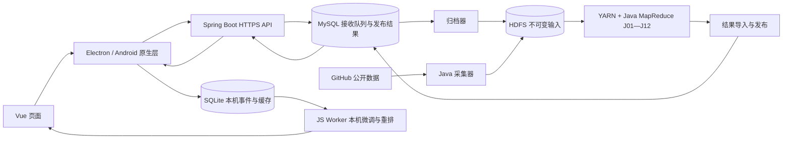
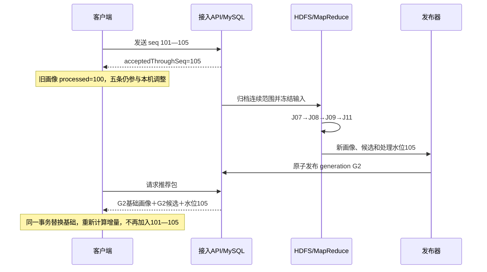

# 新 HappyGit 第一版：从架构到函数的设计文档

版本 1.0，2026-10-29。核对基线为 `feature/hadoop-sdd@62b87a4`；该提交中的业务代码来自 `74bf0d0`。这是第一版新系统的**实现设计**，文中的新增文件、函数和代码片段尚未落入业务工程，也未经过编译或运行。文档版本 1.0 与推荐模型 `mr-content-v2` 是两个不同概念。

本组文档承接 [Hadoop SDD](../../sdd/HadoopSDD.md)、[后端 SDD](../../sdd/后端SDD.md)、[数据库 SDD](../../sdd/数据库SDD.md)和[前端 SDD](../../sdd/前端SDD.md)。原 SDD 解释系统应该具备什么；这里进一步回答代码放在哪里、谁调用谁、每个业务函数接收什么、在内部如何处理、为什么这样处理。它既是开发依据，也是按调用链学习代码的材料。

## 从哪里开始读

先读本页和[接口与数据契约](接口与数据契约.md)，建立完整链路，再读[服务端详细设计](服务端详细设计.md)。服务端的批量计算继续展开在 [Hadoop 计算实现详解](Hadoop计算实现详解.md)，最后读[客户端详细设计](客户端详细设计.md)，看集群输出怎样变成屏幕上的推荐。

如果最关心“如何通过 Hadoop 从大量日志得到一个人的画像”，直接从 Hadoop 详解的 J07、J08、J09 开始。那里用同一位用户、两条项目向量贯穿权重汇总、按项目关联、按用户聚合，再回到客户端的短期向量融合。

所有代码块分成两种：标有“核心实现”的代码完整展开该函数的主逻辑，依赖的本项目类型和方法在邻近正文定义；标有“配置/SQL 片段”的内容只说明指定边界，不冒充可直接部署的完整工程。框架生成的构造器、DTO getter/setter、导包和机械字段映射不逐行重复；涉及业务决策、事务、算法和异步提交的函数均给出输入、步骤及输出。自定义函数名均为设计名称，不冒充 Hadoop 或 Spring 内建 API。

## 这版系统到底怎么分工

前次需求已经选择“以 MapReduce 为核心”。因此 Hadoop 位于**服务端**：接收大量已授权行为，与公开 GitHub 项目关联，计算个人画像、群体画像和最多 300 个候选。个人电脑和 Android 手机是客户端，通过 HTTPS 获取结果，再根据本机近期行为调整候选顺序。客户端不安装 NameNode、ResourceManager，也不直接提交集群任务。

这里有三个重要的存储角色。MySQL 解决请求事务、身份和快速读取；HDFS 保存批量计算的输入与产物；SQLite 让客户端离线保留事件和固定推荐批次。一次浏览先得到 MySQL 的持久接收确认，之后归档到 HDFS，最后进入新画像。这三个时刻不同，代码不能用一个 `uploaded=true` 代替全部进度。

第一版采用模块化进程：`server/` 保留 Spring Boot 3.3.4、JDK 17；新增 `collector/` 在 JDK 11 下运行采集、归档、调度及发布；新增 `mapreduce/` 使用 Hadoop 3.4.2，Java 8 字节码、JDK 11 执行。独立运行环境沿用原 SDD 的固定兼容基线，不宣称这些版本是当前最新版本。客户端继续 Vue、Pinia、Electron、Capacitor，不在设计过程中更换界面框架。

曾可考虑 Spark、将完整画像留在客户端或把所有操作放入 Spring 请求线程。这里选择 Java MapReduce，是因为它既满足已经确认的课程要求，也能把输入切片、Shuffle、聚合和实际作业记录展示清楚；代价是画像按批次更新，刷新按钮不能承诺立即重算全体数据。第一版用精确稀疏点积完成候选匹配，避免在 1000 用户、3000 项目的目标实验规模上先引入向量数据库。该规模是设计输入，不是已测能力。

## 一次“打开项目”如何走完整个系统

用户在现有项目卡片点击打开，`projects.openRepository()` 通过原生桥发起外部访问。成功发起后，`recordBrowse()` 在一个 SQLite 事务中更新聚合历史；距该仓库上次有效计数满 30 秒，才追加一条逐次事件。只有用户已开启云端分析且项目 ID 已解析，事件才获得设备上传序号并进入 outbox。

`CloudSyncService.flush()` 发送最早未确认的连续记录；服务端 `EventIngestionService.acceptBatch()` 锁定设备流，核对重复前缀，插入连续后缀，并与接收水位一起提交。`EventArchiver.archiveNext()` 随后把确定范围写入 HDFS。`InputManifestBuilder.freeze()` 固定此次计算可见的文件、用户设置、时间与水位，作业不扫描不断增长的目录。

J07 按“用户＋项目”累计访问证据，J08 按项目 ID 把证据与项目向量连接，J09 再按用户 ID 累加加权向量。因此同一用户散落在不同输入文件中的记录，最终在同一用户分组中得到唯一画像。J10 聚合用户画像得到群体分析；J11 对项目向量扫描并求每人 Top-300；J12 单独准备公共候选供冷启动使用。

`ResultPublisher.publish()` 导入完整产物，原子切换 generation。客户端 `BundleService.refresh()` 收到同一 generation 的画像、候选与处理水位；`createRerankSnapshot()` 取出尚未被覆盖的本机事件；Worker 调用 `computeLocalAdjustment()` 和 `rerankCandidatesV2()`，最后 `commitLocalRanking()` 再次核对输入版本并保存结果。Vue 按固定 `clientBatchId` 分页，用户阅读过程中不会因后台计算而突然换序。

## 第一版需要写到哪些位置

| 范围 | 当前入口及状态 | 目标责任 | 详细阅读位置 |
| --- | --- | --- | --- |
| 在线身份与 API | `server/.../GitHubOAuthController.java`、`GitHubOAuthService.java` 已存在 | 新增应用会话、设备、接入、发布结果读取 | 服务端第 2—5、8 节 |
| 公开采集与归档 | 仅有 `GitHubTrendingService` 的在线查询 | 新增 `collector/`，把输入可靠地交给 HDFS | 服务端第 6—7 节 |
| 批量算法 | 当前无 `mapreduce/` 工程 | 新增 J01—J12、共享算法及 Driver | Hadoop 详解全文 |
| 推荐入口 | `client/src/stores/feed.js:61` | 改为服务端候选＋本机调整 | 客户端第 7—8 节 |
| 行为记录 | `client/electron/database-worker.cjs:655` | 保留 30 秒规则，增加事件和 outbox 原子写入 | 客户端第 3 节 |
| 计算提交 | `client/electron/database-worker.cjs:863`、`:943` | 保存输入快照，受版本约束提交新排序 | 客户端第 5、7 节 |
| 计算 Worker | `client/src/workers/recommendation.worker.js` | 退出正式画像训练，只做冻结空间中的微调 | 客户端第 6 节 |
| 画像页面 | `client/src/components/ProfileView.vue` | 原兴趣区域内加入个人/群体面板 | 客户端第 8 节 |

表中行号对应上述核对基线，后续代码改变后以函数名定位。所有新路径均在相应章节标注“拟新增”。保留已有网页会话和 Star 能力，但它们不能替代服务端身份验证。原始 GitHub Cookie 不上传给服务端，也不进入 Hadoop 数据集。

## 设计完整性的判断标准

阅读任一核心函数，应能回答五件事：调用入口是什么，输入在哪个时间点冻结，读写哪些状态，返回值由谁消费，以及重试或账号变化会不会重复使用旧数据。本文围绕这些问题展开必要的业务分支，不增加与画像、同步和展示无关的异常扫描。

实现顺序为契约与迁移、在线接入与归档、项目特征、个人与群体画像、候选与发布、双端本机重排、页面接入。各阶段均在功能分支开发，合入 `develop` 后集中联调；发现缺陷另开 `bugfix/` 分支。本文仅进行文档核对，不运行应用测试、构建或集群作业。

最终验收需要拿一条真实或明确标记的合成事件，从 eventId 追踪到 HDFS 输入、Hadoop job、用户画像、候选包和屏幕卡片；需要保存实际两个 worker 的 task 运行记录。文档中的公式、例子和性能目标不能替代这些运行证据。
