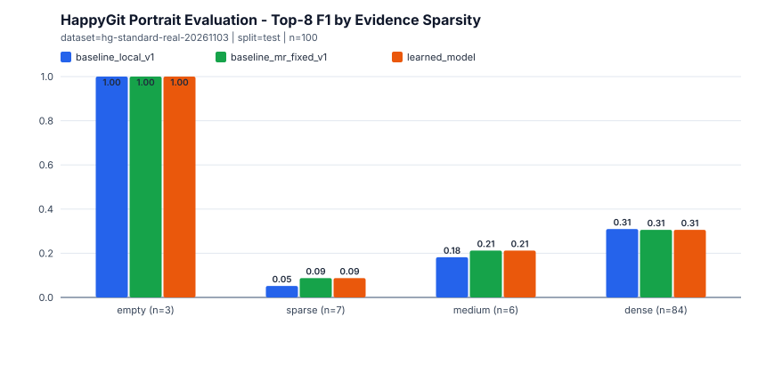

# HappyGit 第三轮独立兴趣画像对比实验报告

- **报告版本**：Round 3 冻结评测协议与真实目录三方实测版（2026-11-20 同步 2026-11-19 首版真实目录导出与评测结果）
- **评测基线代码**：`develop@24f0990`（集成 A 集群模型导出与 B 独立评测运行器）
- **词表与别名表**：[tools/experiments/taxonomy_aliases.json](../../tools/experiments/taxonomy_aliases.json)（版本 `hg-taxonomy-2026-11-v1`，测试前冻结，正式 test 绝不反向调参）
- **通用大模型防泄漏约束**：仅读取对应 `evidence-views/{split}.jsonl`、公开 `taxonomy.json` 与 JSON 输出约定，经 [prompt_builder.py](../../tools/experiments/prompt_builder.py) 逐条校验 `evidenceHash`，严格禁止传入 `generator-truth`、`control-cases`、场景配额、语义索引或任何算法输出。

> **重要方法论声明**：
> 1. 独立通用大模型（`llm_reference`）是**独立对照方法**，不直接当作真值；两两相似度不直接等同于准确率。
> 2. 空证据/空分布样本与非空分布样本**分开统计**，绝不将空分布强行补成均匀向量。
> 3. 项目推荐仅作为后续链路核查（验证画像方向驱动真实搜索及项目用途/证据有用性），不把画像相似度写成推荐准确率。
> 4. 本报告严格记录实际运行状态：**在尚未接入外部通用大模型 API 凭据及完成人工盲评、双机 YARN 多行为网格与真实回流再训练前，绝不编造任何大模型响应或未实测模型版本**。

---

## 一、冻结评测协议与数据来源说明

| 协议维度 | 约定标准 | 当前落地与执行状态 |
| :--- | :--- | :--- |
| 标准真实目录规模 | `standard` 划分（800 train / 100 validation / 100 test），全部 11 类场景 | **已完成**：读取 51 批真实公开目录导出（83,478 行，去重后 75,129 仓库，73,631 有非空 README），分层冻结 10,000 个真实公开项目与 1,000 名用户（200,000 条规则浏览、2,000 条集合记录），`strict-real` 8 项红线校验全部通过（参考时间 `2026-11-19 00:00 +08:00`） |
| 重复波动子集 | 固定分层抽取 **20 位** test 用户，总计 **3 次**独立参考调用（主运行 1 次 + 独立重复 2 次），保留波动均值/标准差/极值与失败数 | 已在 [repeat-subset-ids.json](../../tools/experiments/generated/standard-real-round3-local/repeat-subset-ids.json) 冻结 20 位测试用户（seed=`20261103`），运行器已通过 3 次总调用与部分失败分组计数单测；待接入大模型 API 后实跑 |
| 对比方法清单 | `baseline_local_v1`（B 本地规则基线）、`baseline_mr_fixed_v1`（A 固定规则基线 `rules-mr-30d-3-1.5-v1`）、`learned_model`（A 首版学习模型）、`learned_retrained`（A 回流再训练版本）、`llm_reference`（至少 1 个实际可用通用大模型） | **`baseline_local_v1`、`baseline_mr_fixed_v1`、`learned_model`（本地 Hadoop 版 `portrait-171b14f41dd3b349e93fbcad`）已完成真实目录 100 test 用户实测并校验 SHA-256**；双机 YARN 多行为网格训练版与 `learned_retrained` 待双主机集群运行后补入；`llm_reference` 处于 `pending_api_credentials` |
| 匿名盲评证据核查 | 至少 2 种方法结果齐备时导出随机打乱 `method_A/B/...` 样本，按 4 类（`grounded` / `over_inferred` / `nonexistent_citation` / `insufficient_evidence`）核查并解盲汇总 | 已基于真实目录三方预测导出 15 例匿名盲评工作表（保存在验证机 `output/local-acceptance-20261120/portrait-evaluation/blind-review-worksheet.md`），待接入 `llm_reference` 后统一完成人工标注并解盲回写 |

---

## 二、真实公开目录标准集实测结果（`standard-real`，100 位 test 用户，`deterministic_rules`）

- **数据集版本**：`hg-standard-real-20261103`（`catalogMode=real`，10,000 真实公开仓库；`behaviorSourceMode=deterministic_rules`，`split=test`，`n=100`）
- **输入证据 SHA-256**：`5bb5e99918eb10b90a179ca715728cc72a0bf4811543242975bc31f8946ea634`
- **大模型提示包 SHA-256**：`e00d4b0e1a5f2cb4d9ebbe27db19e3e4a03debf82bb8ba2e16703b230351ce94`（原始提示包约 9.1 MB，保存在验证机输出目录，仓库保留摘要与可复算命令）
- **服务端固定导出包**：
  - `modelVersion`: `portrait-171b14f41dd3b349e93fbcad`（本地 Hadoop MapReduce 标准规模训练，制品 SHA-256 `3cbc6ad370f55c61953d62987cd368c08b57e97725ce56277e2d7da77c1fa285`）
  - `featureSpaceVersion`: `fb6cd68c9ff3229f29d3e0ca62c5b9b5671835988b69a4524e329a924c328f69`
  - `protocolDigest`: `463387fe8293c6660bac867274d2075de213bd17ac60077738d8c2e7bb219b86`
- **完整评测摘要与图表目录**：[tools/experiments/generated/standard-real-round3-local/report.md](../../tools/experiments/generated/standard-real-round3-local/report.md)（历史合成夹具预览保留在 [standard-round3-baseline-preview/report.md](../../tools/experiments/generated/standard-round3-baseline-preview/report.md) 与 [pilot-round3-preview/report.md](../../tools/experiments/generated/pilot-round3-preview/report.md)）

### 2.1 各方法整体对比

| 方法 | 模型标识 | 样本数 (成功/失败) | Top-8 P | Top-8 R | Top-8 F1 | Top-8 Jaccard | nDCG@8 | 语言余弦 (非空 n=97) | 主题余弦 (非空 n=97) | 空分布精确率 (n=3) | 证据有效率 | 必选证据召回 | 幻觉引用 | 空画像准确率 | 耗时(ms) |
| :--- | :--- | ---: | ---: | ---: | ---: | ---: | ---: | ---: | ---: | ---: | ---: | ---: | ---: | ---: | ---: |
| `baseline_local_v1` | `baseline-local-v1` | 100 (100/0) | 0.2462 | 0.4367 | 0.3048 | 0.2028 | 0.4432 | 0.9908 | 0.9737 | 1.0000 | 1.0000 | 0.4000 | 0 | 1.0000 | 416 |
| `baseline_mr_fixed_v1` | `rules-mr-30d-3-1.5-v1` | 100 (100/0) | 0.2470 | 0.4383 | 0.3059 | 0.2042 | 0.4410 | 0.9908 | 0.9013 | 1.0000 | 1.0000 | 1.0000 | 0 | 1.0000 | 364 |
| `learned_model` | `portrait-171b14f41dd3b349e93fbcad` | 100 (100/0) | 0.2470 | 0.4383 | 0.3059 | 0.2042 | 0.4410 | 0.9908 | 0.9013 | 1.0000 | 1.0000 | 1.0000 | 0 | 1.0000 | 127 |
| `llm_reference` | - | 0 (0/0) | - | - | - | - | - | - | - | - | - | - | - | - | `pending_api_credentials` |

### 2.2 方法间两两一致性与样本级改进分析

| 对照组合 | 共同样本数 | Top-8 标签 Jaccard | 语言分布余弦 | 主题分布余弦 | 改进 / 退化 / 持平（±ΔF1>0.01） |
| :--- | ---: | ---: | ---: | ---: | :---: |
| `learned_model` vs `baseline_local_v1` | 100 | 0.7163 | 1.0000 | 0.9074 | 12 / 12 / 76（平均 ΔF1=`+0.0011`） |
| `learned_model` vs `baseline_mr_fixed_v1` | 100 | 1.0000 | 1.0000 | 1.0000 | 0 / 0 / 100（平均 ΔF1=`0.0000`） |

### 2.3 可视化对比图表（由 `tools/experiments/render_charts.py` 直接从真实目录 `report.json` 渲染）




### 2.4 关键机制分析与客观结论

1. **为什么 `learned_model` 在本轮 Top-8 标签与主题分布指标上与 `baseline_mr_fixed_v1` 完全一致？**
   - **架构可追溯约束**：按 `Portraits.infer` 的设计，球面聚类学习到的 8 个兴趣中心仅在 **8192 维稀疏向量空间**（`directionBlend = 0.25`）与**结构化 `directions` / `searchPlan`** 中参与融合与搜索拓展；而用户的个人 `languages`、`topics`、`topInterests` 与 `evidenceRepos` 保持严格来自本人实际仓库证据，避免把群体中心的高频标签直接冒充为个人历史证据。
   - **验证集选参增益体现在留出未来向量相似度**：在 84 名具备上下文与留出近期行为的验证用户上，`centerCount=8, directionBlend=0.25` 将时间留出余弦相似度从基线 `0.7085` 提升至 `0.7089`；由于本次单机首轮验证仅配置了单组行为参数（`30d / star=3 / owned=1.5`）与 `maxIterations=3`，与固定基线 `rules-mr-30d-3-1.5-v1` 的基础行为权重相同，因此在仅考察显式标签/分布的当前表 2.1 中两者完全重合。后续在双主机 YARN 集群上启用多组行为参数网格（如 `30d/3/1.5` 与 `60d/2/1.5`、`maxIterations=12`）后，将重新记录两者的差异。
2. **MapReduce 链路 vs 客户端本地基线差异**：
   - 两者在 100 位测试用户上均达成 `1.0000` 证据有效率、`0` 幻觉引用与 `1.0000` 空画像准确率（3 位 `no_evidence` 用户均诚实返回空分布）；
   - MapReduce 链路输出完整 `usedRepoIds`，在必选对照证据召回（`requiredEvidenceRecall`）上达到 `1.0000`（本地基线截断为前 20 条，召回率为 `0.4000`），且在 `sparse`（`0.0877` vs `0.0519`）、`revisit_heavy`（`0.1212` vs `0.0909`）、`star_only`（`0.2121` vs `0.1818`）与 `stable_multi`（`0.4365` vs `0.4286`）场景上略高于本地基线；
   - 而在 `ambiguous`（`0.1071`）与极稀疏场景（`sparse` `0.0877`）中，纯词面/标签统计仍明显受限，这正是后续接入独立通用大模型（`llm_reference`）进行语义对照的重点观察区。
3. **分数据源与稀疏度统计**：
   - `bySourceKind`：当前 100 位 test 用户全部显式标记为 `synthetic`（`n=100`，真实客户端回流样本在后续接入时单独成行报告，不与合成样本混算）。
   - `bySparsity`（`learned_model` / `baseline_mr_fixed_v1`）：`empty`（`n=3`, 空画像准确率 `1.0000`）、`sparse`（`n=7`, F1@8=`0.0877`）、`medium`（`n=6`, F1@8=`0.2121`）、`dense`（`n=84`, F1@8=`0.3060`）。

---

## 三、待外部条件就绪后的正式复算命令（双机 YARN + 大模型 + 人工盲评）

当（1）双主机 YARN 完成多行为网格首版与回流再训练导出，且（2）提供外部通用大模型 API 凭据后，使用已冻结的 `standard-real-frozen` 直接复跑以下两步命令即可自动生成完整多方法报告、20×3 波动表、SVG 图表与解盲汇总：

```powershell
# 1. 接入双主机 YARN learning-export（首版 + 回流版）与真实大模型（100 test + 20 固定子集 × 总计 3 次独立调用）
$env:HAPPYGIT_LLM_API_URL      = "https://<provider-endpoint>/v1"
$env:HAPPYGIT_LLM_API_KEY      = "<api-key>"
$env:HAPPYGIT_LLM_MODEL        = "<exact-model-identifier>"
$env:HAPPYGIT_LLM_PROVIDER     = "<provider-name>"

python tools/experiments/run_experiment.py `
  --dataset-dir output/first-release-20261119/standard-real-frozen `
  --split test `
  --server-export-dir <path/to/yarn-initial-learning-export> `
  --extra-model learned_retrained=<path/to/yarn-retrained-learning-export/learned.jsonl> `
  --run-llm-api `
  --repeat-subset-size 20 `
  --subset-repeats 3 `
  --blind-review-count 15 `
  --output-dir output/experiments/round3-official

# 2. 人工完成 blind-review-worksheet.md 对应标注后自动解盲回写主报告
python tools/experiments/run_experiment.py `
  --dataset-dir output/first-release-20261119/standard-real-frozen `
  --split test `
  --server-export-dir <path/to/yarn-initial-learning-export> `
  --extra-model learned_retrained=<path/to/yarn-retrained-learning-export/learned.jsonl> `
  --llm-predictions output/experiments/round3-official/predictions/llm_reference.jsonl `
  --blind-audit-file output/experiments/round3-official/blind-review-audit-template.jsonl `
  --output-dir output/experiments/round3-official
```

---

## 四、项目推荐后续验证口径

在正式双端设备验收阶段，针对推荐链路单独核查并记录（不混入画像指标）：
1. **搜索驱动真实性**：核对云端 `search-plan` 方向确实驱动真实 GitHub 搜索并命中训练目录之外的项目，单轮严格受限于 `<= 4` 查询 / `<= 8` 页；
2. **项目卡片证据实用性**：抽查 10–15 个搜索命中的公开项目，核对用途线索（`purposeCue`）、README 安装片段（`installCue`）、许可证（`licenseSpdx`）、最近维护时间与“关注度 ⭐”标签准确无误且可点击跳转 GitHub 原页；
3. **本机增量接续准确性**：核对上传后尚未被 `processedThrough` 覆盖的新打开项目可即时进入近期排序并在 24h 内降权，新画像发布后不再重复累计。
