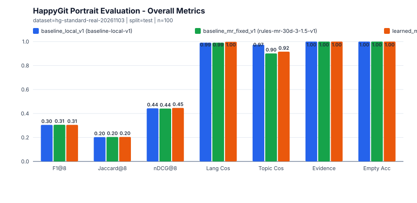
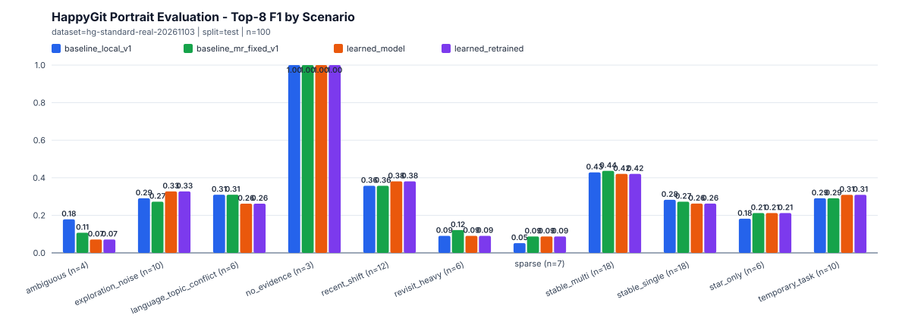
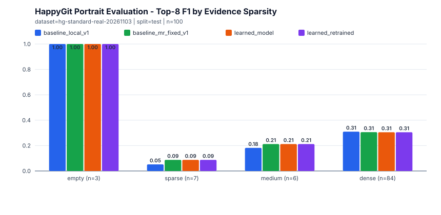

# HappyGit 第三轮独立兴趣画像对比实验报告

- **报告版本**：Round 3 冻结评测协议与**六方正式实测 + 15 人匿名盲评解盲版**（2026-11-23，基于双主机 YARN 正式训练/回流再训练导出、独立双大模型对照及 90 条匿名证据核查汇总）
- **评测基线代码**：`develop@9cd60313f3ac5cedeb92b1a0f9a4ae8584893138`（独立评测运行器 `tools/experiments/run_experiment.py` 来自 `abc0e447a8065f77b61412e64d76b3d9354e5e35`）
- **词表与别名表**：[tools/experiments/taxonomy_aliases.json](../../tools/experiments/taxonomy_aliases.json)（版本 `hg-taxonomy-2026-11-v1`，测试前冻结，正式 test 绝不反向调参）
- **通用大模型防泄漏约束**：仅读取对应 `evidence-views/{split}.jsonl`、公开 `taxonomy.json` 与 JSON 输出约定，经 [prompt_builder.py](../../tools/experiments/prompt_builder.py) 逐条校验 `evidenceHash`，严格禁止传入 `generator-truth`、`control-cases`、场景配额、语义索引或任何算法输出。

> **重要方法论声明**：
> 1. 独立通用大模型（`llm_reference` 与 `llm_codex_sol_xhigh`）是**独立对照方法**，不直接当作真值；两两相似度不直接等同于准确率。
> 2. 空证据/空分布样本与非空分布样本**分开统计**，绝不将空分布强行补成均匀向量。
> 3. 项目推荐仅作为后续链路核查（验证画像方向驱动真实搜索及项目用途/证据有用性），不把画像相似度写成推荐准确率。
> 4. 本报告严格记录实际运行边界：测试集中的公开仓库来自真实 GitHub 采集目录，但 100 名测试用户的行为序列与参考标签由冻结规则生成，结论适用于本评测协议；真实端上大规模回流评测留待生产 HTTPS 部署后另表登记，不与合成测试集混算。

---

## 一、冻结评测协议与数据来源说明

| 协议维度 | 约定标准 | 当前落地与执行状态 |
| :--- | :--- | :--- |
| 标准真实目录规模 | `standard` 划分（800 train / 100 validation / 100 test），全部 11 类场景 | **已完成**：读取 51 批真实公开目录导出（83,478 行，去重后 75,129 仓库，73,631 有非空 README），分层冻结 10,000 个真实公开项目与 1,000 名用户（200,000 条规则浏览、2,000 条集合记录），`strict-real` 8 项红线校验全部通过（参考时间 `2026-11-19 00:00 +08:00`） |
| 重复波动子集 | 固定分层抽取 **20 位** test 用户，总计 **3 次**独立参考调用（主运行 1 次 + 独立重复 2 次），保留波动均值/标准差/极值与失败数 | **已完成**：在 [repeat-subset-ids.json](../../tools/experiments/generated/standard-real-round3-yarn/repeat-subset-ids.json) 冻结 20 位测试用户（seed=`20261103`）；`codex-6.2-sol-xhigh` 与 `gemini-4-neon-xhigh` 均完成 100 主测 + 20×2 独立重复（各 140 条有效预测，3 轮失败数均为 `[0, 0, 0]`；Gemini 原始尝试日志保留 144 次尝试，含 4 次重试成功的失败） |
| 对比方法清单 | 本地规则基线、MapReduce 固定基线、双主机 YARN 首版学习模型、双主机 YARN 回流再训练模型、独立通用大模型对照 | **六方全部完成**：`baseline_local_v1`、`baseline_mr_fixed_v1`、`learned_model`（`portrait-a43992293a479d9c8b70d9a7`）、`learned_retrained`（`portrait-101f749d459768596fbb3275`）、`llm_codex_sol_xhigh`（`codex-6.2-sol-xhigh`）与 `llm_reference`（`gemini-4-neon-xhigh`）均完成 100 名 test 用户实测与摘要校验 |
| 匿名盲评证据核查 | 导出随机打乱 `method_A`–`method_F` 的 15 名用户样本（共 90 条候选），按 4 类（`grounded` / `over_inferred` / `nonexistent_citation` / `insufficient_evidence`）核查并解盲汇总 | **已完成解盲回写**：90 条匿名候选全部核查完成（`unmatched=0`、`invalid=0`），已通过 `--blind-audit-file` 解盲写入 [report.md](../../tools/experiments/generated/standard-real-round3-yarn/report.md)、[report.json](../../tools/experiments/generated/standard-real-round3-yarn/report.json) 与 [blind-review-audit.jsonl](../../tools/experiments/generated/standard-real-round3-yarn/blind-review-audit.jsonl) |

---

## 二、双主机 YARN 正式训练与六方实测结果（`standard-real`，100 位 test 用户）

- **数据集版本**：`hg-standard-real-20261103`（`catalogMode=real`，10,000 真实公开仓库；`behaviorSourceMode=deterministic_rules`，`split=test`，`n=100`）
- **输入证据 SHA-256**：`5bb5e99918eb10b90a179ca715728cc72a0bf4811543242975bc31f8946ea634`
- **大模型提示包 SHA-256**：`e00d4b0e1a5f2cb4d9ebbe27db19e3e4a03debf82bb8ba2e16703b230351ce94`
- **双主机 YARN 服务端固定导出包**（完整训练与并行证据见 [2026-11-20 双主机 YARN 验收记录](../validation/2026-11-20-two-host-yarn-acceptance.md)）：
  - 首版学习模型：`portrait-a43992293a479d9c8b70d9a7`（双主机 `hg-1` + `hg-2` YARN 多行为网格训练 92 作业，`parallelExecution=proven`，制品 SHA-256 `fe20584983730fc782d8ade1e260a2508ab33aa10526a66edabe1f6a60aadd98`）
  - 回流版学习模型：`portrait-101f749d459768596fbb3275`（并入 1 位真实 Electron 原生回流用户 / 8 条 `client_authenticated` 浏览事件，双主机 YARN 41 训练 + 11 导出作业均 `parallelExecution=proven`，制品 SHA-256 `72f951dec2d5bf02630c895c2330b56d7d82c556cd11e09cc2df76dcaf6c2905`）
  - `featureSpaceVersion`：`fb6cd68c9ff3229f29d3e0ca62c5b9b5671835988b69a4524e329a924c328f69`
  - `protocolDigest`：`8cc8589fb19d6a1b6e1adc6cef27d1c82ac2757cb318ee4267266ab77be1270`
  - **验证集选参**：在 84 名时间留出验证用户上对比 12 组候选配置，最终选中 `browseHalfLifeDays=60, starWeight=2, ownedWeight=1.5`、`centerCount=4`、`directionBlend=0.0`，验证留出余弦相似度 `0.709545`（高于固定基线 `30d/3/1.5` 的 `0.708490`）。
- **完整评测摘要、图表与盲评文件目录**：[tools/experiments/generated/standard-real-round3-yarn/report.md](../../tools/experiments/generated/standard-real-round3-yarn/report.md)（历史单机本地模式与合成夹具预览分别保留在 [standard-real-round3-local/report.md](../../tools/experiments/generated/standard-real-round3-local/report.md)、[standard-round3-baseline-preview/report.md](../../tools/experiments/generated/standard-round3-baseline-preview/report.md) 与 [pilot-round3-preview/report.md](../../tools/experiments/generated/pilot-round3-preview/report.md)）

### 2.1 六方整体对比（100 位冻结 test 用户）

| 方法 | 模型标识 | 样本数 (成功/失败) | Top-8 P | Top-8 R | Top-8 F1 | Top-8 Jaccard | nDCG@8 | 语言余弦 (非空 n=97) | 主题余弦 (非空 n=97) | 证据有效率 | 必选证据召回 | 幻觉引用 | 空画像准确率 | 耗时(ms) |
| :--- | :--- | ---: | ---: | ---: | ---: | ---: | ---: | ---: | ---: | ---: | ---: | ---: | ---: | ---: |
| `baseline_local_v1` | `baseline-local-v1` | 100 (100/0) | 0.2462 | 0.4367 | 0.3048 | 0.2028 | 0.4432 | 0.9908 | **0.9737** | 1.0000 | 0.4000 | 0 | 1.0000 | 1345 |
| `baseline_mr_fixed_v1` | `rules-mr-30d-3-1.5-v1` | 100 (100/0) | 0.2470 | 0.4383 | 0.3059 | 0.2042 | 0.4410 | 0.9908 | 0.9013 | 1.0000 | **1.0000** | 0 | 1.0000 | 1204 |
| `learned_model` | `portrait-a43992293a479d9c8b70d9a7` | 100 (100/0) | 0.2457 | 0.4400 | 0.3052 | 0.2044 | 0.4463 | **0.9981** | 0.9157 | 1.0000 | **1.0000** | 0 | 1.0000 | 245 |
| `learned_retrained` | `portrait-101f749d459768596fbb3275` | 100 (100/0) | 0.2457 | 0.4400 | 0.3052 | 0.2044 | 0.4463 | **0.9981** | 0.9157 | 1.0000 | **1.0000** | 0 | 1.0000 | 1086 |
| `llm_codex_sol_xhigh` | `codex-6.2-sol-xhigh` | 100 (100/0) | **0.4012** | 0.6483 | 0.4744 | 0.3403 | 0.6234 | 0.9421 | 0.6626 | 1.0000 | 0.5000 | 0 | 1.0000 | 729 |
| `llm_reference` | `gemini-4-neon-xhigh` | 100 (100/0) | 0.3842 | **0.6867** | **0.4784** | **0.3404** | **0.6430** | 0.9567 | 0.6815 | 1.0000 | 0.6000 | 0 | 1.0000 | 55444201 |

> 注：
> 1. `llm_reference`（`gemini-4-neon-xhigh`）的耗时列为原始尝试日志中全部 144 次调用（含主测 61+39 两批合并、固定 20 人第 2/3 轮独立重复以及 4 次随后重试成功的失败尝试）的累计时长，两批运行使用同一模型标识但账号与工作流渠道不同，完整审计摘要保留于验证机 `output/final-acceptance-20261123/predictions-intake-audit.json`；其余预生成预测文件的耗时为本地读取、评分与复算时长。
> 2. `learned_retrained` 聚类中心成员由首版 `[273, 153, 337, 13]` 真实演化为 `[255, 153, 357, 12]`，在小样本原生回流（1 人 / 8 事件）下于 100 名冻结测试用户上保持零退化，不据此夸大效果提升。
> 3. 六种方法对 3 例 `no_evidence` 用户均 100% 正确留空（`emptyHandlingAccuracy=1.0000`，`emptyLangExactRate=1.0000`，`emptyTopicExactRate=1.0000`）；`gemini-4-neon-xhigh` 另对仅有 1 个证据仓库的 `subj_standard_0745` 保守留空，该例的 F1 与 nDCG 均按 0 计入。

### 2.2 方法间两两一致性与样本级改进分析

| 对照组合 | 共同样本数 | Top-8 标签 Jaccard | 语言分布余弦 | 主题分布余弦 | 改进 / 退化 / 持平（±ΔF1>0.01） | 平均 ΔF1 | 平均 ΔJaccard | 平均 Δ主题余弦 |
| :--- | ---: | ---: | ---: | ---: | :---: | ---: | ---: | ---: |
| `learned_model` vs `baseline_local_v1` | 100 | 0.7030 | 0.9962 | 0.9024 | 12 / 12 / 76 | `+0.0004` | `+0.0016` | `-0.0580` |
| `learned_model` vs `baseline_mr_fixed_v1` | 100 | 0.8518 | 0.9962 | 0.9930 | 8 / 8 / 84 | `-0.0006` | `+0.0002` | **`+0.0144`** |
| `learned_retrained` vs `learned_model` | 100 | 1.0000 | 1.0000 | 1.0000 | 0 / 0 / 100 | `0.0000` | `0.0000` | `0.0000` |
| `llm_codex_sol_xhigh` vs `baseline_mr_fixed_v1` | 100 | 0.3212 | 0.9325 | 0.7006 | 72 / 0 / 28 | `+0.1685` | `+0.1361` | `-0.2387` |
| `llm_reference` vs `baseline_mr_fixed_v1` | 100 | 0.3287 | 0.9489 | 0.7220 | 72 / 1 / 27 | `+0.1725` | `+0.1362` | `-0.2198` |
| `llm_codex_sol_xhigh` vs `learned_model` | 100 | 0.3314 | 0.9429 | 0.7122 | 70 / 0 / 30 | `+0.1691` | `+0.1359` | `-0.2531` |
| `llm_codex_sol_xhigh` vs `llm_reference` | 100 | 0.7210 | 0.9715 | 0.9524 | - | - | - | - |

### 2.3 双大模型固定子集重复调用波动分析（20 名用户 × 3 次独立调用）

| 模型 | 固定子集规模 | 各轮失败数 | 状态完全一致率 | Top-8 Jaccard (mean ± std, min–max) | 语言分布余弦 (mean ± std) | 主题分布余弦 (mean ± std) |
| :--- | ---: | :---: | ---: | :---: | :---: | :---: |
| `llm_codex_sol_xhigh` (`codex-6.2-sol-xhigh`) | 20 | `[0, 0, 0]` | 1.0000 | `0.8973 ± 0.0122` (`0.8806`–`0.9094`) | `0.9981 ± 0.0004` | `0.9886 ± 0.0006` |
| `llm_reference` (`gemini-4-neon-xhigh`) | 20 | `[0, 0, 0]` | 1.0000 | `0.8946 ± 0.0291` (`0.8709`–`0.9355`) | `0.9964 ± 0.0007` | `0.9830 ± 0.0024` |

### 2.4 匿名盲评证据核查汇总（15 名用户 × 6 匿名候选 = 90 条）

基于独立打乱 `method_A`–`method_F` 的 15 名用户盲评包（逐条对照完整 `evidence/<subjectId>.json` 与 `taxonomy.json` 核查，[blind-review-audit.jsonl](../../tools/experiments/generated/standard-real-round3-yarn/blind-review-audit.jsonl) 与 [blind-review-key.json](../../tools/experiments/generated/standard-real-round3-yarn/blind-review-key.json) 已随报告归档），90 条判定全部匹配解盲（`unmatched=0`、`invalid=0`）：

| 方法 | 核查总数 | 有依据 (`grounded`) | 推断过强 (`over_inferred`) | 引用不存在 (`nonexistent_citation`) | 证据不足 (`insufficient_evidence`) | `grounded` 占比 |
| :--- | ---: | ---: | ---: | ---: | ---: | ---: |
| `baseline_local_v1` | 15 | 12 | 1 | 0 | 2 | 80.00% |
| `baseline_mr_fixed_v1` | 15 | 12 | 1 | 0 | 2 | 80.00% |
| `learned_model` | 15 | 13 | 0 | 0 | 2 | 86.67% |
| `learned_retrained` | 15 | 13 | 0 | 0 | 2 | 86.67% |
| `llm_codex_sol_xhigh` | 15 | 15 | 0 | 0 | 0 | 100.00% |
| `llm_reference` | 15 | 14 | 0 | 0 | 1 | 93.33% |

**盲评非 `grounded` 条目定性剖析（共 11 条）**：
1. **单 Star 稀疏标签过度放大（`over_inferred`，2 条，均发生在固定基线）**：
   - `baseline_mr_fixed_v1` 在 `subj_standard_0178`（243 仓）中因固定 `starWeight=3.0` + 较快浏览衰减（30d），将仅 4 个精确标签仓库涉及的 `game`（受单 Star `Keschet` 拉高）抬升为第 2 大主要兴趣，压过 `sql`（35 仓）、`android`（34 仓）、`postgresql`（28 仓）与 `rest-api`（25 仓）；
   - `baseline_local_v1` 在 `subj_standard_0938`（199 仓）中因双标签 Star 仓库 `SQLYog`（`['database', 'sql']`）权重放大，将仅 3 个精确标签仓库涉及的 `sql` 抬升至第 3 位、将 `database`（8 仓）置为第 1 位，压过 `python`（24 仓）、`linux`（21 仓）、`rust`（21 仓）等主线；
   - 相比之下，验证集自动选出 `60d / starWeight=2 / ownedWeight=1.5` 的 `learned_model` 与 `learned_retrained` 均未触发该类单 Star 放大失真（`over_inferred=0`）。
2. **极稀疏证据未保守收敛（`insufficient_evidence`，9 条，集中在 2 仓库极稀疏样本 `subj_standard_0748` 与 `subj_standard_0749`）**：
   - 4 条规则/MapReduce 链路在仅有 2 个仓库的 `subj_standard_0748`（1 Star + 1 次 70 天前浏览 `glances`）与 `subj_standard_0749`（无 Star、仅 55–70 天前 2 次单次浏览）上均未做稀疏裁剪，直接铺出 5–8 个完整 Top 兴趣（含 `web`/`terminal`/`system`/`nutanix`/`junit-vintage` 等噪声或细分标签）；
   - `llm_reference`（Gemini）在 `subj_standard_0749` 上输出 4 个兴趣（仅凭 70 天前单次浏览给出 `android+mobile=60%`）并在 `languages` 中推断出两仓主语言均未出现的 `Kotlin (0.20)`，判为 `insufficient_evidence`；
   - `llm_codex_sol_xhigh`（Codex）在 `subj_standard_0748` 仅输出 2 个核心标签（`terraform`/`monitoring`），在 `subj_standard_0749` 收敛为 1 个低置信度标签（`android`, `score=0.4`, `Java=1.0`），表现出最强的稀疏保守性。
3. **活动型元数据噪声观察**：在 `subj_standard_0474`、`subj_standard_0573`、`subj_standard_0578` 中，4 条规则/MapReduce 链路均因仓库原始 Topic 中包含 24–28 个 `hacktoberfest` 而将其排入 Top-4 至 Top-6（因有真实高频仓库对应，盲评仍按口径记为 `grounded` 并在备注中标注），两个大模型则均自动过滤了该非技术活动标签。

### 2.5 可视化对比图表（由 `tools/experiments/render_charts.py` 直接从六方 `report.json` 渲染）







### 2.6 关键机制分析与客观结论

1. **标签语义归纳 vs 原始权重分布拟合的两类互补能力**：
   - 在冻结的 100 名测试用户上，两个独立大模型凭借跨词表语义归类与噪声过滤能力（过滤 `hacktoberfest`、项目名等非技术标签并对齐到公开 `taxonomy.json` 规范词表），在 Top-8 标签命中和排序上显著领先：`gemini-4-neon-xhigh` 的 **Top-8 F1 = `0.4784`、nDCG@8 = `0.6430`** 为六方最高，`codex-6.2-sol-xhigh` 紧随其后（**F1 = `0.4744`、nDCG@8 = `0.6234`**），且在 `sparse`（`0.2483`/`0.1837` vs `0.0519`–`0.0877`）、`star_only`（`0.3717`/`0.4310` vs `0.1818`–`0.2121`）、`recent_shift`（`0.5238`/`0.5623` vs `0.3571`–`0.3810`）等复杂场景提升明显；
   - 反过来，在非空主题分布余弦拟合上，本地规则基线（`0.9737`）与 MapReduce/学习模型（`0.9013`–`0.9157`）远高于大模型（`0.6626`–`0.6815`），因为确定性统计方法精确保留全量仓库的权重比例，且 MapReduce 链路的必选证据召回率达 `1.0000`（大模型抽样引用为 `0.5000`–`0.6000`），同时离线批量推理成本远低于大模型逐用户调用。
2. **多行为网格验证选参带来的真实改进与边界**：
   - 双主机 YARN 学习模型（`portrait-a43992293a479d9c8b70d9a7`）通过时间留出验证自动选出 `60d/2/1.5`，相对固定规则 `baseline_mr_fixed_v1`（`30d/3/1.5`）在排序质量（**nDCG@8 `0.4463` vs `0.4410`**）、**语言余弦（`0.9981` vs `0.9908`）**、**主题余弦（`0.9157` vs `0.9013`，`+0.0144`）**以及匿名盲评无过度推断率（`over_inferred: 0` vs `1`）上均有稳定改善，在 `recent_shift` 场景 F1 由 `0.3571` 提升至 `0.3810`，而整体 Top-8 F1 基本持平（`0.3052` vs `0.3059`）；
   - 这客观说明：在离线 Hadoop 架构中，引入**词表规范化与非技术噪声标签过滤**、以及**极稀疏用户的 Top-K 收敛策略**是下一阶段相对规则/向量学习最有收益的工程优化方向。
3. **证据可追溯性、空画像诚实性与重复稳定性**：
   - 六方首轮 600 条预测全部达到 `1.0000` 证据有效率、`0` 幻觉引用与 `1.0000` 空画像准确率；
   - 两个大模型在固定 20 人子集 3 次独立调用中状态完全一致率均为 `1.0000`，Top-8 Jaccard 稳定性接近 `0.90`（Codex `0.8973 ± 0.0122`，Gemini `0.8946 ± 0.0291`），语言与主题分布余弦均高于 `0.98`；
   - `bySourceKind`：当前 100 位 test 用户全部显式标记为 `synthetic`（`n=100`），未来真实生产端上回流评测将单独成行报告，不与合成测试集混算。

---

## 三、完整六方评测与盲评审计复算命令

以下命令可基于已归档输入与 [blind-review-audit.jsonl](../../tools/experiments/generated/standard-real-round3-yarn/blind-review-audit.jsonl) 一键复现本次完整六方报告、双大模型稳定性、匿名盲评审计与 SVG 图表：

```powershell
python tools/experiments/run_experiment.py `
  --dataset-dir output/first-release-20261119/standard-real-frozen `
  --split test `
  --server-export-dir output/two-host-20261120-212158/server-export-fixed `
  --extra-model learned_retrained=output/two-host-retrain-20261120/server-export-retrained/learned.jsonl `
  --extra-model llm_codex_sol_xhigh=output/acceptance-20261121/portrait-evaluation-codex/predictions/llm_codex_sol_xhigh.jsonl `
  --extra-model-repeat llm_codex_sol_xhigh=output/final-acceptance-20261123/codex-repeats/codex_run2_repeat20.jsonl `
  --extra-model-repeat llm_codex_sol_xhigh=output/final-acceptance-20261123/codex-repeats/codex_run3_repeat20.jsonl `
  --llm-predictions output/final-acceptance-20261123/gemini-neon-verified/run1_all100.jsonl `
  --llm-repeat-predictions output/final-acceptance-20261123/gemini-neon-verified/run2_repeat20.jsonl `
  --llm-repeat-predictions output/final-acceptance-20261123/gemini-neon-verified/run3_repeat20.jsonl `
  --llm-raw-responses output/final-acceptance-20261123/gemini-neon-verified/raw-responses.jsonl `
  --repeat-subset-size 20 `
  --subset-repeats 3 `
  --repeat-seed 20261103 `
  --blind-review-count 15 `
  --blind-audit-file output/final-acceptance-20261123/portrait-evaluation-6way/blind-review-audit.jsonl `
  --output-dir output/final-acceptance-20261123/portrait-evaluation-6way
```

---

## 四、项目推荐后续验证口径

在正式双端设备联网验收阶段，针对推荐链路单独核查并记录（不混入画像指标）：
1. **搜索驱动真实性**：核对云端 `search-plan` 方向确实驱动真实 GitHub 搜索并命中训练目录之外的项目，单轮严格受限于 `<= 4` 查询 / `<= 8` 页；
2. **项目卡片证据实用性**：抽查 10–15 个搜索命中的公开项目，核对用途线索（`purposeCue`）、README 安装片段（`installCue`）、许可证（`licenseSpdx`）、最近维护时间与“关注度 ⭐”标签准确无误且可点击跳转 GitHub 原页；
3. **本机增量接续准确性**：核对上传后尚未被 `processedThrough` 覆盖的新打开项目可即时进入近期排序并在 24h 内降权，新画像发布后不再重复累计。
