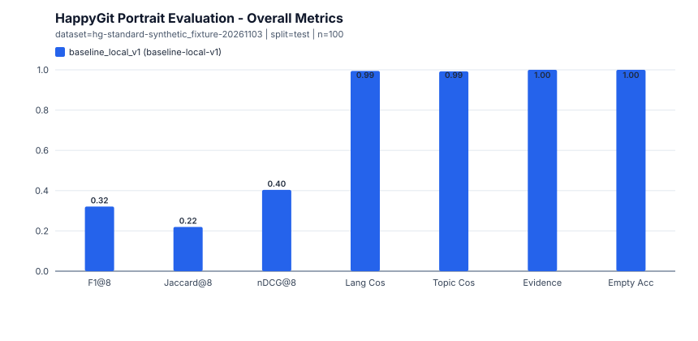
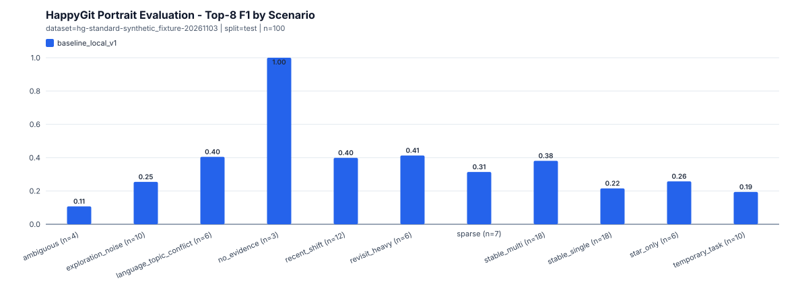
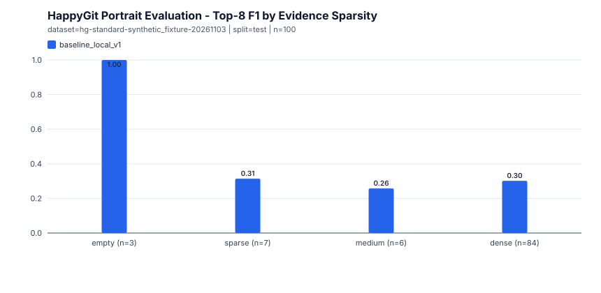

# HappyGit 第三轮独立兴趣画像对比实验报告

- **报告版本**：Round 3 冻结评测协议与基准实测版（对应分支 `feature/experiment-and-client-release`）
- **评测基线代码**：基于已完成第二轮集中验收的 `develop@792a0bc` 及本轮实验运行器升级
- **词表与别名表**：[tools/experiments/taxonomy_aliases.json](../../tools/experiments/taxonomy_aliases.json)（版本 `hg-taxonomy-2026-11-v1`，测试前冻结，正式 test 绝不反向调参）
- **通用大模型防泄漏约束**：仅读取对应 `evidence-views/{split}.jsonl`、公开 `taxonomy.json` 与 JSON 输出约定，经 [prompt_builder.py](../../tools/experiments/prompt_builder.py) 逐条校验 `evidenceHash`，严格禁止传入 `generator-truth`、`control-cases`、场景配额、语义索引或任何算法输出。

> **重要方法论声明**：
> 1. 独立通用大模型（`llm_reference`）是**独立对照方法**，不直接当作真值；两两相似度不直接等同于准确率。
> 2. 空证据/空分布样本与非空分布样本**分开统计**，绝不将空分布强行补成均匀向量。
> 3. 项目推荐仅作为后续链路核查（验证画像方向驱动真实搜索及项目用途/证据有用性），不把画像相似度写成推荐准确率。
> 4. 本报告严格记录实际运行状态：**在尚未接入成员甲集群 `learning-export` 输出与外部大模型 API 凭据前，绝不编造任何学习模型版本或大模型响应**。

---

## 一、冻结评测协议与数据来源说明

| 协议维度 | 约定标准 | 当前落地与执行状态 |
| :--- | :--- | :--- |
| 标准评测规模 | `standard` 划分（800 train / 100 validation / 100 test），全部 11 类场景 | 已使用 `build_dataset.py --scale standard --catalog-mode synthetic_fixture --seed 20261103` 通过全部 8 项红线校验并完成 100 位 test 用户基线评测；真实 75,129 采集目录接入入口（`--repo-catalog` 多批去重+分层冻结）已实现并通过单测，待合入后对正式真实目录复跑 |
| 重复波动子集 | 固定分层抽取 **20 位** test 用户，总计 **3 次**独立参考调用（主运行 1 次 + 独立重复 2 次），保留波动均值/标准差/极值与失败数 | 已在 [repeat-subset-ids.json](../../tools/experiments/generated/standard-round3-baseline-preview/repeat-subset-ids.json) 冻结 20 位测试用户（seed=`20261103`），运行器已通过 3 次总调用与部分失败分组计数单测 |
| 对比方法清单 | `baseline_local_v1`（B 本地规则基线）、`baseline_mr_fixed_v1`（A 固定规则基线 `rules-mr-30d-3-1.5-v1`）、`learned_model`（A 首版学习模型）、`learned_retrained`（A 回流再训练版本）、`llm_reference`（至少 1 个实际可用通用大模型） | `baseline_local_v1` 已实测；`baseline_mr_fixed_v1` / `learned_model` / `learned_retrained` 处于 `pending_server_export`（待 A 集群 `learning-export` 产物）；`llm_reference` 处于 `pending_api_credentials`（待提供外部大模型 API 配置） |
| 匿名盲评证据核查 | 至少 2 种方法结果齐备时导出随机打乱 `method_A/B/...` 样本，按 4 类（`grounded` / `over_inferred` / `nonexistent_citation` / `insufficient_evidence`）核查并解盲汇总 | 匿名样本、工作表、标注模板与解盲聚合逻辑已实现并通过单元测试 |

---

## 二、当前已实测基准结果（`standard` 100 位 test 用户，`synthetic_fixture` + `deterministic_rules`）

- **数据集版本**：`hg-standard-synthetic_fixture-20261103`（`catalogMode=synthetic_fixture`，`behaviorSourceMode=deterministic_rules`，`split=test`，`n=100`）
- **输入证据 SHA-256**：`268cc20fed3cf6a8bb925d4ee8380235fd3152e43740a93753bb6470089315b3`
- **大模型提示包 SHA-256**：`af282e93e6fde9fb1b019403c2b1208f56b9e1710352fb1f690205682806a5c8`（因 100 用户完整提示包约 7.9 MB，仓库保留摘要与可复算命令，未直接提交巨型提示文本）
- **完整原始报告目录**：[tools/experiments/generated/standard-round3-baseline-preview/](../../tools/experiments/generated/standard-round3-baseline-preview/report.md)（另附 `pilot` 5 用户预览：[pilot-round3-preview/report.md](../../tools/experiments/generated/pilot-round3-preview/report.md)）

### 2.1 各方法整体对比

| 方法 | 模型标识 | 样本数 (成功/失败) | Top-8 P | Top-8 R | Top-8 F1 | Top-8 Jaccard | nDCG@8 | 语言余弦 (非空 n=97) | 主题余弦 (非空 n=97) | 空分布精确率 (n=3) | 证据有效率 | 幻觉引用 | 空画像准确率 | 耗时(ms) |
| :--- | :--- | ---: | ---: | ---: | ---: | ---: | ---: | ---: | ---: | ---: | ---: | ---: | ---: | ---: |
| `baseline_local_v1` | `baseline-local-v1` | 100 (100/0) | 0.2708 | 0.4283 | 0.3209 | 0.2197 | 0.4036 | 0.9943 | 0.9924 | 1.0000 | 1.0000 | 0 | 1.0000 | 158 |
| `baseline_mr_fixed_v1` | `rules-mr-30d-3-1.5-v1` | 0 (0/0) | - | - | - | - | - | - | - | - | - | - | - | `pending_server_export` |
| `learned_model` | - | 0 (0/0) | - | - | - | - | - | - | - | - | - | - | - | `pending_server_export` |
| `llm_reference` | - | 0 (0/0) | - | - | - | - | - | - | - | - | - | - | - | `pending_api_credentials` |

### 2.2 可视化对比图表（由 `tools/experiments/render_charts.py` 直接由 `report.json` 自动生成）







### 2.3 `baseline_local_v1` 分场景、来源与稀疏度实测观察

- **分场景（`byScenario`，11 类共 100 人，失败数均为 0）**：
  - `no_evidence`（`n=3`）：空画像准确率 `1.0000`，空分布严格保持 `{}`（非空分布指标记为 `-`），无任何编造引用；
  - 较强表现场景：`revisit_heavy`（`n=6`, F1@8=`0.4131`）、`language_topic_conflict`（`n=6`, F1@8=`0.4048`）、`recent_shift`（`n=12`, F1@8=`0.3988`）、`stable_multi`（`n=18`, F1@8=`0.3810`）；
  - 基线薄弱场景（正是学习型兴趣中心与大模型语义泛化的重点对照区）：`ambiguous`（`n=4`, F1@8=`0.1071`）、`temporary_task`（`n=10`, F1@8=`0.1939`）、`stable_single`（`n=18`, F1@8=`0.2155`）、`exploration_noise`（`n=10`, F1@8=`0.2545`）、`star_only`（`n=6`, F1@8=`0.2576`）。
- **分数据源（`bySourceKind`）**：当前 100 位 test 用户全部显式标记为 `synthetic`（`n=100`，真实观察与真实客户端回流样本将在接入后按各自 `sourceKind` 单独成行报告，不与合成样本混拼）。
- **分证据稀疏度（`bySparsity`）**：`empty`（`n=3`）、`sparse`（`n=7`, F1@8=`0.3143`）、`medium`（`n=6`, F1@8=`0.2576`）、`dense`（`n=84`, F1@8=`0.3017`）。

---

## 三、待外部条件就绪后的一键复算与正式对比步骤

当（1）成员甲完成真实 75,129 目录导出与 `learning-export` 首版/回流版导出，且（2）维护者提供实际可用的外部通用大模型 API 地址、密钥与模型 ID 后，按以下可复算命令即可产出最终完整多方法对比报告、原始响应、波动统计、SVG 图表与匿名盲评工作表：

```powershell
# 1. 使用真实采集导出目录生成并校验冻结 standard 数据集（10,000 真实公开仓库，1,000 用户，100 位 test）
python tools/datasets/build_dataset.py `
  --scale standard `
  --catalog-mode real `
  --repo-catalog <path/to/collected-batches-dir> `
  --behavior-source-mode deterministic_rules `
  --output-dir output/datasets/standard-real-frozen
python tools/datasets/validate_dataset.py --dataset-dir output/datasets/standard-real-frozen --strict-real

# 2. 接入成员甲 learning-export（首版 + 回流版）与真实大模型（100 test + 20 固定子集 × 总计 3 次独立调用）
$env:HAPPYGIT_LLM_API_URL      = "https://<provider-endpoint>/v1"
$env:HAPPYGIT_LLM_API_KEY      = "<api-key>"
$env:HAPPYGIT_LLM_MODEL        = "<exact-model-identifier>"
$env:HAPPYGIT_LLM_PROVIDER     = "<provider-name>"

python tools/experiments/run_experiment.py `
  --dataset-dir output/datasets/standard-real-frozen `
  --split test `
  --server-export-dir <path/to/initial-learning-export> `
  --extra-model learned_retrained=<path/to/retrained-learning-export/learned.jsonl> `
  --run-llm-api `
  --repeat-subset-size 20 `
  --subset-repeats 3 `
  --blind-review-count 15 `
  --output-dir output/experiments/round3-official

# 3. 人工完成 output/experiments/round3-official/blind-review-worksheet.md 对应标注后自动解盲回写主报告
python tools/experiments/run_experiment.py `
  --dataset-dir output/datasets/standard-real-frozen `
  --split test `
  --server-export-dir <path/to/initial-learning-export> `
  --extra-model learned_retrained=<path/to/retrained-learning-export/learned.jsonl> `
  --llm-predictions output/experiments/round3-official/predictions/llm_reference.jsonl `
  --blind-audit-file output/experiments/round3-official/blind-review-audit-template.jsonl `
  --output-dir output/experiments/round3-official
```

---

## 四、项目推荐后续验证口径

在正式双端设备验收阶段，针对推荐链路单独核查并记录（不混入画像指标）：
1. **搜索驱动真实性**：核对云端 `search-plan` 方向确实驱动真实 GitHub 搜索并命中训练目录之外的项目，单轮严格受限于 `<= 4` 查询 / `<= 8` 页；
2. **项目卡片证据实用性**：抽查 10–15 个搜索命中的公开项目，核对用途线索（`purposeCue`）、README 安装片段（`installCue`）、许可证（`licenseSpdx`）、最近维护时间与“关注度 ⭐”标签准确无误且可点击跳转 GitHub 原页；
3. **本机增量接续准确性**：核对上传后尚未被 `processedThrough` 覆盖的新打开项目可即时进入近期排序并在 24h 内降权，新画像发布后不再重复累计。
