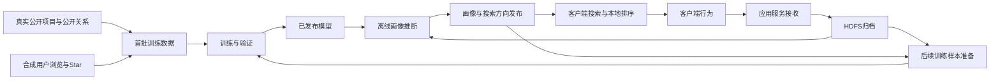

# HappyGit 项目实施方案

日期：2026-11-08。代码基线：develop，`5e46112c8140b0a650ada8e8d0eb10e8802d45e5`。本文描述接下来要完成的系统，当前代码的实现边界仍以已保存的运行记录为准。

项目采用两人、三轮开发。最终交付是一个可以持续学习用户技术兴趣的开源项目发现应用：管理员初始化广范围项目采集与首轮训练；客户端上传允许分析的个人行为；服务端用当前模型离线生成画像；客户端根据画像搜索并排序项目；新的行为和画像记录进入后续训练准备，形成下一版模型。

这里固定的是每次训练、推断和评测所用的输入快照。底层数据持续积累，模型也持续更新。一个版本可追溯，多个版本连续迭代。

## 系统怎样运行

管理员先指定广泛的公开项目来源及采集预算，系统批量取得元信息、README和可获取的公开用户关系。项目目录不围绕某个预设用户兴趣建立。大模型帮助设计合成用户行为，脚本生成可复现的浏览和Star数据，来源与真实观察分别保存。

首批用户样本按80%训练、10%验证、10%测试划分。训练产生候选模型，验证用于选择参数，测试用于独立报告。合成样本的隐藏设定和大模型对照输出不进入正式画像输入。首轮模型通过发布检查后成为当前使用版本。

个人客户端产生有效浏览后先保存本地，再批量上传。服务端接收、归档和计算分别记录进度。离线推断读取当前已发布模型与该用户的新输入，发布画像、技术方向、搜索词及对应证据，客户端据此搜索GitHub项目并完成本地排序。

新增行为持续进入训练候选区。后续训练结合历史代表样本和新增样本，生成新的训练快照和候选模型；通过同口径验证后，管理员发布下一版。当前使用版本在训练期间继续处理个人数据，训练失败或候选未通过时保留原版本。首版提供管理员手动触发和可配置的批次调度，不在每次点击后重训全局模型。

## 现有代码怎样复用

| 现有部分 | 继续承担的职责 | 需要补齐的能力 |
| --- | --- | --- |
| `data-platform`采集、TaskStore、HdfsFiles | 公开采集、任务领取、重试、不可变归档 | 广范围批量来源、关联项目补抓、增量刷新、数据与训练批次登记 |
| J01—J06与Vectors | 项目清洗、分词、词频、固定特征空间和向量 | 独立拟合与投影入口、模型制品加载、训练和推断版本隔离 |
| J07—J10 | 用户项目证据、个人向量和群体统计 | 学习型兴趣方向、按模型版本推断、回流样本关联 |
| J11—J12 | 已知目录的相似候选和公共项目池 | 作为示例与搜索补充，按用户块处理有界任务 |
| Spring Boot服务 | HTTP入口和现有授权基础 | 应用会话、MySQL、设备与事件接收、画像查询、结果发布 |
| Electron与Android原生模块 | GitHub网页会话、公开集合、本地存储、搜索与Star | 逐次事件、上传队列、云端会话与画像缓存 |
| Vue与共享推荐模块 | 发现页、个人页、设置与本地排序 | 使用云端画像生成搜索计划，显示进度、依据和群体结果 |
| Ubuntu部署工具 | 角色和配置生成、服务安装入口 | 真实多主机运行、训练和推断部署、运行记录及恢复步骤 |

当前真实数据验证为4个公开项目，在单物理机WSL的local MapReduce模式跑完12阶段。它证明已有数据链路可运行，不代表批量训练、真实用户回流、多机YARN和新版安装包已完成。

## 模型怎样训练和持续更新

首版建议复用已有语言、topic和文本向量，增加归一化向量上的兴趣中心学习。训练用户的行为先形成个人兴趣向量，再通过迭代聚类学习群体兴趣中心；新用户与多个中心的相似关系用于产生方向权重。现有规则加权画像保留为独立基线。这一方案可用Java MapReduce实现，正式计算继续由Hadoop承担。

训练实际学习的内容包括兴趣中心及其统计。中心数量、方向融合强度和行为参数在验证集上选择，结果写入模型配置；初始值与最终选择都保留。中心的语言、topic和代表词用于解释方向，一个用户可以同时关联多个方向。本文选定的是首版实现路线，效果以实验为准，不预设一定优于基线。

实现时由训练Driver固定随机种子和初始中心，每轮Mapper计算训练用户向量与中心的相似关系，Reducer累计成员向量并归一化更新中心，直到配置的停止条件成立。新用户推断只计算与已保存中心的关系；回流再训练重新准备样本并运行训练过程，保存新的制品。中心方向参与画像融合，具体兴趣标签和用户证据仍需要可追溯来源。

模型制品至少保存分词规则、词表与IDF、兴趣中心、训练配置、目录快照、训练输入摘要和验证摘要。推断加载完整制品，不以新用户数据重新拟合词表或改变中心。项目新词暂时不能投影时，保留实际可用的语言与主题证据，并在后续训练版本中更新特征空间。

持续学习首版采用分批再训练。准备下一批训练数据时，读取截至固定时间的原始行为、可用集合、用户明确反馈和项目快照，并混合历史代表样本。数据源选择、各来源样本量和采样规则写入训练清单。首次训练与后续训练使用同一套入口，首版不要求训练算法支持逐条参数更新。

已经生成的画像也进入回流记录，用于查看兴趣变化、核查旧判断和关联当时的推荐上下文。每份画像带模型版本和输入摘要。训练主线依据原始行为重建样本，不把旧画像无条件作为监督真值；后续如果引入弱标注训练，需要单独记录标签来源和可信依据。

固定测试用户保留为独立基准，不因出现了新模型就并入训练。新增真实数据另外形成近期验证和评测样本，明确按用户隔离还是按时间评估已知用户的变化，两种协议分别报告。关闭分析、删除云端数据和已失效的数据版本在训练准备及结果读取时同步生效。

模型版本与画像结果版本分别管理。一次再训练产生新的模型；同一模型可对不同日期的个人输入产生多次画像。模型发布后按新版本重新处理受影响用户，旧画像保留原始版本和时间，界面显示等待更新或历史结果，不直接替换版本标签。

## 功能模块在项目中的位置

公共契约位于三层之间，统一项目、事件、集合、画像、搜索方向和处理进度。先确定契约，再由两人各自实现Java服务与客户端适配。现有候选查询结构、DTO字段和向量使用问题在这个阶段修复，避免影响新链路。

批量采集位于数据入口，负责发现与补抓项目、抓取完整性、请求预算、刷新和采集批次。实验数据工具位于采集和训练之间，负责真实/合成来源、用户拆分、有效事件、共同证据和可重现文件。两者通过冻结目录与四类JSONL记录连接。

业务服务位于客户端和数据平台之间，负责云端身份、设备、偏好、事件持久接收和查询。客户端本机GitHub网页会话继续用于网页搜索与Star；服务端通过受信任的应用身份绑定云端数据。普通用户使用预置服务地址。

客户端事件与上传模块位于用户动作之后，在保留现有聚合历史的同时保存逐次有效事件。服务端接收模块负责去重和确认，归档模块再把已接收数据写入HDFS。接收确认和画像处理完成使用不同进度，供本机增量排序准确接续。

训练、推断和回流准备位于离线数据平台。训练更新全局模型，推断生成个人结果，回流准备把后续可用证据整理成新的训练快照。三种任务分开登记，并复用已有租约和任务执行设施。

结果发布位于离线输出和在线读取之间。完成的画像先导入待发布区域，通过版本和输入检查后切换当前结果。在线服务提供画像和结构化搜索方向；少量服务端示例候选仅作补充。模型发布和画像结果发布各自具备明确的当前指针。

客户端发现与排序位于用户直接使用的一端。搜索根据兴趣方向组合语言、topic和关键词，合并结果后结合近期行为、隐藏、维护与已看情况排序。新项目可超出训练目录；后续补采将其纳入数据平台。用途、安装或示例线索、许可证和维护信息保留可核查来源，Star使用关注度名称。

个人与群体页面负责展示实际画像、引用项目、更新时间、处理进度和聚合技术分布。管理工作台负责查看采集、数据集、训练、推断和发布状态。两个界面共享已有视觉规范，主要补业务连接和真实状态。

独立评测负责运行基线、学习型画像和大模型，并按同一用户证据对齐结果。部署与交付负责真实Ubuntu集群、新EXE/APK、数据升级和端到端演示。模块完成条件详见[功能模块任务表](功能模块任务表.md)和[三轮协作与验收](三轮协作与验收.md)。

## 两人三轮的交付边界

甲负责数据平台、Spring Boot业务服务、业务数据库和Ubuntu部署。乙负责客户端、数据集与评测工具、图表报告和安装包。共享契约由甲维护、乙共同审阅；客户端共享契约与原生适配由乙维护。开发时按目录和新增文件划分所有权，避免两人同时改同一大文件。

第一轮交付广范围采集、实验数据入口、应用身份和行为接收基础，以及客户端事件队列和旧问题修正。第二轮交付初始训练、个人推断、画像发布、搜索排序和回流再训练，形成一次模型更新闭环。第三轮交付正式实验、多机运行、双端验收和发布材料。

每人每轮可提交一个包含多个相关功能模块的主PR，正常路径为六个主PR；实际缺陷通过独立修复PR处理。功能分支从develop创建，阶段功能合入develop后集中测试。分支、提交和PR使用功能名称，任务表正文同样使用功能名称。临时口头编号不进入代码、提交说明、PR和文档正文；若文件名临时带编号，最终交付时重命名并修正引用，保留已有Git历史。

本轮范围包含持续学习闭环、Windows/Android实际使用和主要画像实验。贡献任务发现、ALS、新框架迁移、在线调用大模型生成每个用户画像和完整自动代码质量审查留作独立扩展，不占用三轮核心交付。

## 文档入口

统一字段、边界和版本见[接口与模型契约](接口与模型契约.md)。按功能与人员分工见[功能模块任务表](功能模块任务表.md)。PR组合、轮次交接、集中验收和最终交付见[三轮协作与验收](三轮协作与验收.md)。初始实验数据生成使用根目录[服务端数据集生成要求](../../数据集生成要求-服务端版.md)。

历史设计提供可复用的实现细节。本方案在模型持续更新、画像驱动客户端搜索和三轮协作范围上优先于旧的固定候选包主线；新增接口及命令的实现状态统一记录在任务表，不把设计中的路径写成当前已可调用。
