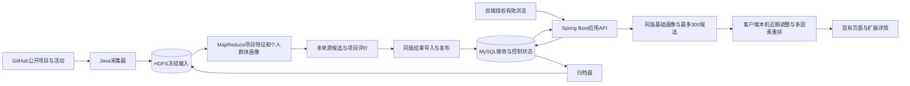

# HappyGit 下一代应用迭代方案

审阅草案，2026-11-03。现状依据见[当前完成情况清单](2026-11-03-完成情况清单.md)。本方案供用户确认方向、范围和顺序，尚未批准执行；它补充 2026-10-29 的[第一版设计](../design/v1/README.md)，批准后再同步修改具体 SDD、契约和函数设计。当前不修改算法实现、合并分支、启动服务、部署或发布。

建议把下一代称为 HappyGit V2，定位为：**面向学习与实际使用的开源项目发现和推荐应用，综合用户兴趣、明确需求、项目实用性、工程质量证据、维护情况和热度，并保留未来参与贡献的入口。** 用户应看得到推荐依据、数据时间和局限；热度与兴趣都只是其中一部分。

## 一、选择什么迭代方向

| 方向 | 内容与收益 | 成本及取舍 |
| --- | --- | --- |
| A 分阶段完成 Hadoop 主链与多因素推荐，建议采用 | 保留双端界面，先接通服务端批量画像和候选，再完善实用性/质量与本机微调 | 需要新增服务端存储、采集和作业工程，但每阶段都有可验收结果，符合原课程要求 |
| B 只改善现有本地推荐 | 可较快修复候选和排序，补充项目信息展示 | 无法实现已确认的 Hadoop 主链，仅可作为 A 的基础整理阶段 |
| C 同期引入 Spark ALS、贡献机会和大范围界面改版 | 功能范围更大 | 在尚无中心数据链的情况下同时增加数据、模型与页面风险，首轮不建议 |

推荐 A，并把已有代码复用与基础问题整理作为起点。MapReduce 继续承担正式画像和候选计算，保持原需求；不因为对比项目采用 Spark 就更换主框架。贡献任务发现可在核心版本验收后加入，ALS 则取决于真实交互覆盖和实验结果。

## 二、V2 核心版本交付什么

用户保留现有 Windows/Android 应用和发现/个人页结构。进入发现页，可以在综合推荐中看到适合自己的项目，查看兴趣匹配、用途、文档/工程证据、维护与关注情况；也可以使用公共探索查看非个人候选。项目详情展示安装/示例线索、许可证标识、采集时间、近期维护信息和原始链接。

个人页展示正式个人画像及证据，群体区域展示合法聚合样本的技术分布。开启云端分析后，逐次有效浏览通过可靠队列上传并进入后续画像；尚未进入当前画像的本机近期行为仍能影响本机排序。关闭云端分析时仍能访问公共项目，并按允许的本机输入进行近期调整。

增加一个可选的“学习/使用”用途偏好与少量明确技术标签，用户不填写也能使用综合推荐。第一轮不增加复杂需求问卷、不承诺自动评估代码安全，也不承诺判断某库与用户工程一定兼容。新关键词的全库搜索与周期性个性化召回分别标识，不能把当前 300 项重排描述成即时搜索全站。

核心版本不包含自动 PR、贡献任务接单、运行任意项目验证质量、LLM 全文评审、私有仓库接入或 ALS 训练。这些能力不是接通当前主链的前提。

## 三、整体架构怎样演进



沿用 server/collector/mapreduce 三个工程边界和 HDFS、MySQL、SQLite 三层存储。server 提供新 `/api/v2` 的应用身份和业务读取；collector 负责公开采集、归档、运行编排和发布；mapreduce 承担固定输入下的项目向量、个人/群体画像、公共排名和召回。正式结果由 generation 原子切换，客户端按版本缓存。

当前网页登录只证明本机网页账号；V2 云端身份通过服务端 OAuth 独立核验，不能把 Cookie 或 accountId 声明直接交给服务端作身份。界面仍可提供一个登录入口，但内部区分应用会话和执行 Star 的网页会话；恢复与切换后核对两者账号一致。普通用户不配置服务地址或 Client Secret。

原 v1 固定特征空间、90 天基础画像、近 7 天本机增量、accepted/exported/processed 三类水位、删除后的 discard 接续和隐私 epoch 继续采用。新增业务维度必须与基础向量分开定义，避免将质量和热度直接掺进“用户兴趣”坐标，导致画像含义改变。

## 四、把推荐目标落实为独立维度

| 维度 | 具体含义 | 第一轮可用证据 | 设计边界 |
| --- | --- | --- | --- |
| 兴趣匹配 I | 与长期及近期技术方向接近 | 同版语言/topic/文本向量、授权行为 | 仍由既有内容画像主链计算 |
| 明确需求 D | 用户明确的用途和技术标签是否相符 | 可选学习/使用偏好、明确标签与项目用途词典 | 无明确输入时为 null，不假装知道用户任务 |
| 实用性 U | 项目是否提供可理解的上手与使用线索 | 安装说明、用法说明、示例入口、适用环境说明 | 证明线索存在，不证明示例能在本机运行 |
| 工程质量证据 Q | 可观察的规范和成熟度证据 | 许可证识别、版本发布情况、测试/工作流文件存在性等 | 标为代理评价；文件存在不等于测试通过或代码质量优良 |
| 维护情况 M | 是否持续维护及观测到的更新 | pushedAt、公开 release 时间、实际观测窗口 | 不只使用 updatedAt；缺少数据不推断无人维护 |
| 关注度 P | 社区关注规模和可验证增长 | Star 数；有两次同口径快照才计算增长 | 不再把 Star 命名为 qualityScore |

每个维度都保存 score、coverage、evidence、observedAt 和 ruleVersion。输出分数是项目比较的排序依据，不是成功率、喜欢概率或整体质量认证。对完整采样才可认定的“没有示例/没有文件”，必须先确认该次采样范围；接口失败或未采集记 unknown，不填成已知 0。

同一个原始证据只按约定进入一个维度：安装/示例属于 U，许可证和测试/工作流存在性属于 Q，更新时刻属于 M，Star 属于 P。README 内容用于兴趣投影与抽取使用线索时，分别保存其用途，不能把同一个“README 存在”同时累计成多个质量加分项。

仓库元信息、发布记录和文件内容来自公开接口及受控采集。采集限流、分页和条件请求按实际响应执行，不为每个用户刷新重新扫描项目。可用字段与请求边界参考 [GitHub 仓库接口](https://docs.github.com/en/rest/repos/repos#get-a-repository)、[发布记录接口](https://docs.github.com/en/rest/releases/releases#list-releases)和[REST 最佳实践](https://docs.github.com/en/rest/using-the-rest-api/best-practices-for-using-the-rest-api)。以上分维度和打分规则是本项目待审阅设计，不是 GitHub 提供的质量评分。

### 分数先怎样组合

建议综合模式的初始参数为 `I=0.35、D=0.20、U=0.15、Q=0.15、M=0.10、P=0.05`，只是开发起点，需在验证集上选择，不作为效果结论。缺失分量按实际可用权重归一化，同时显示证据覆盖；用户无画像和明确需求时，公共结果使用 U/Q/M/P，不虚构兴趣。

```text
baseScore = Σ(可用维度权重 × 对应score) / Σ(可用维度权重)
finalOrder = 本机兴趣调整后重新评分，再做已看降权与MMR多样性重排
```

用途偏好第一轮改变 D/U 的具体解释和推荐理由，不立即维护多套任意权重表。明确用途和标签先作为带 revision 的用户配置进入下一次服务端快照；在新候选尚未生成时，客户端仅重排现有候选，并说明覆盖范围。搜索接口仍可做独立项目检索，但不现场训练正式个人画像。

## 五、候选召回也必须调整

原 v1 的 J11 主要返回相似度最高的 300 个项目。如果某个实用、维护良好但兴趣相似度略低的项目没有进入这 300 项，客户端再增加质量权重也无法推荐它。因此 V2 不仅修改最终评分，还要增加互补来源。

建议首轮的内部候选预算如下。它们是上限，不要求凑满；并集按 repoId 去重，最多 600 个，仍只向客户端下发最多 300 个。

| 候选来源 | 初始上限 | 如何产生 |
| --- | ---: | --- |
| 内容兴趣 | 200 | J11 用户向量与项目向量精确匹配 |
| 明确用途/标签 | 150 | 在冻结项目目录中按已确认用途/标签匹配，形成同一批次输入 |
| 实用性与工程证据 | 100 | U/Q/M 的公共排名，经个人隐藏/本人项目过滤 |
| 热门探索 | 100 | 关注度及可验证增长排名，保留公共来源 |
| 多样性探索 | 50 | 从已有项目目录的不同领域稳定选择，固定seed且排除已选项 |

没有 D 输入时不生成该路，实际预算可以少于 600。排序前统一排除确认不公开、已归档、本人仓库及隐藏项；Star 继续表示兴趣，不自动等同于永久排除。先形成互补候选池，再在服务端按同版基础画像和项目评价筛到 300；客户端用本机增量重新计算 I 并排序，不能从未下发的项目中召回。

项目评价在 J06 的项目级计算中输出，按来源/用途的公共池由 J12 扩展；J11 增加用途候选，发布前合并各路。个人/群体画像的 J07—J10 不需要改成 ALS。后续函数级设计需明确各路 Top-K 的键、比较器和内存预算，不把这一段当作已经实现的新作业。

该变化需要升级模型/契约：建议 `mr-content-v3`，新增 evaluationVersion 与 evaluations，recallSource 扩展为 similarity/intent/quality/popular/exploration，原 qualityScore 明确迁移为 popularityScore。300 项包上限、完整 Repository DTO、featureSpaceVersion 和处理水位继续保留。新旧模型不靠改一个版本字符串互相冒充。

## 六、开发按六个里程碑推进

| 阶段 | 实施范围 | 完成后能看到什么 | 集成验收标准 |
| --- | --- | --- | --- |
| M0 基础整理 | 修复候选契约和 DTO 丢失、已有重排问题；整理登录/构建/文档代际；保留旧库 | 现有应用的边界明确，基础问题不继续带入迁移 | develop 上核对当前真实登录入口、页面数据、历史与候选；旧报告标注版本，不伪装重新通过 |
| M1 中心身份与数据接入 | 应用会话、MySQL 迁移、设备注册、SQLite v3事件/outbox、公开采集与HDFS归档 | 一条授权事件有持久ACK，并能追到闭合HDFS文件 | 重发不新增、缺号不确认、旧epoch不重灌；用户未授权时不上传；完整集合分页中断保留旧代 |
| M2 集群画像主链 | 固定输入、J01—J10、同版项目向量、个人与群体画像 | 在真实HDFS/YARN上产出画像和群体统计 | 固定样本手算一致；至少两worker有实际task；空用户不消失；样本人数和数据来源可追溯 |
| M3 多因素候选与发布 | U/Q/M/P评价、J11/J12多路候选、同代导入发布、公共冷启动 | 可从API取得完整画像、评价证据及最多300候选 | 不重复计Star为质量；同代画像候选水位一致；隐私变化拒绝旧输入发布；候选来源/覆盖可解释 |
| M4 双端接入与界面 | 同版包/词表缓存、近期微调、可信快照、固定分页、用途偏好、详情与群像 | 真实Windows和Android界面展示可追溯的推荐 | ACK不提前清增量；新画像接续不重复计权；换号旧结果不提交；隐藏不漏分页；离线缓存有时间 |
| M5 效果实验与交付 | 冻结模型、时间留出对比、性能记录、双端打包、部署说明和演示 | 一个版本、同一口径的安装包、结果与材料 | 对比公共热门/内容基线/v1/v2；报告真实数字和覆盖；升级保留历史，产物绑定提交/模型/数据版本 |

M0—M5 为建议的核心交付范围。M1、M2 是最大的新增工程量；M3 是本次产品目标修正的主要增量，M4 复用现有界面和原生壳。暂不承诺具体完成日期，先按每阶段验收结果推进；外部部署、GitHub配置和真机条件会影响日历进度。

功能开发使用 `feature/*`；B01 等已经存在的缺陷从 develop 开 `bugfix/*`。每个阶段相关功能合入 develop 后集中联调，发现缺陷再开 bugfix，不在每次文档或可逆界面调整后重复跑整套测试。main 只接收已集成并具备发布证据的版本，不在本次审阅阶段操作合并。

## 七、效果怎样证明

先交付小样本闭环，再扩大数据。沿用原规范的 pilot 50 用户/240 项目/5000 有效打开和 standard 1000/3000/20万作为合成实验目标；当前尚无这些输入的交付证明。真实公开项目与真实授权用户另计来源，不用合成账号数字冒充真实用户规模。

同一固定输入比较公共热门、内容兴趣、旧 v1 权重与 V2 多因素方案；V2 再做移除 U/Q、移除本机微调的对照。时间留出时只使用推荐时刻已经可获得的项目评价、公开快照和行为，不能拿今天的 Star/维护状态解释历史时刻推荐。训练/验证/测试及任何参数选择分开，测试集不反复调权重。

报告 Recall@300、NDCG@20、目录/领域覆盖、已知低证据项目占比、候选来源占比及各维度覆盖。未来访问只能衡量行为命中，不能直接证明实用性；另外采用固定任务样例和用户评价核对安装/示例线索是否有帮助，注明评价者、样本数和标准。不得预先宣称新权重必然胜出。

性能沿用原设计作为待测目标：standard 全链20分钟内、包读取P95一秒内、300候选本机重排P95三百毫秒内，同时记录实际节点、输入分片、非零维度和包字节数。参数不能用目标值替换测量值；同一物理机的多虚拟节点也要说明共享资源。

## 八、核心版本之后的两个可选方向

**贡献机会发现建议作为 V2.1 独立迭代。** 先从当前候选目录的项目读取开放 good first issue，显示语言、标签、负责人状态、任务链接与采集时间，用户跳转 GitHub 确认后自行参与。Issues 接口可能返回 PR，采集时按 pull_request 字段剔除；这一点依据 [GitHub Issues 接口](https://docs.github.com/en/rest/issues/issues#list-repository-issues)。未分配不保证无人处理，不提供自动PR或合并承诺。核心主链验收后再批准此范围。

**ALS 建议作为 V2.2 的实验选项。** 先统计实际交互用户数、项目覆盖、稀疏度、冷用户/冷项目和时间留出正例，再决定是否值得训练。可以比较 MapReduce 可行的协同方法与增加独立 Spark 实验的代价，但不能以新增框架名称替代有效样本和效果验证。原 MapReduce 主链在没有此扩展时仍应完整运行。

## 九、执行前需要哪些条件

| 条件 | 默认规划 | 何时必须落实 |
| --- | --- | --- |
| API部署与GitHub身份配置 | 固定HTTPS入口，应用安装包预置公开地址，凭据只在服务端 | M1联调前；用户无需将secret粘贴到聊天或写入文档 |
| 数据平台资源 | 沿用control＋两个worker的Linux节点设计；虚拟节点可共享物理机并如实记录 | M1归档/M2真实集群验收前 |
| GitHub采集访问 | 有界公开采样、共享预算、条件请求，数据注明覆盖 | M1真实采集前 |
| Windows与Android设备 | 保留现有工具链；至少一台目标Android设备或可运行模拟器 | M4双端验收前 |
| 真实GitHub写入范围 | 仅在明确授权的专用测试项目执行Star/取消Star | 对应真实写入验收前，普通只读推荐不依赖此项 |

这些是后续阶段的依赖清单，本次不要求立即补齐。若平台资源暂缺，可开发固定输入的模块和协议，但必须将未完成的真实集群/真机验收保留为未完成，不用单机夹具代替。

## 十、本次希望确认的范围

建议批准的是方向 A 的 M0—M5：保留双端界面和 MapReduce 主线，完成中心数据链、多因素候选、项目证据展示与本机近期调整；贡献机会和 ALS 分别列为后续独立决定。综合权重、内部候选预算和阶段顺序是可修改的草案参数。

用户确认后，先将本方案细化为按阶段的函数/数据/迁移变更清单，补齐与旧 v1 不同的契约，再从 M0 开始执行。本次仅交付现状清单与待审阅方案，不因文档写完而启动开发。
