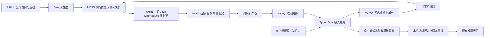

# HappyGit Hadoop 软件设计说明书

版本：2.0，2026-10-28。源码核对基线：`develop@74bf0d0`。状态：待实现设计。本文件与[前端 SDD](前端SDD.md)、[后端 SDD](后端SDD.md)、[数据库 SDD](数据库SDD.md)共同定义本次重构；本文负责计算口径、作业依赖和集群验收，不能作为集群已经部署或算法已经运行的证明。

## 1. 设计目标与现状

本次把 Hadoop 放到业务必经链路：服务端收集公开 GitHub 项目和活动数据，接收用户授权同步的 HappyGit 浏览日志，持久化到 HDFS；Java MapReduce 在 YARN 上完成清洗、特征工程、个人画像、群体画像和候选推荐；在线 API 读取已发布结果；客户端只根据近期尚未被该画像覆盖的本机记录微调向量和重排候选。正式画像及候选召回不使用 Python，也不在 Spring Boot 请求线程里重新计算。

当前 README 提到了 `mapreduce/`，但核对时仓库没有该作业工程。实际调用链位于 `client/src/stores/feed.js:61`：客户端创建快照、调用 Worker 生成画像、规划 GitHub 网页查询，再执行本地排序。`client/shared/recommendation/profile.js:138` 返回语言、topic 和兴趣标签，没有输出正式的用户高维向量；`rank.js:46` 的文本余弦分量却要求 `profile.vector`。因此本次不仅更换执行位置，也要补齐统一向量空间与完整的数据闭环。未发现已实现的群体画像模块，群体画像属于新增能力。

静态阅读还发现，`recall.js:69` 返回 `{queryPlan}`，而 `feed.js` 直接检查返回对象的 length，现有候选发现入口的契约并不一致。这些是源码层面可确认的问题，本次不顺带修改实现；新服务端候选包应直接替代这段正式召回调用，后续在 develop 联调验证。

原 `project.md` 中“服务端不参与正常运行、画像仅在本机生成”的约束被本组 SDD 的服务端方案替代；其前端框架、页面布局、账号隔离和本机存储原则继续使用。`数据集生成要求.md` 只是现有实验数据的生成规范，不能把其中的规模写成已经存在的数据。

方案选择已按课程要求确定为 Java MapReduce。三种边界的差别如下，后续开发以第一种为准。

| 方案 | 业务计算位置 | 结论 |
| --- | --- | --- |
| HDFS + YARN + Java MapReduce，API 发布结果，客户端微调 | 正式画像、群像和候选全部经过 MapReduce | 本次采用，作业输入、Shuffle、输出可直接用于课程验收 |
| Spark on YARN | Spark 负责大部分计算 | 不作为本次主实现，避免偏离已确认的 MapReduce 要求 |
| Hadoop 仅存文件或跑独立实验，页面仍用原本地算法 | Hadoop 不决定实际推荐 | 不满足本次目标 |

## 2. 集群与服务边界

课程部署基线采用 Hadoop 3.4.2、HDFS、YARN 和 MapReduce v2。Hadoop 守护进程、提交器及作业使用 JDK 11 运行，作业模块以 Java 8 字节码为编译目标；现有 Spring Boot 服务保持 JDK 17，两个运行环境分开。选择 3.4.2 是本设计固定的兼容基线，不是“最新版本”声明。Java 兼容范围依据 [Apache Hadoop Java Versions](https://cwiki.apache.org/confluence/spaces/HADOOP/pages/100827883/Hadoop+Java+Versions)。

拟建三个独立 Linux 节点，节点名是部署角色，不是已经存在的主机。可使用同一物理机上的三台虚拟机，但报告必须注明共享物理资源；单进程本地模式和单节点伪分布式只能用于开发，不能代替多节点验收。

| 节点 | 进程 | 初始资源预算 |
| --- | --- | --- |
| control | NameNode、ResourceManager、JobHistoryServer；独立进程运行 API、采集器、MySQL、作业提交器 | 4 vCPU、8 GiB 内存、80 GiB 磁盘 |
| worker-1 | DataNode、NodeManager，运行 Map/Reduce container | 2 vCPU、4 GiB 内存、80 GiB 磁盘 |
| worker-2 | DataNode、NodeManager，运行 Map/Reduce container | 2 vCPU、4 GiB 内存、80 GiB 磁盘 |

HDFS 副本数设为 2，对应两个实际 DataNode，默认块大小 128 MiB。每个 worker 初始向 YARN 提供 2 GiB、2 vcore，Map/Reduce container 各申请 1 GiB、1 vcore，Java heap 先设 768 MiB；资源参数必须随实际节点调整并记录。该规模没有 NameNode、ResourceManager 或 MySQL 高可用能力，属于课程部署边界。

YARN 负责 container 资源与作业执行管理，API 不直接管理某台机器上的 Mapper。职责划分依据 [YARN 架构说明](https://hadoop.apache.org/docs/r3.4.2/hadoop-yarn/hadoop-yarn-site/YARN.html)。集群管理端口只供部署网络使用，个人客户端只连接 HTTPS API。



爬虫属于服务端数据接入，不是 Hadoop 自带功能。HTTP 请求由 Java 采集器执行，结果成为 MapReduce 输入；Mapper/Reducer 不访问 GitHub，也不写在线业务表。这样任务重试不会重复发起外部请求或重复发布结果。

## 3. 输入数据与计算快照

数据源分为 `github_public`、`app_authorized` 和 `synthetic`。公开数据包括公开仓库元信息、README、公开 Star/本人仓库集合和可获取的公开活动。HappyGit 浏览日志只表示用户在本应用内执行的有效打开，来自客户端授权同步；不能通过爬虫获得用户在 GitHub 网站或外部浏览器中的完整浏览历史。

GitHub Events API 是有时间、数量和延迟边界的活动流，不是完整审计日志。采集器保存本次获取范围、分页完成情况及覆盖缺口，不能用缺失活动推断用户从未操作。接口限制以 [GitHub Events 文档](https://docs.github.com/en/rest/activity/events) 为准，部署时记录实际 API 版本及响应信息。

为延续当前本机历史语义，原生端仍执行“同账号、同仓库距上次计数至少 30 秒才增加一次访问”。只有增加计数的有效打开生成 `repo_open` 原始事件；30 秒内重复打开可以更新本机列表的最近访问时间，但不另发行为事件。服务端按事件身份去重，不再跨设备做第二遍 30 秒合并。因此这里的原始日志是有效打开事件，不是每一次鼠标点击。

每个事件携带 `eventId`、`deviceId`、`streamEpoch`、`deviceSeq`、`analysisEpoch`、`repoId`、`occurredAt`、`source` 和 `schemaVersion`。服务端补充内部 `subjectId`、`receivedAt`、接收状态及 payload 摘要。`deviceSeq` 在同账号、同设备、同 streamEpoch 中从 1 连续递增；所有 ID 在 JSON 中用字符串，时间用 UTC 毫秒整数。未解析到真实仓库 ID 的本机记录留在待解析区，不占用正式上传序号。

上传记录另有 `recordKind=open|discard`。discard 是本机删除待发送内容后的最小序号占位，没有仓库正文，J02 将其归入已忽略而非兴趣证据。服务端补充的 effectiveAt 是计算时间：正常使用 occurredAt，超过 receivedAt 5 分钟的未来时间改为 receivedAt 并记录修正；所有衰减使用 effectiveAt，原始时间仍保留。未开启上传的本机专用事件没有 deviceSeq，只用于客户端近期调整。

一次计算使用不可变的 `InputManifest`，包含 `runId`、固定的 `referenceTime`、90 天行为窗口、`catalogSnapshotId`、公开集合快照、偏好/隐藏记录快照、隐私版本、源文件路径及摘要、每个设备流的 `exportedThroughSeq`。Manifest 仅引用已经关闭并提交的 HDFS 文件。作业读 Manifest，不扫描一个持续变化的“当前目录”。

输入可以覆盖多个设备，但必须属于同一服务端核验账号。`synthetic` 有独立 namespace、subject ID 和发布通道，不与真实用户合并。旧 SQLite 中的聚合历史无法还原 eventId 和逐次时间，迁移时保留本机展示，不伪造事件补传；如将来导入聚合快照，必须另设事件类型及算法版本。

## 4. 统一高维特征空间

本版模型名为 `mr-content-v2`，固定维度为 8192。维数是设计参数，不表示当前已经有 8192 个有效特征。语言区间为 `[0,127]`，topic 区间为 `[128,1151]`，文本区间为 `[1152,8191]`；每块未使用的坐标保留为零。维度映射、IDF、技术词别名、分词词典、停用词、字段权重和截断参数一起组成不可变的 FeatureSpace 制品，内容摘要作为 `featureSpaceVersion`。

词表只根据冻结的公开项目语料建立，不能读取测试用户未来行为或实验隐藏标签。语言保留最多 128 项，topic 最多 1024 项，文本保留文档频率至少为 2 的最多 7040 项；选择时按 DF 降序、Unicode 码点顺序打破平局，选中后按码点顺序分配块内坐标。词表不足时不补假词，未登录词忽略并记录覆盖率。原客户端 `buildVocabulary()` 针对每批输入重新拟合的做法退出正式推荐链路。

文本先进行 Unicode NFKC 规范化、固定规则的小写转换，再按随制品发布的技术词典最长匹配；保留 C++、C#、.NET 等技术词。其他英文标识按固定字符规则切分，中文使用词典匹配并补充未命中片段的二元词组。Java 与 JavaScript 使用同一份规则版本和固定样例，不能分别依赖不一致的系统分词器。README 最多取规范化后的前 8000 个 Unicode 码点，避免两种语言按 UTF-16 code unit 截断产生差异。

对仓库 `r`，文本计数采用 name×2、description×2、topic 文本×2、README×1；每个字段中的词频均实际计数。令 `N` 为该快照项目数，`df(t)` 为包含词项的项目数，则：

```text
tf(r,t)  = 1 + ln(weightedCount(r,t))            # 仅对正计数定义
idf(t)   = ln((N + 1) / (df(t) + 1)) + 1
X(r)     = L2Normalize(tf(r,t) × idf(t))
L(r)     = 主要语言的 one-hot 向量；未知语言为零向量
T(r)     = 已知 topic 的均匀计数向量，再做 L2 归一化
x(r)     = L2Normalize(concat(sqrt(0.20)L(r), sqrt(0.30)T(r), sqrt(0.50)X(r)))
```

最终项目向量按绝对权重取最多 256 个非零坐标、按坐标排序，再做一次 L2 归一化。缺失字段对应的块为零，最后的整体归一化自然调整有效块比例；全空向量保留为空，不能除以零或生成随机向量。项目向量、用户向量和客户端微调必须引用完全相同的 `featureSpaceVersion`。

个人画像基于 90 天有效打开、当前完整公开 Star/本人仓库集合、允许使用的公开活动和手动兴趣。每个用户、仓库只输出一条证据汇总记录，初始权重如下，均为待用验证集调整的设计默认值。

```text
ageDays       = max(0, (referenceTime - lastCountedOpenAt) / 86400000)
browseWeight  = min(1 + ln(validOpenCount), 3) × 2^(-ageDays / 30)
               # validOpenCount = 0 时整项为 0
activityWeight = 0.5 × min(ln(1 + activityCount), 2) × 2^(-activityAgeDays / 30)
w(u,r)        = browseWeight + 3 × isCurrentlyStarred + 1.5 × isOwned
                + activityWeight
a(u)          = Σr w(u,r) × x(r) + 4 × manualTopicVector(u)
u_base        = L2Normalize(Top512(a(u)))
```

`activityCount` 只统计当前版本允许的公开 Push、Issues 和 PullRequest 活动，按 GitHub event ID 去重；Watch/Star 活动不与当前 Star 状态再叠加，私有、无法解析仓库和已隐藏项目不贡献正向兴趣。`manualTopicVector` 是已知手选 topic 坐标上的 L2 单位向量，空标签集合为零。手动标签原文可保留展示，但只有词表内技术兴趣进入向量。

画像还输出语言分布、topic 分布、前 8 个兴趣及每项最多 5 个证据仓库。分布使用上述仓库证据权重累计，topic 在单项目内先均分，手选 topic 总权重 4 均分；语言和 topic 各自做 L1 归一化。`topInterests.score` 统一等于对应的归一化 topic 权重，避免继承旧实现中原始累计分与概率形态混用的问题。输出描述只解释技术兴趣，不推断年龄、职业或能力等级。

## 5. MapReduce 作业划分

建议新增独立 `mapreduce/` Maven 工程，包根为 `com.happygit.hadoop`，包含 `io`、`model`、`jobs` 和 `driver`。Hadoop 依赖用 provided 范围；算法 JAR 不打包 Spring Boot。名称和路径是实施目标，当前仓库尚无这些类。

| 作业 | 输入和 Map 输出 | Reduce 职责及输出 |
| --- | --- | --- |
| J01 `RepositorySnapshotJob` | 多批公开项目观测 → `(repoId, observation)` | 按观测时间及稳定 ID 选冻结状态，输出公共项目快照；明确非公开的项目排除 |
| J02 `EventNormalizeJob` | 接入日志、GitHub 活动、撤回标记 → 事件身份键 | 应用事件按 `(sourceKind,subjectId,eventId)`、公共活动按 `(sourceKind,githubEventId)` 去重；过滤 epoch/撤回/窗口外及 discard，输出规范日志和忽略计数 |
| J03 `RepositoryTermJob` | 冻结项目 → `(repoId, 字段词频、语言、topic)` | 每项目合并一次词频；产生 term-frequency 及文档唯一词项 |
| J04 `DocumentFrequencyJob` | 每项目唯一词项 → `(namespace, term)` | 求 DF；Combiner 只执行整数求和 |
| J05 `FeatureSpaceJob` | DF 与语料数量 → `(namespace, term, df)` | 有界 Top-N 堆选词、稳定编号、输出词表和 IDF；规模小的字典归并允许单 Reducer |
| J06 `RepositoryVectorJob` | 项目词频 + 缓存的 FeatureSpace → `(repoId, x(r), displayMetadata)` | 以 Map-only 方式生成固定空间的项目向量及完整卡片字段 |
| J07 `UserRepositoryEvidenceJob` | 有效日志、完整集合、偏好快照 → `(subjectId, repoId)` | 汇总访问次数与末次时间、集合状态、活动和隐藏情况，输出 `w(u,r)` |
| J08 `UserVectorJoinJob` | 项目向量与用户仓库证据 → `(repoId, taggedRecord)` | Reduce-side join，流式输出用户的加权项目向量及解释证据 |
| J09 `PersonalProfileJob` | 用户向量贡献、手动兴趣及用户种子 → `(subjectId, contribution)` | 累加后一次性归一化，输出正式向量、分布、证据和处理水位；无证据用户也有空画像 |
| J10 `GroupPortraitJob` | 每用户一条正式画像 → `(cohortId, userSummary)` | 按用户而非事件数量聚合人数、分布和质心，输出群体报告 |
| J11 `CandidateRecallJob` | 项目向量分片 + 缓存的用户画像/排除集合 → `(subjectId, 局部Top300)` | 归并得到全局 Top300 相近项目；输出候选及余弦分数 |
| J12 `PublicRankingJob` | 冻结项目质量字段 → `(rankingKind, item)` | 生成独立公共热门候选，供冷启动使用 |

J08 的组合键为 `(repoId, recordKind, subjectId)`，按 repoId 分组、将项目向量排序在证据之前；同一项目下逐条读取用户贡献，不把热门项目的所有用户装进内存。手动兴趣和用户种子作为 J09 的独立输入，避免空历史用户在 join 后完全消失。

J09 的向量和、语言/topic 计数允许先局部求和，但归一化、Top512 和证据定额只在最终聚合执行。不能在每个 Mapper 先归一化再相加，也不能截断局部特征后宣称与全量求和等价。证据仓库按贡献分及 repoId 稳定选取。

每日生成一次公共语料快照和 FeatureSpace；小时级画像批次复用最近已完成的同版项目向量。逻辑依赖为 `J01→J03→J04→J05→J06`，`J02→J07`，`J06+J07→J08→J09→J10/J11`，`J01→J12`。首次运行必须完成整条链；复用的作业输出必须有相同输入摘要和版本，不能凭目录名字判断成功。

群体按主技术兴趣分组，首版采用随模型发布的 topic→领域映射，例如前端、后端、数据工程、机器学习、移动端、开发工具、安全及其他。每用户按领域权重总和选择唯一主群体，同分按固定领域 ID 排序；全空画像进入 insufficient_evidence，单独统计。这里是可解释分组，不宣称已经实现 K-means 聚类。

群体语言/topic 占比为各成员已归一化分布的平均值，分母分别使用该字段有效用户数，并同时返回群体总人数与字段覆盖人数。质心先平均成员单位向量，再归一化。每用户每仓库最多贡献一次“代表项目”支持人数，防止高频访问者主导群像。少于 10 个真实用户的群体不返回细分画像，只显示样本不足；合成数据可演示完整流程，但报告必须醒目标记数据来源。群体特征分析独立成立，不以强行影响每个人的候选为验收条件。

## 6. 服务端相似项目匹配

初始验收规模按现有数据规范的 standard 目标设计：1000 个用户、3000 个项目、20 万条有效原始打开事件；这些是待生成和核验的输入数量。该规模选择可解释的精确余弦 Top-K，不先引入近似向量数据库。1000×3000 约为 300 万次稀疏点积，可以完整报告实际耗时，不能据此声称支持千万用户。

J11 通过 `Job.addCacheFile` 分发冻结的用户向量和必要排除集合。Mapper 流式读取其项目分片，对每个非空用户向量计算 `dot(u_base,x(r))`，为每个用户维护大小 300 的最小堆；处理完分片后输出局部 Top300，Reducer 再按相同规则归并为全局 Top300。分布式缓存与作业组合机制参考 [MapReduce Tutorial](https://hadoop.apache.org/docs/r3.4.2/hadoop-mapreduce-client/hadoop-mapreduce-client-core/MapReduceTutorial.html)，具体算法和规模边界是本项目设计。

候选资格过滤先于 Top-K：仓库必须确认为 public、非 archived、有可用向量、不在本人仓库或隐藏集合内。公开 Star 项目允许保留，因 Star 表示兴趣而非永久排除。相似度必须大于零；同分按 repoId 的 UTF-8 字节顺序打破平局。局部与全局使用完全一致的比较器，所以任何全局前 K 项必然属于至少一个分片的局部前 K 项。最终只保留不同 repoId。

缓存制品的初始上限为 32 MiB，并记录反序列化后的 heap 占用；用户数、排除集合和 Top-K 堆的内存预算都要计入。当超出预算时，按 subjectId 稳定划分用户块，每块最多 1000 用户、制品不超过 32 MiB，分别提交同样的项目扫描任务，最后合并互不重叠的用户结果。复杂度仍是 O(U×R)，此扩展主要解决内存上限，不冒充近似检索或线性扩展。

正常画像候选数上限为 300。正相似度项目不足时返回实际数量和 `coverage=partial`；可以另外附加公共热门补充项，但必须标记 `recallSource=popular` 且总包仍不超过 300。空向量使用 J12 结果，`mode=cold_start`，不生成虚假相似度。客户端无法从未下发的全站项目中发现新候选，其短期兴趣大幅变化需要下一轮服务端召回覆盖。

候选包含完整卡片所需 Repository DTO、稀疏向量、`serverSimilarity`、`qualityScore`、`freshnessScore` 和可追溯理由。初始 `qualityScore=min(ln(1+starCount)/ln(10001),1)`，未知 Star 值保留 null；`freshnessScore=2^(-daysSinceUpdate/180)`，未知更新时间为 null。这些是排序信号，不宣称项目质量或增长趋势的客观评级。

## 7. 发布、水位与客户端接续

服务端持久接收的连续序号叫 `acceptedThroughSeq`；已经进入闭合 HDFS 输入的叫 `exportedThroughSeq`；正式发布画像覆盖的叫 `processedThroughSeq`。前两者只表示存储进度，只有最后一个能作为客户端取消本机增量贡献的依据。水位必须按 `(deviceId, streamEpoch)` 返回，不能只返回一个全局时间或设备共用数字。

处理水位来自本次 Manifest 的完整输入边界，只有对应作业成功且所有范围内事件都有已使用或已忽略的确定处置后才能发布。窗口外、合法撤回或缺少仓库特征的事件可以被明确忽略，但必须计入分类计数；缺失特征事件会在后续完整窗口重算中再次评估，不因为前一次未使用就永久丢失原始记录。

每条流的接续同时记录上一代已经确认的处理前缀和本轮新增范围，新增序号从旧 processedThroughSeq+1 到本次 exportedThroughSeq 必须完整。个人画像仍从当前 90 天有效窗口重建；已过窗口的新增事件明确终结为忽略，而不是因文件缺失被静默越过。首次计算从流起点建立前缀，无法确定处置的缺口阻止发布新水位。

结果发布器先校验 HDFS 产物与 `_SUCCESS`，导入 MySQL staging generation，然后检查项目/用户引用、向量版本、候选上限、输入数量守恒和隐私版本。通过后在一个事务中切换在线 `active_generation`。Mapper/Reducer 只产出 HDFS 文件，不自行更新线上指针。作业重试使用相同输入及新的 attempt 路径；成功后输出目录固定，不覆盖正在服务的 generation。

客户端获取同一 generation 中的基础画像、候选和水位，选取近 7 天 `deviceSeq > processedThroughSeq` 的本机有效打开，按同版项目向量形成短期方向。已经上传但尚未被新画像覆盖的日志仍在这个集合内，这比字面上的“未上传”更能保证连续性。

尚未获准上传而没有 deviceSeq 的本机专用事件也可参与当前设备的近期调整，但不补传旧历史。客户端以本次固定 now 计算非负 ageDays；已经收到的时间修正优先使用 effectiveAt，未确认且明显超前的时间先夹到本次 now，不让未来时间产生放大权重。

```text
d_local = Σe [2^(-ageDays(e)/3) × x(repo(e))]     # 最近7天、未被基础画像覆盖
delta   = L2Normalize(Top512(d_local))
alpha   = min(0.25, 0.05 × usableEventCount)
u_local = L2Normalize(Top512((1-alpha)×u_base + alpha×delta))
```

无有效增量时 alpha 为 0；基础画像为空而 delta 非空时 alpha 为 1，并标注“本机近期调整”；两者都空时保持公共排序。客户端只能使用同版特征，不能拿旧 FeatureSpace 下的向量直接相加。未命中本机项目向量时，可按已下载字典从本机公开项目文本投影；仍无可用特征则本次忽略并显示较低覆盖率，不上传这次微调向量。

例如基础画像水位为 100，本机新增 101—105；上传 ACK 到 105 后这五条仍参与微调。只有新 generation 把处理水位提升到 105，才同时替换基础画像并移除它们的增量贡献。事件时间早于画像生成时间、但序号晚于水位时同样参与，不以时间戳错误排除迟到上传。

## 8. 调度、存储与运行证据

采集器按照接口分页、条件请求和限流响应调度，日志归档按最多 5 分钟或 64 MiB 封闭一批；后续合并碎片为目标 64—128 MiB 的可切分文件。HDFS 面向吞吐型批处理，因此不为每个事件或每个用户建一个微小文件，设计依据见 [HDFS Architecture](https://hadoop.apache.org/docs/r3.4.2/hadoop-project-dist/hadoop-hdfs/HdfsDesign.html)。详细目录、格式及保留期由数据库 SDD 定义。

公开项目语料默认每日北京时间 03:00 冻结；个体画像、群像和候选默认每小时调度一次。正常在线请求只读取最新已发布版本，刷新按钮不为每个用户启动一串 MapReduce 作业。答辩时允许维护者显式提交一次完整批次，固定输入并展示端到端变化，不能把批处理描述为毫秒级在线计算。

Job Driver 记录每个 jobId、applicationId、输入摘要、配置摘要、起止时间、Map/Reduce 数量和 Counters。依赖作业失败则终止该 generation 的后续发布，保留上一版结果并显示更新时间；不在 API 中偷偷调用旧本地画像算法补成“新 Hadoop 结果”。

必要 Counters 包括输入事件数、重复事件数、窗口外数、撤回数、缺失项目特征数、有效证据数、画像数、空画像数、群体人数、候选数和点积次数。分类应互斥，满足 `输入=重复+忽略+有效`；原始 GitHub 活动和本机打开分别统计。只检查影响结果正确性的结构、引用和版本，不增加与业务无关的环境异常探测。

这个守恒关系在每个作业入口分别核对：J02 的有效表示结构和来源有效，J08 的缺失项目特征是后续 join 结果，不能把不同作业的计数混加成一个分母。隐私、窗口和 discard 同时适用时按固定优先级只计一个主要忽略原因，其他原因作为附加诊断保存。

## 9. 开发顺序与课程验收

先完成数据契约、HDFS 输入归档和 J01—J06，再完成 J07—J10，之后实现 J11/J12 与结果发布，最后接入客户端重排。开发分支可按 `feature/hadoop-foundation`、`feature/hadoop-profile`、`feature/hadoop-recall` 划分，不使用额外前缀。按项目要求，功能分支合入 develop 后集中做联调和实验；发现问题另开 bugfix 分支，不在每次文档或低风险修改后重复运行完整测试。

验收首先证明数据确实经过集群：从一条授权事件追溯本地 eventId、服务端 ACK、HDFS 文件、J02/J07/J09 作业、画像水位、J11 候选及客户端显示。再证明分布式执行：记录至少两个 worker 上实际运行的 task attempt，保存 YARN/JobHistory 的作业记录和 HDFS 副本位置。只有一个 Mapper 或单节点执行时应如实记录，不能只凭管理页面出现两台节点就判定计算已分布。

| 验收对象 | 需要的实际证据 |
| --- | --- |
| 个人画像 | 同一冻结输入的向量、分布、证据仓库、模型及词表版本；空输入保持为空 |
| 群体画像 | 用户级聚合与独立小样本手算一致；人数、有效分母及合成/真实来源明确 |
| 候选匹配 | 在有足够相似项目的输入上最多 300 条去重结果；与同口径单机精确 Top-K 对齐 |
| 本地微调 | 保持候选包不变，新增本机日志后顺序变化；上传 ACK 不重复计权，水位更新后接续正确 |
| 发布一致性 | 任一上游作业失败时不切换 generation；隐私撤回后不再发布旧输入结果 |
| 多节点 | 真实 task host、运行时间、Shuffle 字节与副本信息；注明虚拟机和物理资源关系 |

性能报告写明数据量、非零特征数、节点资源、作业总耗时、候选包大小和客户端重排耗时。初始目标为 standard 全量作业链 20 分钟内、缓存候选包 API P95 1 秒内、300 条候选在目标客户端的重排 P95 300 毫秒内；这些是测量目标，当前没有结果，不作达标声明。

推荐效果采用按时间划分的历史/未来留出，比较公共热门、仅服务端画像、服务端画像加本机微调三种方法，并报告 Recall@300、NDCG@20、覆盖率及候选内排序改善。未来行为不得参与词表调参或当前用户画像；本机微调只能使用推荐时刻已经发生的记录。合成数据结论仅说明机制可运行，不等于真实用户效果。独立的数据生成脚本即使使用 Python，也只能准备实验输入，不能产生正式个人画像或替代任何 MapReduce 作业。

本文件交付的是计算设计。实际 Hadoop JAR、集群部署、实验数据生成、作业运行和以上验收均须在后续实现后完成。
