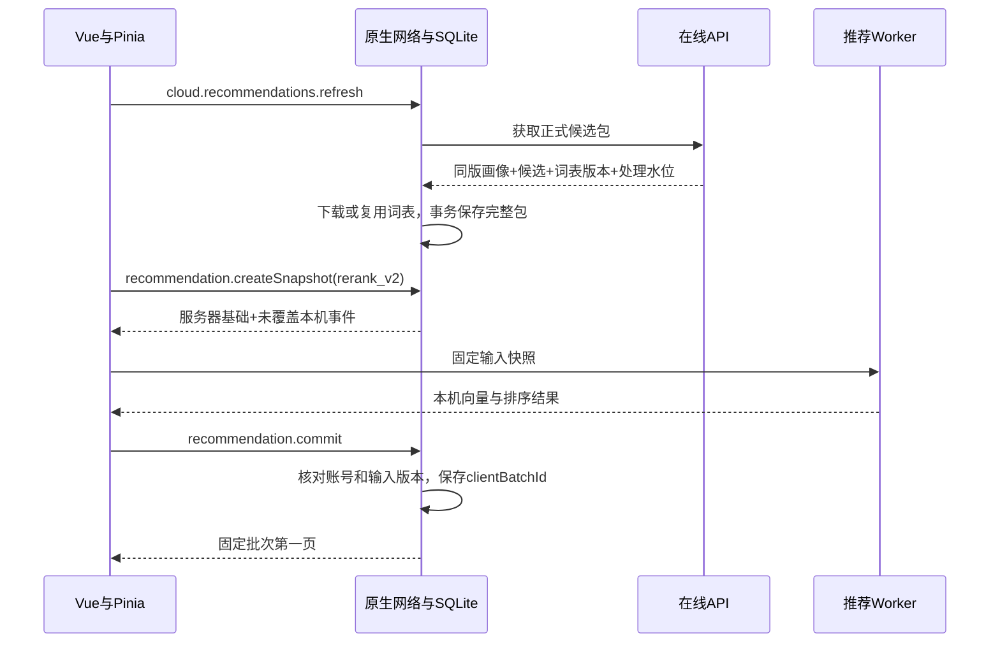

# HappyGit 前端软件设计说明书

版本：2.0，2026-10-28。源码核对基线：`develop@74bf0d0`。状态：待实现设计。本文覆盖 Vue 页面、Electron/Android 客户端桥接、本机增量微调和展示状态；在线协议见[后端 SDD](后端SDD.md)，持久化见[数据库 SDD](数据库SDD.md)，正式画像与召回算法见[Hadoop SDD](HadoopSDD.md)。本次只写设计，没有改动页面或业务代码。

## 1. 现有界面与保留范围

当前前端使用 Vue 3、Pinia 和现有样式体系，Windows 为 Electron，Android 为 Capacitor 原生壳。`client/src/App.vue` 负责发现与个人页面，`TrendingView.vue` 提供推荐/热门切换与项目卡片，`ProfileView.vue` 提供账号资料、技术兴趣、历史、Star 和本人项目，设置及登录通过现有弹窗完成。

本次保留页面外框、导航位置、卡片布局、配色、头像区、底部导航、项目操作和弹窗结构。变化集中在数据来源、画像区域内容、同步状态与推荐计算职责，不增加独立的后台仪表盘来替换现有客户端。

当前源码没有完整的“群体画像分析”组件；个人页现有技术兴趣标签也不等于已经完成正式画像可视化。因此新增群像展示放在个人页现有技术兴趣区域内部，通过“个人画像 / 群体分析”局部切换承载，保留主导航和历史/Star/项目三个原页签。

实际计算链位于 `client/src/stores/feed.js:61`、`client/src/services/recommendation.js:64` 和 `client/src/workers/recommendation.worker.js:19`。当前是客户端生成画像、生成 GitHub 查询计划、读取候选、再次本地排序；新链路改成读取 Hadoop 已发布的基础画像与候选，再在 Worker 内进行有限的本机微调。当前未发现 Python 画像运行路径，本次不会新增这一依赖。

## 2. 页面行为与状态表达

发现页继续使用原项目卡片。推荐页签展示服务端候选经本机调整后的结果，热门页签展示公共结果；原 Star 和打开仓库操作位置不变。推荐理由优先使用真实匹配的技术兴趣，若只是公共热门则标注公共来源，不显示“与你高度相似”等没有依据的文案。

个人画像面板展示正式基础画像的技术语言占比、主要 topic、前 8 项兴趣及可展开的证据项目。标题说明“根据已同步的公开项目和授权浏览记录整理”，同时展示最近更新时间和数据范围。本机微调单独显示“已结合本机近期浏览调整推荐”，不会覆盖服务器基础画像，也不把本机结果重新包装为新的服务端画像。

群体分析面板展示样本人数、技术领域分布、主要语言/topic、字段覆盖人数和统计时间。数据来自服务端聚合结果，客户端不收集其他用户明细来现场统计。真实群体少于 10 人时只显示样本不足；实验通道明确显示“合成实验数据”，不能与真实用户人数混合。

设置弹窗保留“记录本机历史”和本机清理操作，在同一区域增加云端画像/同步开关及云端清除入口。旧用户迁移后默认不上传；开启前说明上传的是 HappyGit 内的有效浏览记录，已有旧聚合历史不会自动补传。用户不需要配置 Hadoop、MySQL、服务地址或算法参数。

| 状态 | 页面表现 | 客户端动作 |
| --- | --- | --- |
| 游客或未开启云端画像 | 可看公共热门；不声称已生成服务器个人画像 | 不上传行为，不创建虚构账号 |
| 服务器尚无正式画像 | “画像整理中”，保留公共项目入口 | 按服务建议时间刷新，不循环启动计算作业 |
| 有正式画像与候选 | 显示真实更新时间，正常呈现个性化推荐 | 原生缓存后交 Worker 微调 |
| 日志已上传、尚未进入画像 | “部分记录等待更新”，仍可显示本机调整结果 | 保留这部分事件的增量贡献 |
| 临时离线 | 显示允许使用的最近缓存及其时间 | 原生保留 outbox，恢复后续传 |
| 词表或协议不兼容 | 保留仍可用的完整旧包，说明需要更新或稍后重试 | 不混合两个版本的向量 |
| 候选不足 | 展示实际条数，可明确补充公共热门 | 不复制项目凑够 300 条 |
| 账号切换、隐私重置 | 清除旧账号内存视图和旧计算结果 | 取消旧上下文任务，重新建立有效快照 |

本机清空不会被文案描述为云端删除。云端清除处理中可显示“已停止使用，正在清理历史数据”，完成程度由真实状态决定。界面只呈现用户能理解的更新时间、覆盖范围和同步状态，不展示 JAR 名、HDFS 路径、原始 8192 维数组或内部任务 ID。

## 3. 客户端模块设计

Vue 组件只负责交互与展示；Pinia 维护当前账号和展示批次；service 组织业务流程；原生层负责网络凭据、服务器请求、日志上传和 SQLite 事务；Web Worker 负责向量微调与候选重排。两个客户端共用 JavaScript 微调逻辑，正式画像留在 Java MapReduce。

| 当前文件或目标模块 | 本次职责调整 |
| --- | --- |
| `src/App.vue` | 保留外框和导航，初始化原生账号与缓存状态 |
| `components/TrendingView.vue` | 复用卡片，显示候选来源与状态，稳定读取一个 clientBatchId |
| `components/ProfileView.vue` | 在技术兴趣区嵌入个人画像/群体分析局部面板 |
| 拟新增 `components/PortraitPanel.vue`、`CohortPanel.vue` | 分别展示个人证据与群体聚合，不持有数据库连接 |
| `components/SettingsModal.vue` | 保留本机设置，加入云端范围和同步状态 |
| `stores/user.js` | 区分服务端登录身份、GitHub 网页操作会话、云端同步状态 |
| `stores/feed.js` | 从“本机画像→网页搜索→排序”改为“服务器候选包→本机微调→展示” |
| 拟新增 `stores/portrait.js` | 保存个人/群体面板的同版数据与加载状态 |
| `services/recommendation.js` | 创建 rerank_v2 快照、调 Worker、受版本约束地提交 |
| 拟新增 `services/cloud.js` | 通过固定原生操作名读取服务端结果和触发同步 |
| `workers/recommendation.worker.js` | 只执行同版增量向量融合和候选排序 |
| `shared/recommendation/features.js` | 增加读取冻结字典的投影能力；正式链路不调用 buildVocabulary |
| `shared/recommendation/profile.js`、`recall.js` | 原正式画像/网页候选规划从新链路退出，按实验基线保留 |
| Electron `ipc-router.cjs`、数据库 worker；Android `HappyGitPlugin`、`LocalRepository` | 实现同一原生契约、HTTP 调用、事件队列和 v3 迁移 |

公共 GitHub 网页解析可继续服务于显式网页操作与已有兼容功能，但不再由客户端依据完整个人画像搜索全站项目作为正式召回。候选列表必须能追溯到 Hadoop 发布的服务器 batchId，不能在加载失败后悄悄用旧算法替换而仍称同一个结果。

## 4. 原生接口与统一快照

沿用现有 `invoke(operation,payload,contextId)` 和 `capture()` 形式，不把任意 HTTP URL、SQL 或脚本执行能力暴露给页面。登录入口仍由 session 服务组织，内部改为服务端 OAuth；GitHub 网页 Cookie 保留在原生受控会话中，仅在执行 Star 等显式操作时核验账号一致性。

| 原生业务操作 | 输入与返回 |
| --- | --- |
| `cloud.sync.readState` | 当前账号；返回本机待上传数、已接收/归档进度和已发布处理水位 |
| `cloud.sync.flush` | 当前上下文；提交已有 outbox，返回状态，不生成新画像 |
| `cloud.recommendations.refresh` | 获取同一服务器 generation 的画像、候选、水位并事务缓存 |
| `cloud.portrait.read` | 按 generationId 读取本账号正式画像缓存 |
| `cloud.cohorts.read` | 按 generationId 读取群体报告或从服务器刷新 |
| `account.savePreferences` | 扩展云端同步、手选标签修订；本地停用立即生效 |
| `cloud.privacy.request` | 显式云端清除操作，返回 privacyRevision、analysisEpoch、处理状态 |
| `recommendation.createSnapshot` | `{purpose:'rerank_v2',serverBatchId}` → 一致计算快照 |
| `recommendation.commit` | 计算结果与原生保存的 inputId 对照，合法后写本机展示批次 |
| `recommendation.list` | `{clientBatchId,afterPosition,limit:20}` → 固定批次下一页 |

现有推荐 service 的 offset 分页在新模式调整为固定 position 游标，避免隐藏某一条后数组缩短，后续页漏读项目。旧调用保留在旧模式兼容层，新模式的接口名虽然可复用，但 payload 和 purpose 必须显式区分。

计算快照包含 accountId、contextId、inputId、serverBatchId、generationId、modelVersion、featureSpaceVersion、privacyRevision、analysisEpoch、deltaRevision、固定 now、基础画像、完整候选 DTO、对应项目向量、processedThrough、本机近 7 天有效事件以及本机隐藏/本人仓库集合。原生层在一次事务中读取这些对象并登记 inputId，Worker 不能自行打开数据库补读另一版本。

Worker 输出 clientBatchId、本机临时向量、固定顺序的 items、计算版本和输入标识。原生提交前重新核对 inputId 中保存的版本，而非仅信任 Worker 回传的字段。若用户换号、清理历史、更新隐藏项或候选包已变化，返回 INPUT_CHANGED 并放弃该结果，最多立即合并重算一次，避免持续变化时无界重试。



## 5. 本机事件与同步边界

用户在卡片点击“打开”并成功发起仓库访问后，原生层按当前 30 秒计数规则更新历史。每个有效计数生成一个本机事件；不以页面曝光或网络预加载冒充用户访问。应用只知道成功发起了外部打开，无法据此声称用户阅读了几分钟或浏览了 GitHub 的其他页面，首版不使用这种不可观测停留时长作为特征。

有效事件在 SQLite 中有 eventId 和 localSeq。只有云端同步已开启、账号已核验、repoId 已解析且 analysisEpoch 当前有效时，才分配 deviceSeq 并写入 outbox。没有上传序号的事件仍可在允许范围内参与本机近期微调；它们不会在用户日后开启云端同步时自动变成待补传历史。

应用处于可运行且联网状态时，累计 100 条或经过 5 分钟触发一次同步，单请求最多 500 条、1 MiB。Android 后台被系统暂停时允许延迟，不能承诺应用被终止后仍持续上传。发送从最早未确认序号开始，成功后更新 ACK；失败保留数据，按服务端限流或网络恢复条件继续。

服务器返回 timeAdjustments 时，原生层保存对应 effectiveAt，后续衰减使用修正后的计算时间；事件原始时间和 payloadHash 不改动。尚未确认的未来时间以本次固定 now 为上界，避免时钟超前放大短期权重。

本机增量必须覆盖“未上传”和“已经上传但尚未进入当前服务器画像”两部分。对有上传序号的记录，只看对应流的 processedThroughSeq；对本机专用记录，确认没有被删除且位于近 7 天即可。已上传标志、acceptedThroughSeq 和 generatedAt 都不能用来直接排除增量。

本机清空或删除历史立即移除相关微调输入和展示数据。仍在 outbox 中的已分配序号转为 discard 占位，保留原摘要以结束该序号，不再上传被清除内容；如果此前已被服务器收到，本地清空不撤回那份云端数据。用户选择云端清除时，则以新的 analysisEpoch 废弃旧流，并按照新的服务端状态恢复后续同步。

例如旧画像覆盖 seq=100，用户新增 101—105 后重排；即使上传 ACK 已到 105，本机仍保留这五条贡献。新候选包覆盖到 105 时，原生事务同时替换基础画像、水位和候选，随后重建本机增量，不能先清空增量再等待另一请求取得新基础画像。

## 6. 向量微调与最终排序

正式基础向量为 Hadoop 输出的 8192 维稀疏向量，最多 512 个非零项；项目向量最多 256 项。Worker 只使用对应 featureSpaceVersion 的坐标和参数，不针对当前 300 条候选重建词表，也不训练新的长期个人画像。

对近 7 天尚未覆盖的有效事件，按三天半衰期累计同版项目向量，取最多 512 项并归一化得到 delta。alpha 为 `min(0.25,0.05×usableEventCount)`，本机向量为归一化后的 `(1-alpha)×u_base + alpha×delta`；公式及空向量规则以 Hadoop SDD 第 7 节为准。客户端每次从基础和未覆盖事件重新计算，不把上一次微调结果继续加一遍。

本机刚打开的项目可能不在当前候选里。若有该项目同版缓存向量则直接使用，否则按冻结的 FeatureSpace 对本机公开文本投影，不能向服务端发送“我要微调的整个近期向量”来换取结果；没有足够本地字段时本次忽略该事件并记录特征覆盖情况。服务端并未覆盖的本机记录因此仍留在本机。

候选重排先剔除本机隐藏项、确认不公开/已归档项目和本人仓库，再计算余弦匹配及有限的公共信号。初始评分为：

```text
interest  = dot(u_local, candidate.vector)
score     = weightedAvailable(0.85×interest, 0.10×qualityScore, 0.05×freshnessScore)
score     = score×0.70     # 本机最近24小时已打开时
MMR       = 0.80×score - 0.20×maxSimilarityToSelected
```

`weightedAvailable` 只对确实可用的分量重新归一化其权重，未知质量/时间不伪造为已测零值。基础和本机增量都为空时保留公共结果顺序，不使用零兴趣装成个性化排序。负向的“最近已看”降权与正向画像微调是不同用途，不意味着已经进入基础画像的事件可以再贡献一次正向增量。

按 MMR 贪心选择最多 100 条，每次比较使用同一套候选向量，同分按 repoId 的 UTF-8 字节顺序。任意连续 10 项同 owner 最多 2 项；追加新项时只检查最近 9 项，候选不足以满足约束时放宽并保持不重复。没有重新排序的首批输入也必须经过同一比较器，不能因候选数较少直接按网络返回顺序显示。

每页读取 20 条固定 position。新浏览会生成待展示的新 clientBatchId；用户初次进入或点击刷新时切换，已在阅读/翻页时保留当前批次并提示有更新，避免卡片在用户手指下自动换位。隐藏项目立即从当前视图移除，但保留原始位置游标；下一次分页继续在同一批次读取未隐藏的后续位置。

推荐理由保留服务器的长期依据，并可增加“与你最近浏览的某技术方向相关”；引用必须来自实际证据，不能输出其他用户资料。局部调整只改变已下发候选中的顺序，若新兴趣完全不在候选包内，界面等待下一轮服务端召回补充，不宣称本机已搜索全站。

## 7. 缓存、离线和账号隔离

服务器候选包、词表和本机排序结果保存在 SQLite，渲染层只持有必要展示数据。网络访问与数据库 I/O 在原生后台线程完成，向量计算在 Web Worker 完成，不阻塞 Vue 渲染。候选包压缩传输目标不超过 2 MiB，实际大小随非零项和卡片字段测量，完整 README 不随 300 个候选全部下发。

临时离线时，在当前账号、隐私版本未被本机停用且候选包仍有效的条件下，允许继续微调和浏览缓存。24 小时有效期后不再以“当前推荐”继续刷新该包，可展示已缓存列表并明确时间，或切到缓存公共项目。离线期间无法获知另一设备刚发生的撤回，最大可见陈旧窗口由包有效期限制；下次联网先核对隐私状态再恢复个性化读取，不声称离线能够实时同步撤回。

账号退出或切换时，释放 Pinia 当前画像、候选和 Worker 输入，暂停对应账号上传任务；保存在本机的其他账号数据按现有设置保留。所有响应提交都要匹配捕获的 contextId 和 accountId。网页 GitHub 会话也要独立核验，不因为应用切换账号就把另一账号 Cookie 当成有效授权。

FeatureSpace 更新时先完整下载并验证制品原始字节摘要，再接收匹配的新候选包。本机旧向量缓存失去直接复用资格，仍保留原始公开文本以便重投影。下载中断时继续使用原先完整且有效的包，不把新词表配上旧画像。

## 8. 迁移、实施与验收

实施先扩展共享契约和 SQLite v3，再完成 Electron 与 Android 的相同原生操作，随后改造 feed service/Worker，最后在现有 ProfileView 内加入画像和群体面板。前端布局改动只服务于新增的数据与状态，不更换框架，不新增一套原生壳。

旧 `computeAndCommitProfile()`、`planDiscoveryQueries()` 和本机 content-v1 正式画像调用从新链路移除；保留作实验基线时放到明确的旧模式或实验入口，正常页面不能调用。旧数据库数据保留，旧推荐缓存按模型版本失效，不能在客户端无法连服务时悄悄切回旧算法且不说明来源。

登录和 Star 的整合必须实测真实平台：普通浏览器里的 Vue 预览不能证明 Electron 安全存储、Android WebView、SQLite 或 GitHub 会话已经正常工作。本轮设计不把历史构建包或截图当作新链路验证结果。

开发可分别使用 `feature/client-cloud-sync`、`feature/client-local-rerank` 和 `feature/client-portrait-panel`，按项目约定合入 develop 后集中联调，发现缺陷另开 bugfix 分支。文件级自查用于保证契约一致，不在每次可逆 UI 文案或文档改动后重复运行整套测试。

| 验收情景 | 预期结果 |
| --- | --- |
| 保留布局 | 导航、卡片、个人资料和原有三个数据页签位置一致，新增内容在原兴趣区域内 |
| 正常推荐 | 当前 UI 项目可追溯到服务器 batchId 和 Hadoop generationId |
| 本机新增浏览 | 不上传微调向量即可改变候选排序，基础画像缓存不被覆盖 |
| 上传与水位接续 | ACK 不消除未覆盖增量，新画像水位切换后不重复计权 |
| 本机删除与云端删除 | 作用范围清楚，未发送内容不再上传，序号占位不阻塞后续事件 |
| 切换账号 | 旧账号迟到响应不能写入或显示在新账号下 |
| 版本切换与离线 | 不混用词表；仅显示有效或明确标时的旧缓存 |
| 群体分析 | 显示真实样本数、有效分母和来源，缺数据不编造图表 |

计算一致性用同一 FeatureSpace 与固定事件快照对照 Java/JavaScript 投影，余弦与归一化误差目标为 1e-6；界面性能用目标 Windows 和 Android 设备记录重排 P95，300 候选的初始目标为 300 毫秒内。目标值与实际测量分开记录。

本文件定义了保留现有布局的客户端改造方案。本次没有修改 Vue、Electron 或 Android 源码，也没有运行客户端测试、打包或真实登录验收。
