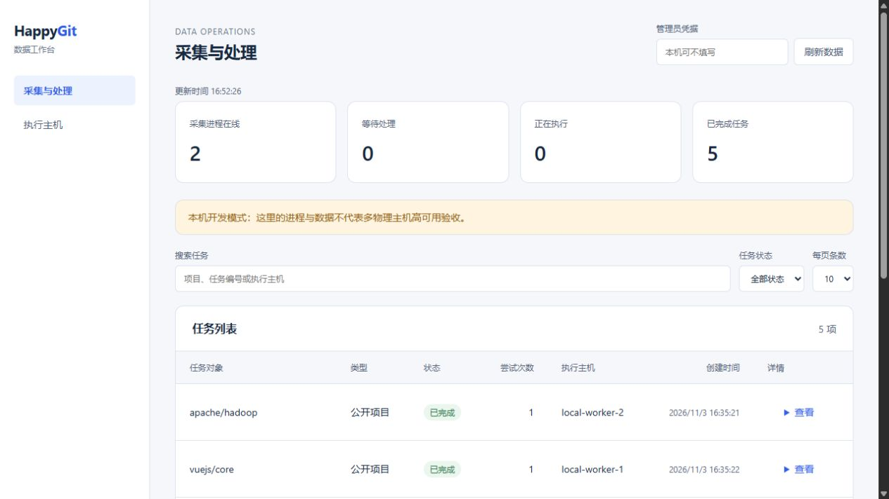
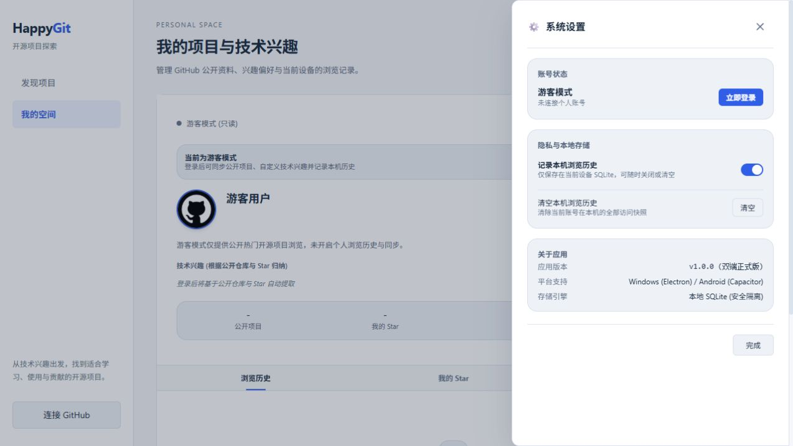

# 2026-11-03 数据平台与双端 UI 执行后记录

本轮实施范围是公开数据采集、Hadoop 离线处理、2—4 台 Ubuntu 的部署配置，以及管理端与现有 Vue 客户端的界面改造。按项目约定先在 feature 分支开发，合入 develop 后验证；发现的验收入口、预览和可见性问题经独立 bugfix 分支修复，再合回 develop。本轮没有推送、合入 main 或操作远程 Ubuntu 主机；用户原有 `数据集生成要求.md` 未修改、未提交。

功能提交为 `058d3ef`（数据平台）、`fbf1400`（双端 UI）、`a102479`（最新可见性），最终功能集成点为 develop 的 `14bc173`。下面记录的是实际运行结果，原完成情况清单保留为实施前快照。

## 当前交付边界

| 能力 | 本轮结果 | 仍需完成的部分 |
| --- | --- | --- |
| 公开项目、README、Star/本人公开项目集合采集 | 已实现；4个真实项目采集成功 | 活动源采集、全量发现策略、ETag/增量调度未实现；公开集合上限20页并标完整性 |
| HDFS 归档、冻结输入与摘要 | 已实现；真实归档与结果清单在 HDFS | 业务数据库索引、保留期清理和运维容量策略 |
| 多 worker 并行领取与故障接管 | 已实现；2个独立 JVM 分担真实任务，受控杀进程接管验证通过 | 多物理主机整机故障、网络分区的实测 |
| J01—J12 Java MapReduce | 已实现；固定输入及真实目录均跑完整链路 | YARN 多机运行、任务 attempt 跨节点迁移与性能压测 |
| 个人/群体画像与 Top-300 | 已实现数据平台算法；合成受控输入验证过画像与召回 | 授权用户输入 API、在线画像表、正式发布包及跨端消费 |
| Ubuntu 2/3/4 节点适配 | 已生成并检查各档角色/XML；HA、资源和路径可配置 | 主机安装、服务启动、fencing 及 NameNode/RM 实际切换 |
| 管理端界面 | 已实现；连接真实任务状态及在线 worker | 完整 HDFS/YARN 守护进程健康与作业运维视图 |
| 现有 Vue 客户端重设计 | 已实现；共享于 Electron/Android 的源码已改造，构建及回归通过 | 新 EXE/APK 打包与真机视觉验证、正式 Hadoop 结果接入 |

核心实现位于 [data-platform](../../data-platform/README.md)：`GitHubCollector.repository/collection` 采集；`HdfsFiles.write` 写入不可变归档；`TaskStore.claim/finish/retry` 保存租约和版本；`Main` 负责入队和 worker；`Pipeline.run/stage` 串联12个作业；`Jobs`/`Vectors` 完成清洗、特征、画像、关联和召回。正式计算使用 Java MapReduce，Python 工具只负责运行时与部署配置。

控制队列当前使用 ZooKeeper，独立于尚未接入的 MySQL 业务层。接管后可能重新计算整个处理批次；旧 attempt 的孤立输出不成为已发布结果。不承诺请求/计算恰好执行一次，也不承诺任意步骤断点续跑。最新私有观测只保留最小可见性状态，公开目录不能用旧公开归档覆盖较新的私有状态。

## 本机环境与真实数据结果

实际环境为 Windows 上的 WSL Ubuntu 22.04.5 LTS、x86_64，隔离 JDK 11.0.32.1、Maven 3.9.11、Hadoop 3.4.2。未替换系统 Java。WSL 当时可见约7.6 GiB 内存，实验期间 Swap 使用为0。运行时和下载文件在专用 `/tmp/happygit-runtime/v2`，未打入 Git。

演示运行一个 MiniDFSCluster，含1个 NameNode和3个 DataNode 实例；另有1个本机 ZooKeeper 和2个独立 worker JVM。它们位于**同一物理主机**。MapReduce 为 **local 模式**，本机数据链路结果不能作为 YARN 调度或控制面高可用验收。早期演示 `started.json` 的 `dataNodeProcesses` 字段指实例，源码已更正为 `dataNodeInstances`；下列证据按实际进程边界记录。

实际从 GitHub 读取 `apache/hadoop`、`apache/spark`、`vuejs/core`、`spring-projects/spring-boot`，归档成功4个任务。两个 worker 各完成2个采集任务，随后其中一个 worker 完成一个批量处理任务；工作台显示5项成功任务。未使用随机演示项目替代网络采集。

该真实批次完整运行 J01—J12，产出4个项目向量、1份特征空间和1份公共排名记录。没有导入任何真实用户行为或身份种子，个人画像数为0，个人候选也为空。画像有效性另由独立合成输入验证，未把实验用户混入真实目录。[实际批次证据](2026-11-03-public-run.json)保存模型版本、特征摘要、作业 ID、各阶段输入输出及时间；结果摘要为 `8bbb1a0948784684e30d5826d0ac0334f3b2c43994e834371d64b17c5b44af4f`。

真实批次使用 `mr-content-v2-data1`，不能冒充完整第一版 SDD 的跨端 FeatureSpace 包或下一代多因素模型。项目8192维、最多256非零项，画像最多512非零项；J11 当前限制1000用户/32MiB 画像缓存，后续需要分块。Star/维护时间为公共信号，尚未提供完整质量或实用性评分。

## 实际验证

最终数据平台测试在 develop 集成 `a102479` 后运行：`bash tools/data_local.sh test`，**6项通过，0失败、0错误、0跳过**，2026-11-03 16:56:08（UTC+8）完成，耗时50.545秒。[测试摘要](2026-11-03-data-tests.json)从本轮 Surefire XML 提取。随后 `bash tools/data_local.sh build` 生成最终部署 JAR。

| 验证 | 实际动作与结果 |
| --- | --- |
| 任务接管与旧提交隔离 | 启动领取任务的子 JVM，强制终止；ZK session 到期后另一 owner 领取，旧 token 提交被拒绝，完成记录仅1份 |
| 幂等输入 | 同 request 身份与同输入返回原任务；同身份改 input 被拒绝 |
| 完整处理 | 3个合成项目、2个 subject、重复事件；12阶段完成，事件去重为1次浏览，输出含空画像与非空画像及召回，冻结输入被改动时拒绝处理 |
| HDFS 副本 | 3个 DataNode 实例、2副本；停止实际持有该文件块的一实例，剩余副本仍可读回相同记录 |
| 私有信息归档范围 | 私有上游响应仅转换为最小可见性状态，名称/描述/README 不写入结果 |
| 公开目录最新状态 | 交换新私有/旧公开输入顺序，最终都不显示该项目；处理不修改归档原对象 |

客户端 UI 分支合入 develop 后执行 `npm test`：**31项现有领域回归及5项配置测试均通过**，包括 SQLite 历史、账号隔离、取消登录、集合分页、迟到响应、Star 状态与发布配置。`npm run build` 通过。没有在 feature 分支运行应用测试，也没有重新构建 EXE/APK。

Ubuntu 配置分别生成2、3、4节点，核对角色数、仲裁、NameNode、所有 DataNode/NodeManager/collector、各节点四份 XML 可解析，均通过；Linux 安装与启动脚本通过 `bash -n`。这验证生成结果，不等于目标主机已安装或服务已运行。Ubuntu 20.04/24.04 和 ARM 尚未运行验收。

## 界面核对

参考已安装的 [Ludi b-end-design-system](https://github.com/Ludi-Herry/b-end-design-system-skill)，管理端采用查询表格/4项核心计数/浅色业务状态；客户端使用用途简介、技术标签和来源证据，未把 Star 命名为质量。已有 Vue 应用改为桌面侧栏与双列卡片、手机底栏、个人空间与设置抽屉；复用现有组件和原有业务调用。

实际浏览器检查了管理端真实列表、无匹配筛选、目录的真实4项目、Vue 游客空状态与个人空间、桌面设置抽屉，以及390×844手机宽度的导航和布局。未进行真实登录、Star 写入、Android 真机或多机故障 UI 验收。Ludi 静态脚本未发现其可检测规则的违规；这不能替代全部人工可用性验收。

[Vue 桌面空状态](images/2026-11-03-client-desktop.jpg)、[手机宽度个人页](images/2026-11-03-client-mobile.jpg)、[公开目录](images/2026-11-03-public-catalog.jpg)作为视觉核对记录保存。Vue 在普通浏览器下缺少原生账号/SQLite 能力，显示实际空/受限状态；已采集目录另由数据平台 `/client` 提供，没有假装二者已经完成正式推荐包连接。

本轮预览入口为 Windows 回环 `http://127.0.0.1:8190/`（管理）、`http://127.0.0.1:8190/client`（采集目录）、`http://127.0.0.1:4190/`（现有 Vue 新界面）。它们依赖本机实验进程存活。复现命令见[模块说明](../../data-platform/README.md#本机复现)，前台退出可关闭所启动的实验集群。

## 上机验收入口

若要求一台物理主机故障后控制面继续自动工作，应采用至少3台独立 Ubuntu 主机；2台模式只有工作节点重试与数据副本，无法等价提供多数派控制面的任意单机故障容忍。3/4台方案还需多数派、可读副本、剩余资源和实际 fencing 共同成立。SSH fencing 在整机不可达时可能阻止切换，需按机房能力提供并验证电源/网络隔离措施。

下一阶段按[Ubuntu 部署说明](../../deploy/ubuntu/README.md)填写实际清单，部署后保存 YARN task attempt 跨 node ID、NameNode/RM active切换、fencing 和数据摘要的证据。当前未取得这些主机连接，不将本机成功替代该项验收。之后再接入应用身份、授权逐次事件上传/水位、MySQL 在线发布、版本一致的推荐包及跨端近期行为微调。
