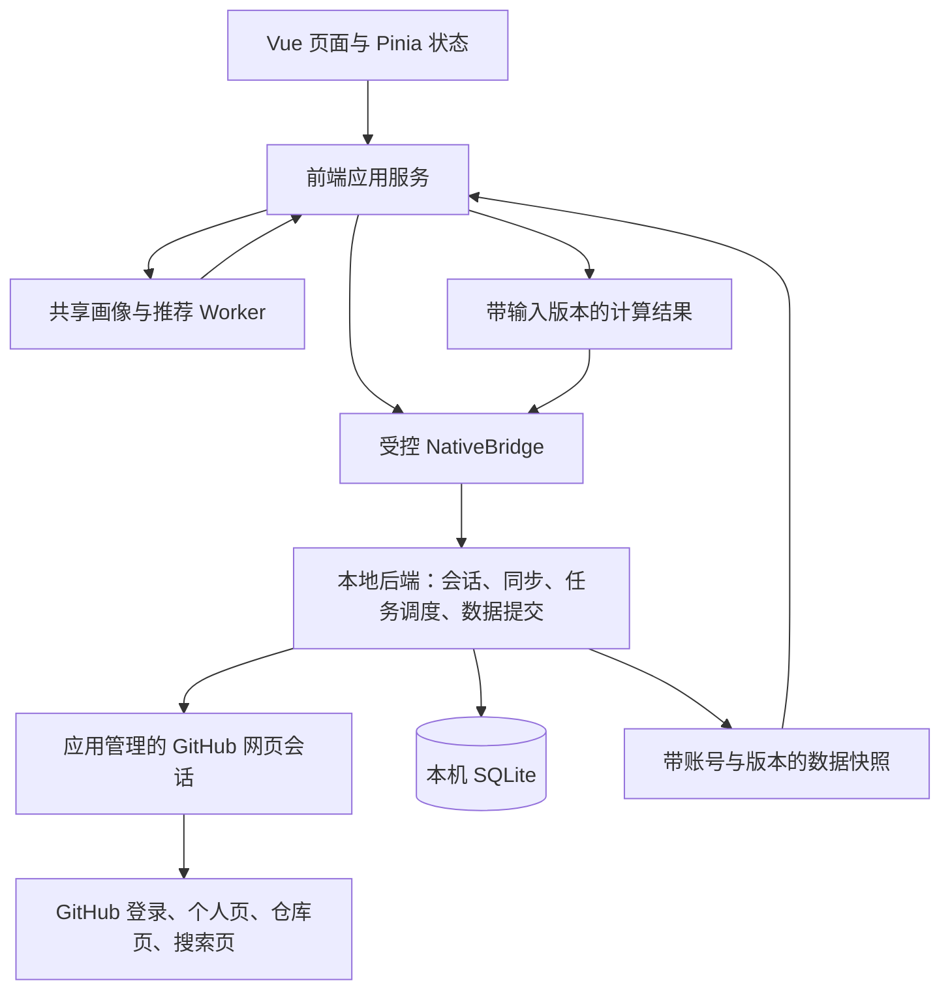

# HappyGit 项目重构方案

版本日期：2026-10-19。核对基线：本地 `develop`，提交 `3b6f273`。本文替换此前的账号接入方案，作为 Windows 与 Android 两端后续重构的统一依据。文中的新目录、函数、表结构和流程均为待实现设计；旧版本的编译结果、模拟数据及接口测试不代表本文方案已经实现。

## 一、产品目标与运行边界

HappyGit 是安装后直接使用的本地 GitHub 项目发现应用。用户点击“使用 GitHub 登录”，进入应用管理的真实 GitHub 网页，按 GitHub 自己的流程完成登录。应用识别当前网页账号后返回个人页，并在本机保留网页会话。用户不需要填写服务网址、注册开发者应用、申请访问令牌、编辑配置文件，也不需要单独启动 Java、Node 或数据库服务。

账号资料、本人公开仓库、公开 Star 和候选项目从 GitHub 网页读取。用户在 HappyGit 点击 Star 或取消 Star 后，由本地模块在同一已登录网页会话中执行对应操作，并确认 GitHub 网页上的最终状态。浏览历史、兴趣画像、推荐反馈和推荐结果保存在本机，默认不上传到任何项目服务器。

这里的“网页登录”具体指建立并复用 GitHub 网站会话，不是给第三方 OAuth 应用授予 API 权限。产品统一称“GitHub 登录”，技术文档应区分网站会话和 OAuth，不能继续把 Client ID、Client Secret、回调域名或公网授权服务作为必备条件。

仅打开电脑或手机的外部默认浏览器，不能使应用自动获得该浏览器的登录会话。因此，两端都采用应用管理的 GitHub 网页窗口。用户输入密码、验证码和二次验证信息的页面由 GitHub 提供，HappyGit 不制作替代登录表单。外部浏览器仍可用于普通项目阅读，但不承担应用账号接入。

本轮完整个人数据的范围是当前账号真实基本资料、本人公开仓库、可访问的公开 Star，以及当前设备产生的浏览记录和偏好。公开资料中未填写的字段保留空值。私有仓库、私有 Star、邮件、组织内部资料以及 GitHub 历史浏览记录不进入默认采集范围。本机历史仅表示通过 HappyGit 打开过哪些项目，不能展示成用户在 GitHub 上的全部浏览历史。

账号在 Windows 和 Android 分别登录，数据分别保存在各自设备。“双端”表示产品能力和数据契约一致，不表示两台设备自动同步 Cookie、历史或画像。首版只保留一个活动网页账号，允许切换账号，并在 SQLite 中隔离各账号的本地数据；不增加多账号同时在线功能。

## 二、总体结构与技术选择

保留现有 Vue 3、Pinia、Tailwind、Electron 和 Capacitor，继续使用 JavaScript、CJS 和 Java。重构重点是调整账号入口和领域边界，不整体更换前端框架，不增加第二套桌面壳。

本地后端由两端原生模块承担：Windows 使用 Electron 主进程、网页执行器和 SQLite worker，Android 使用原生插件、独立 GitHub WebView 和 SQLiteOpenHelper。页面采集、会话识别、账号同步、Star 操作和数据库提交都由本地后端控制。前端只提交业务意图和展示结果，不获取 Cookie，不提交任意脚本，不直接决定远端操作已经成功。

画像和排序采用共享的纯 JavaScript 领域模块，在应用可信本地页面启动的 Web Worker 中执行。这个 worker 是本地计算模块，没有 GitHub Cookie、网页操作接口和数据库连接。原生后端提供带版本的计算快照，并校验计算结果对应的账号和数据版本后提交。这样两端使用同一套算法，避免分别维护 Java 与 JavaScript 两份推荐规则。应用退到后台或关闭时可以暂停计算，不要求安装常驻服务。

现有 `server/` 不再承担客户端登录或正常运行的前置条件。它可以暂时保留为独立研究、公共数据实验或以后离线批处理的工程，但从客户端默认调用链和正式打包流程中退出。未来若继续使用 Hadoop MapReduce，只用于离线实验、公共项目特征生成和算法比较，不能要求普通用户配置集群，不能上传用户会话或本机历史作为隐含前提。



此前考虑过由公网服务处理 OAuth，以及桌面端安装浏览器扩展后复用外部浏览器。前者增加部署和应用注册条件，后者增加额外安装并且无法统一覆盖 Android。当前采用原生网页会话模块，使登录和数据访问随安装包一起交付。

这里必须区分平台能力与站点兼容性。Electron 提供持久网页会话，Android WebView 提供网页执行和本应用 Cookie 管理，这些能力有官方接口依据；GitHub 当前登录方式、身份标记、分页和 Star 按钮能否在指定运行环境中稳定使用，需要在第一阶段实际验证。不得把“存在 WebView 接口”写成“双端 GitHub 登录已通过”。

## 三、目录与职责

以下为目标目录。现有同责模块优先改造，不为一两个表达式拆出文件。共享源码由构建脚本分别生成前端 worker、Electron 可加载资源和 Android assets；生成物不手工维护。

```text
happy-git/
  project.md
  client/
    shared/
      contracts/                    数据模型、操作名、状态与错误码
      github-page/
        routes.js                   GitHub 页面路由与分页路径校验
        scripts/                    当前身份、资料、列表、搜索、Star 页面脚本
        normalize.js                网页 DTO 标准化、数量与日期处理
      recommendation/
        features.js                 项目特征、分词与向量
        profile.js                  本地兴趣画像
        recall.js                   查询规划与候选合并
        rank.js                     评分、重排与解释
        protocol.js                 worker 输入输出及算法版本
    src/
      components/                   保留现有页面，拆分账号与推荐状态
      platform/                     Electron / Capacitor 传输适配
      services/
        session.js                  登录、恢复、取消、退出的前端编排
        account.js                  发起同步、查询快照与列表
        projects.js                 项目打开与本机历史语义
        history.js                  历史分页、搜索、清理
        discovery.js                候选发现与热门列表
        recommendation.js           快照、worker 计算与结果提交
      stores/
        user.js                     当前会话、个人资料、集合同步进度
        history.js                  历史页面状态
        feed.js                     推荐与热门分页状态
      workers/recommendation.worker.js
      models/github.js              兼容网页 DTO，清除虚构默认值
      style.css                     统一语义色
    electron/
      main.cjs                      启动、窗口、生命周期
      preload.cjs                   主界面的受控桥
      ipc-router.cjs                操作白名单、来源与上下文校验
      session-manager.cjs           网页会话与活动账号
      github-browser.cjs            登录窗口、后台页、原生导航控制
      page-executor.cjs             页面任务执行与结构化结果
      task-scheduler.cjs            页面串行调度、优先级和取消
      account-sync.cjs              资料、公开仓库与 Star 同步
      star-service.cjs              确定目标状态、网页操作与结果确认
      database.cjs                  保留现有数据库 worker 代理
      database-worker.cjs           保留并增量扩展 SQLite 领域操作
      generated/                    构建生成的网页脚本及契约
    android/app/src/main/
      java/com/happygit/app/
        MainActivity.java
        GitHubLoginActivity.java    真实 GitHub 登录窗口，无 Capacitor bridge
        nativebridge/
          HappyGitPlugin.java       受控原生操作入口
          SessionManager.java       网站会话及账号上下文
          GitHubWebViewHost.java    登录页与后台工作页生命周期
          PageExecutor.java         主线程网页执行、DTO 返回
          PageTaskScheduler.java    串行调度、优先级和取消
          AccountSyncService.java   资料与集合同步
          StarService.java          网页 Star 与最终状态确认
          HappyGitDbHelper.java     SQLite 增量迁移
          LocalRepository.java      保留已有本地数据操作
      assets/happygit/               生成的固定页面脚本与契约
    scripts/
      build-page-scripts.mjs        一次构建两端使用的网页脚本
      build-release.mjs             校验应用资源，取消远程授权服务探测
      build-win.mjs                 打包完整 Electron 运行目录
    tests/fixtures/github-pages/    脱敏页面契约样本
  server/                           退出客户端必需运行链，暂保留独立工程
  docs/github-login.md              改写为网页登录与会话生命周期说明
```

`shared/github-page` 只负责当前页面识别与提取，不访问 SQLite，不生成推荐，不调用原生桥。`page-executor` 负责把固定脚本放到正确的页面执行，检查任务是否过期，再取回 DTO。`account-sync` 负责分页、集合版本和数据库提交。`star-service` 负责用户意图、串行化和实际结果。不要把这些职责堆回 `main.cjs`、`GitHubAuth.java` 或一个巨大的 `userStore`。

`shared/recommendation` 只处理显式输入，不能读取全局 Pinia、localStorage 或网页 DOM。模型版本、输入时间和排序参数全部随输入传入，以便同一快照得到可复现结果。

## 四、统一契约与原生接口

现有项目使用 JavaScript。下面的类型记法用于明确契约，落地时可用 JSDoc 和常量表示，不要求增加 TypeScript 编译链。

```ts
type SessionStatus =
  | 'guest'
  | 'restoring'
  | 'authenticated'
  | 'offline'
  | 'reauth_required'
  | 'logging_out';

type SessionContext = {
  contextId: string;                 // 原生生成，每次激活、切换、退出都更换
  accountId: string | null;          // 已核实的 GitHub 数字用户 ID，序列化为字符串
  login: string | null;
  status: SessionStatus;
  verifiedAt: number | null;
  profile: AccountProfile | null;
};

type AccountProfile = {
  accountId: string;
  login: string;
  displayName: string | null;
  avatarUrl: string | null;
  profileUrl: string;
  bio: string | null;
  location: string | null;
  company: string | null;
  publicRepoCount: number | null;
  followerCount: number | null;
  followingCount: number | null;
  countPrecision: Record<string, 'exact' | 'approximate' | 'unknown'>;
  fetchedAt: number;
};

type Repository = {
  repoId: string | null;             // 获取数字 ID 后稳定使用，不伪造
  canonicalKey: string;              // 小写 owner/name，只有链接时的临时去重键
  owner: string;
  name: string;
  fullName: string;
  htmlUrl: string;
  description: string | null;
  primaryLanguage: string | null;
  topics: string[];
  starCount: number | null;
  forkCount: number | null;
  countPrecision: Record<string, 'exact' | 'approximate' | 'unknown'>;
  visibility: 'public' | 'private' | 'unknown';
  isFork: boolean | null;
  isArchived: boolean | null;
  licenseSpdx: string | null;
  updatedAt: number | null;
  createdAt: number | null;
  starredAt: number | null;
  readmeText: string | null;
  fetchedAt: number;
  source: 'profile' | 'repositories' | 'stars' | 'search' | 'trending' | 'detail';
};

type PageCursor = {
  nextUrl: string | null;
  pageSeq: number;
};

type PageResult<T> = {
  pageKind: string;
  items: T[];
  next: PageCursor | null;
  completion: 'more' | 'end' | 'unknown';
  observedTotal: number | null;
  totalPrecision: 'exact' | 'approximate' | 'unknown';
  fetchedAt: number;
  parserVersion: string;
};

type NativeResult<T> =
  | { ok: true; data: T; contextId: string }
  | { ok: false; error: {
      code: string; message: string; retryAt?: number;
      taskId?: string; remoteApplied?: boolean;
    }; contextId: string };
```

网页列表允许只有仓库链接，没有稳定数字 ID。此类记录可作为候选卡片展示，但不能把 `owner/name` 填进 `repoId` 伪装成 GitHub ID。写入账号集合、Star 状态、历史和正式推荐批次前，通过仓库详情补齐 ID；补齐失败时可以打开项目，但不能虚构稳定身份。历史是否保存应单独返回，不能阻止用户阅读。仓库改名后由实际详情中的数字 ID 合并别名。

项目当前 `normalizeProfile()` 用用户名兜底 ID、把缺失数量默认为 0，`normalizeRepository()` 用仓库全名兜底 ID，并对缺失布尔值直接 `Boolean()`，这些行为需要调整。缺失与确认为零、公开与未知、未归档与未识别必须区分。`1.2k` 可以解析为约 1200，并标注 approximate；不能作为精确计数使用。GitHub 没有展示 Star 时间时，`starredAt` 保持 null，不能拿采集时间冒充用户 Star 时间。

NativeBridge 保留 `invoke(operation, payload, contextId)` 和 `capture()`。前端一次业务开始后捕获 context，整个请求链使用同一个值；原生在队列入队、真正执行和提交数据库前再次检查活动 context。外部网页不能调用这个接口。

| 操作 | 请求 | 返回及职责 |
| --- | --- | --- |
| `app.initialize` | `{}` | 平台能力、会话、账号快照、是否首次提示登录 |
| `session.beginLogin` | `{ intent: 'login' \| 'reauth' \| 'switch' }` | `{ loginTaskId, state }`，原生直接打开 GitHub 窗口 |
| `session.getLoginTask` | `{ loginTaskId }` | opening / waiting / verifying / authenticated / cancelled / failed，以及成功后的 session |
| `session.cancelLogin` | `{ loginTaskId }` | 取消并关闭对应窗口，迟到验证结果失效 |
| `session.restore` | `{}` | 本机网页会话校验后的 SessionContext |
| `session.logout` | `{}` | 清理应用网页会话并返回 guest |
| `account.readSnapshot` | `{}` | 当前账号资料、偏好、集合完成状态、画像版本 |
| `account.sync` | `{ collections: ['profile','repos','stars'], force }` | `{ taskId }`，同步在本地后端继续 |
| `tasks.read` | `{ taskId }` | 阶段、完成页数、已读条数、是否结束、错误 |
| `tasks.cancel` | `{ taskId }` | 取消本人当前 context 的读任务；Star 进入确认阶段后只停止后续动作 |
| `repositories.list` | `{ kind, offset, limit }` | active 集合的 items、total、nextOffset、complete |
| `stars.readState` | `{ repoId, fullName, force? }` | `{ state: 'starred' \| 'unstarred' \| 'unknown', observedAt }` |
| `stars.set` | `{ repoId, fullName, desiredStarred, intentId }` | confirmed / unchanged / uncertain，以及本地缓存提交情况 |
| `history.record` | `{ repository, source }` | 原生偏好与时间校验后写入；返回 saved 与原因 |
| `history.list` | `{ cursor, limit, keyword }` | items、nextCursor、total |
| `history.delete` | `{ repoId }` | 删除一条并使画像、推荐版本失效 |
| `history.clear` | `{}` | 清除当前账号历史及依赖它的画像贡献 |
| `account.savePreferences` | `{ historyEnabled, manualTags }` | 保存偏好并更新对应数据版本 |
| `account.forgetLocalData` | `{}` | 结束会话，删除当前账号本地数据及派生缓存 |
| `discovery.refresh` | `{ mode, queryPlan?, profileInputVersions?, force? }` | 本地候选刷新任务 ID；mode 为 trending 或 personalized |
| `discovery.read` | `{ cursor, limit }` | 当前候选快照分页 |
| `recommendation.createSnapshot` | `{ purpose: 'profile' \| 'ranking', reason }` | inputId、inputVersions、画像输入及候选特征 |
| `recommendation.commit` | `{ inputId, inputVersions, purpose, profile?, batch? }` | 原生校验版本后提交对应结果，或返回 INPUT_CHANGED |
| `recommendation.list` | `{ batchId?, offset, limit }` | 固定批次推荐卡片、理由、nextOffset |
| `recommendation.feedback` | `{ repoId, kind, eventId }` | 当前版本只支持 hide / unhide，写入本地反馈 |
| `repository.open` | `{ repository, source, target: 'app' \| 'external' }` | opened、historySaved，两项分别报告 |

不向 Vue 暴露 `executeJavaScript`、任意 URL 抓取、Cookie 导出、任意 SQL、`saveProfile`、`sync.writePage`、`stars.applyConfirmed` 等写原始状态的接口。现有这些接口可以保留为原生内部函数，但前端只能调用上述业务操作。特别是 Star 的“已确认”状态必须来自本地网页执行器，不能由组件传一个布尔值直接落库。

首版任务状态沿用轮询传输，每秒读取一次正在显示的任务，任务结束立即停止。`session.getLoginTask` 读取本地任务对象，不向 GitHub 每秒发请求。普通列表不通过高频轮询刷新。现有 preload 和 Capacitor 的 invoke 形式可以复用，暂不增加第二套事件总线。

## 五、网页会话与账号生命周期

### Windows

`SessionManager.initialize({ userDataPath, database })` 创建应用专用 `persist:happygit-github` partition。主界面继续加载本地 dist，保持独立默认会话；登录窗口与后台 GitHub 页面使用同一个 GitHub partition，均关闭 Node 集成、启用 contextIsolation、sandbox 和 webSecurity，不加载主界面的 preload。该 partition 的数据落在 HappyGit 的 userData 目录，由 Electron 管理，不读取 Chrome 或 Edge 的配置目录。

持久 partition 和同 partition 页面的会话共享是 Electron 官方能力，参考 [BrowserWindow](https://www.electronjs.org/docs/latest/api/browser-window) 与 [Session](https://www.electronjs.org/docs/latest/api/session)。持久化不能保证网站会话永久有效，每次恢复仍需核对当前网站账号。

`GitHubBrowser.openLoginWindow(loginTask)` 打开真实 `https://github.com/login` 或经过固定路由生成的站内返回路径，原生标题区域持续显示当前真实域名，并提供返回、重新加载和关闭。GitHub 页面不覆盖原生地址区域。GitHub 登录所需页面内跳转继续在该窗口完成。密码、验证码、恢复码和 WebAuthn 内容不进入采集脚本、日志或 SQLite。

页面采集和 Star 脚本只在实际 origin 为 `https://github.com` 的页面执行。登录过程中若用户进入其他身份提供方页面，只保留可见的人工交互和真实域名显示，不运行采集脚本；返回 GitHub 后重新核对身份。普通项目外链交给阅读入口或系统浏览器，不让后台工作页自行导航到任意网站。

登录状态检测在 GitHub 页面完成必要加载后调用 `readCurrentIdentity`。不要监听输入框内容，不读取登录请求体，不根据页面 URL 离开 `/login` 就判定成功。能够进入首页也不代表登录成功。

`GitHubBrowser.createWorkPage()` 创建一个复用同 partition 的后台页，用于资料、列表和 Star 任务。只维护一个后台工作页，空闲时不轮询 GitHub。应用进入登录、切换或退出流程时暂停普通采集。页面变成验证或重新登录状态时停止任务，允许用户把该页切到前台继续处理。

### Android

`GitHubLoginActivity` 是独立原生 Activity，内部创建普通 Android WebView，而不是把 GitHub 加载进 Capacitor 主 WebView。它不注册 HappyGitPlugin，不调用 `addJavascriptInterface`，不向远程网页暴露本地能力。原生工具栏显示域名和关闭按钮，返回键先处理网页导航，再结束 Activity。

`GitHubWebViewHost` 在 MainActivity 存活期间管理一个工作 WebView。登录 WebView 与工作 WebView 在同一应用进程中，使用本应用的 CookieManager，因此可以复用应用内的 GitHub 会话。主界面的 Capacitor WebView 仍只加载可信本地资源，禁止其主 frame 导航到 GitHub。

首版保持 minSdk 24，不使用 API 28 才有的 `setDataDirectorySuffix()` 动态切换账号 partition，也不尝试在运行过程中多次切换 WebView 数据目录。活动账号切换先清理本应用网页会话，再重新登录；账号历史继续按 GitHub ID 保存在 SQLite。Android WebView 默认不共享外部浏览器状态，而 Custom Tabs 使用浏览器状态，二者不可混用，参考 [Android Custom Tabs 说明](https://developer.android.com/develop/ui/views/layout/webapps/overview-of-android-custom-tabs)。

WebView 开启站点所需 JavaScript 与 DOM storage，关闭文件访问和混合内容，SSL 错误取消，不移除证书校验。`PageExecutor` 通过固定 scriptId 查找安装包内的脚本，在 UI 线程调用 `evaluateJavascript()`，结果经 DTO 校验后交给后台数据线程。使用方法依据 [Android WebView](https://developer.android.com/reference/android/webkit/WebView)；不把整个业务数据库操作放到 UI 线程。

首次启动工作页时按需创建，不随着列表滚动反复 new WebView。MainActivity 销毁时释放工作页，配置变化后按任务 context 恢复；登录 Activity 旋转时保持或恢复现有登录流程，不能再发起第二次登录。应用退到后台后停止普通采集，已经送出的 Star 最多完成当前确认，剩余部分保留为 uncertain，不使用前台常驻服务维持抓取。

不能为了通过第一阶段验证而伪装浏览器标识、绕过二次验证或把站点拒绝信息吞成成功。普通密码登录、账号启用的二次验证和已登录重启恢复都需要在目标 Android WebView 上实测；Passkey、硬件密钥等路径以实际设备验证结果说明支持范围。

### 身份识别和状态流转

```text
guest --点击登录--> 登录任务 opening / waiting / verifying
登录任务验证成功 --> authenticated
应用重启 --> restoring --> authenticated / offline / reauth_required / guest
authenticated --明确被网站要求登录--> reauth_required
authenticated --仅网络不可用--> offline
offline --复核同一账号成功--> authenticated
任一账号状态 --退出--> logging_out --> guest
```

登录任务状态单独管理，不把 waiting 混进已激活账号状态。初次登录期间会话仍为 guest；重新验证期间原账号只能阅读本地缓存，禁止使用尚未核实的网页会话写入 Star。同步中的资料或仓库请求失败不能把已完成的网站登录一并回滚。

`readCurrentIdentity(document)` 返回 `{ kind, accountId, login, evidence }`，kind 仅为 authenticated / anonymous / verification / unknown。身份依据必须来自当前 GitHub 页面中代表“当前登录用户”的信息；被访问个人页的用户名、头像或仓库所有者都不能作为当前登录身份。数字 ID 必须和同一身份的 login 对应。

页面契约实现时优先验证当前用户菜单和站点自身的当前用户元数据能否互相对应，再到该用户资料页补齐资料。`octolytics-actor-id`、`user-login` 一类标签只能作为待核实的候选来源，本文没有验证当前已登录 HTML，不能据名称直接写死并标记已完成。若实际页面没有可用的当前身份数字 ID，可以在确认当前 login 后，由其本人资料页中经校验的用户 ID 字段补齐；头像链接中的数字只有在确认它确属该用户且格式稳定时才可作为补充证据。缺少可信证据返回 unknown，不能退回“输入用户名就是登录”。

`SessionManager.activateIdentity(identity, loginTaskId)` 只有在任务仍有效、网页身份验证完成后调用。在数据库事务中保存真实资料与 active_account_id，然后生成新 contextId，并使旧任务全部失效。Vue 取得新 session 后清空旧账号内存数据，再从数据库读取对应账号快照。切换 A 到 B 时，A 的迟到响应既不能改 B 的界面，也不能写 B 的数据库。

`restoreSession()` 首先读 active_account_id 和本地资料，再低频加载当前身份页面。若网络失败且本地有账号，返回 offline，允许查看该账号缓存，但禁止远端写操作。若网页明确匿名，返回 reauth_required。若网页是另一账号，停止原账号任务，先按实际身份完成切换；不能继续用 A 的 context 操作 B 的网页。

`logout()` 先更新会话 epoch、停止入队、关闭所有 GitHub 页面并等待在途任务进入可终止状态，再清理应用管理的网页会话。Windows 清理专用 partition 的网站存储。Android 关闭登录与工作 WebView 后，等待 CookieManager 的清理回调并 flush，再重建匿名工作环境；当前应用仅将远程会话用于 GitHub，可清理本应用 WebView Cookie，不影响外部 Chrome。禁止调用清 Cookie 后仍让旧页面继续加载，从而重新写回 Cookie。清理完成后才报告退出成功，保留 SQLite 历史。

`forgetCurrentAccount()` 在上述退出完成后，事务删除当前账号及其所有账号关联数据。普通退出与删除本地数据是两个行为；切换账号不自动删除原账号历史。个人页不能继续展示刚删除账号的画像或推荐。

## 六、GitHub 网页适配与任务调度

页面适配层面对的是网站页面，不再伪装 REST 返回值。删除对 HTTP 204、GitHub API Link header 和 OAuth scope 的业务依赖。内部可记录真实网络状态辅助诊断，但最终结果以页面契约和目标状态为准。

| 页面脚本 | 输入 | 输出与提取规则 |
| --- | --- | --- |
| `detectPage` | 无 | 当前 origin、pageKind、登录/验证/受限/不存在/正常结构信号 |
| `readCurrentIdentity` | 无 | 当前登录身份；不读取密码、Cookie、CSRF 值 |
| `readProfile` | expectedLogin | 昵称、简介、位置、公开数量及其精度，不虚构缺失项 |
| `readOwnedRepositories` | expectedLogin、pageSeq | 公开仓库条目、下一页、结束证据 |
| `readStarredRepositories` | expectedLogin、pageSeq | 公开 Star 条目、下一页、结束证据；排除用户自建 Star 列表管理页 |
| `readRepositoryDetail` | expectedFullName | canonical 链接、数字仓库 ID、可见性、语言、topic、许可、README 文本等 |
| `readRepositoryStarState` | expectedRepoId、expectedFullName | starred / unstarred / unknown；只识别目标仓库主操作区 |
| `setRepositoryStar` | expectedRepoId、desiredStarred | 定位当前页面已有且可见的目标按钮，单次执行原生页面行为 |
| `readSearchResults` | 查询标识、pageSeq | 仓库搜索条目与分页，不混入用户、Issue 或代码结果 |
| `readTrendingResults` | 页面日期维度 | 趋势候选及网页实际提供的指标 |

`routes.js` 提供 `profileUrl(login)`、`ownedRepositoriesUrl(login)`、`starredRepositoriesUrl(login)`、`repositoryUrl(fullName)`、`searchRepositoriesUrl(query, sort)` 和 `validateNextUrl(currentTask, nextUrl)`。登录名、owner 和 name 按各自路径片段编码，查询通过 URLSearchParams 编码。前端不能传任意 URL 绕过路由生成。

分页 URL 必须属于 `https://github.com`，不含用户名密码或自定义端口，且匹配当前账号、集合或原搜索条件。不把其他页面上的 Next 链接拿来翻页。每次遍历记录访问过的规范化 URL，重复 URL 终止为 PAGINATION_STALLED，不提交完整集合。网页分页可能使用页码，也可能使用游标，数据库保存 nextUrl 和 pageSeq，不再只支持整数 nextPage。

`PageExecutor.run(task)` 输入包括 taskId、contextId、sessionEpoch、pageKind、固定路由参数和固定 scriptId。执行顺序是检查 context、调度导航、识别实际页面、等待所需语义结构、执行脚本、校验 DTO、再次检查 context，再返回结果。导航和 DOM 识别都设置有限超时，默认一次页面导航上限 30 秒、必要结构等待上限 10 秒，不等待永远不会结束的 network idle。

等待结构时由原生调度安装包内的同步 DOM 探针，导航完成立即读一次，结构尚未就绪时每 250 毫秒复核，最多 10 秒；任务取消或完成立即清理计时器。不要永久抓取页面，也不根据固定睡眠后“应该加载完了”直接解析。对于局部更新，同样等待目标结构满足契约，不能仅依靠一次 onPageFinished。

两端页面脚本只返回普通 JSON 对象，不返回 Promise。Electron 的执行接口可等待 Promise，不代表 Android evaluateJavascript 的回调也会等待；统一使用同步探针和原生调度，避免 Android 把空对象误当作解析结果。脚本不把跨页状态保存在 window 变量中。

`PageTaskScheduler.enqueue(task)` 对工作页执行串行调度。用户触发的 Star 优先，其次是登录复核和手动刷新，再是候选刷新，最后是后台集合同步；同步每完成一页重新入队，使 Star 可以插队。已经发出的网页点击不会因为 Promise 取消而撤销，调度器必须区分尚未执行与已执行待确认。

同一账号、同一集合只存在一个同步任务；同一仓库只存在一个 Star 变更任务。读任务可合并，写任务不能因重试被隐式重复。单次后台导航之间默认至少间隔 1.5 秒，该值是本应用节流参数，不是 GitHub 保证的额度。站点明确提示限制时，停止当前采集并按实际可用的等待信息恢复；没有明确时间则先冷却 60 秒，连续受限延长到 5 分钟，交互不进入无限重试。

页面脚本以语义属性、标准链接、对应表单和可见状态定位为主，避免依赖构建 hash 类名和屏幕坐标。优先通过仓库 canonical 链接、目标 form、按钮含义及可见性共同确定 Star 控件，防止点击 README 或列表里另一个仓库的按钮。语言变化不能只靠英文按钮文本兜底。

GitHub 当前 DOM 的精确选择器、身份标记及动态表单行为没有在本轮设计中实测。执行者应在第一阶段采集经过脱敏的真实样本，把实际选择器、匹配依据和 parserVersion 一起写入页面契约。不能把本文的字段名当成已经存在的 DOM 属性，不能用模拟页面验证代替真实登录页面验证。

当页面变动导致核心字段或按钮无法确认，返回 PAGE_CONTRACT_CHANGED，并保留上次有效数据；不把它解释成“用户没有仓库”“没有 Star”或“操作成功”。恢复入口是重新加载当前 GitHub 页面或等待适配更新，不是让用户填写服务网址。

## 七、账号同步与 Star 操作

### 资料与集合

`AccountSyncService.start(context, collections, force)` 创建一个任务 ID，先读取资料，再分页同步 repos 与 stars。登录成功后先进入应用，显示本地缓存或同步进度，不等待全部仓库和 Star 完成才允许使用。没有本地集合时显示“正在读取”，不能暂时显示“0 个 Star”冒充已经读完。

`syncProfile(context)` 先验证当前网页身份，再读取其本人公开资料，保存 accounts 并增加 profileRevision。公开资料读取成功不等于网站登录成功，身份验证仍由 SessionManager 单独负责。

`syncCollection(context, kind)` 调用现有 `beginSync` 创建 staging_generation，逐页读取、补齐必要身份、去重并写入 staging。页面中的数字 ID 优先；只有链接的条目先解析详情，不能用假 ID 写入。任务进度包括 scannedCount、acceptedCount、skippedPrivateCount 和 pageSeq，展示时说明只同步公开数据。第一次大量同步可以被用户取消，下次重新开始；不实现跨进程自动恢复一半的远端翻页快照。

`writeSyncPage(accountId, kind, generationId, pageSeq, items, nextUrl)` 在事务中验证 generation 和预期 pageSeq，再写当前页。相邻页面存在重复项时按 repoId 去重，不能按“本页数量小于某个 API pageSize”推断结束。所有网页条目保持原始顺序信息，GitHub 没有给出时间时使用本次序号维持列表顺序，不制造 createdAt 或 starredAt。

只有页面脚本明确返回 `completion:'end'` 且 next 为 null，并且公开条目的核心身份均已解析，才可调用 `finishSync()`。确定为私有的条目可以排除；身份或可见性未知的条目不能静默跳过后仍报告全量。数据页缺失、受限、结构未知或超过本次任务预算只会暂停或失败，不能把已读的一部分标成 complete。多页采集不是 GitHub 数据库的一致性快照；同步期间外部修改可能造成漂移，允许下一次刷新纠正，界面标明最近同步时间，不承诺绝对实时数量。

`finishSync()` 保留现有 staging/active 原子切换逻辑。中断继续使用旧 active；没有旧 active 时保持“未完成”，不生成空的完整集合。账号页数量优先使用完整本地公开集合 count，并明确为“已同步公开项目”或“已同步公开 Star”，不要与网页上可能包含私有内容或约数的徽标混为同一精确值。

每次应用回到前台，若资料与集合距上次成功超过 15 分钟，可以发起低优先级刷新。手动刷新可以提前触发，但与在途同类任务合并。应用后台不持续刷新。后续可根据用户数据量调整，首版不增加复杂定时系统。

### Star 的确定状态操作

前端统一使用 `setStar(repository, desiredStarred)`，不使用只表达“反转一次”的 toggle 接口。未确认过的状态显示 unknown。完整公开 Star 集合中的命中是正向证据；不完整集合中没有某项目，不能据此判定未 Star。卡片不需要为每个项目都打开网页查询，用户触发操作或进入详情时再读取目标页状态。

`StarService.set(context, repository, desiredStarred, intentId)` 是完整业务入口。它检查活动账号和当前网站身份，把同仓库任务串行化，取消当前 stars 集合 staging 同步，记录一条本地操作任务，再导航到目标仓库详情页。若操作前状态已经等于目标，返回 unchanged，不再点击按钮。目标尚无数字 ID 时先解析详情补齐，未补齐不执行写操作。

网页调度器还需要 `withPageLease()`：从身份核对、读取操作前状态到点击、重载确认，整个序列独占工作页。不能只串行单次导航，却让普通仓库同步在读取按钮和点击之间导航到其他页面。这里的独占只覆盖页面任务，不占用数据库线程或长期阻塞界面。

执行前必须核对仓库 canonical 与数字 ID，并且控件属于该仓库的主操作区。`setRepositoryStar` 只点击当前页面上已有的相应按钮或使用页面原生表单行为，不手工拼接未公开请求、不提取 CSRF 值复制到后端网络库，不调用猜测出的隐藏接口。页面的 Cookie、CSRF 和提交行为交给网站正常运行环境处理。

点击后等待操作区更新，再重新加载同一仓库页面并读取状态。只有重新读取的真实状态等于 desiredStarred，才返回 confirmed，并调用内部 `applyConfirmedStar()` 更新本地集合和 star_state。页面未重新加载成功而只是按钮短暂变色，不足以报告成功。

```ts
async function setStar(context, repository, desiredStarred, intentId) {
  return starQueue.runExclusive(repository.repoId, async () => {
    assertActiveContext(context);
    await sync.cancelStarCollection(context);
    const task = await operations.createOrRead(intentId, repository, desiredStarred);
    if (task.isTerminal) return task.result;
    if (task.attemptedAt !== null) return reconcileWithoutClick(task);

    return pageScheduler.withPageLease(context, 'star', async (pages) => {
      await session.verifyIdentity(context, pages);
      // 领域层将网页 starred / unstarred / unknown 转成 boolean / null。
      const before = await pages.readStarState(context, repository);
      if (before.starred === desiredStarred) {
        return commitConfirmedState(task, before, 'unchanged');
      }
      if (before.starred === null) return failWithoutClick(task, before.reason);

      await operations.markAttempted(task.id); // 先落盘，重启后只复核，不盲目重放
      await pages.setStarOnce(context, repository, desiredStarred);
      const after = await pages.reloadAndReadStarState(context, repository);
      if (after.starred !== desiredStarred) return markUncertainOrFailed(task, after);
      assertActiveContext(context);
      return commitConfirmedState(task, after, 'confirmed');
    });
  });
}
```

网页点击发生后网络中断、应用切后台或进程退出时，操作可能已经生效。此时标记 uncertain，重连或重启后只重新读取状态，不能自动再点一次。已经写入 attempted 的任务永远不会由恢复逻辑直接重放，避免 Star 被反向切换或重复提交。

远端确认成功但 SQLite 提交失败，返回 confirmed 且 localCacheSaved:false，提示“GitHub 已更新，本机记录稍后同步”；不能显示远端失败，不能再发送点击。同一 intentId 的连续点击复用任务，前端按钮在 pending 时禁用。用户随后发起相反目标时使用新 intentId，并排在上一个任务完成或状态复核之后。

Star 完成后增加 starMutationRevision，并丢弃早于该版本的 Star 查询结果。任何在变更前开始的 stars 同步都不能在变更后提交成完整集合。重新启动 stars 同步可以纠正网页之外发生的修改。

## 八、SQLite、历史与增量迁移

现有 accounts、account_preferences、browse_history、repository_cache、sync_state、app_settings、feed_cache 七张表继续使用。保留历史时间戳、30 秒访问去重、90 天保留、最多 5000 条、搜索转义、账号外键和 staging/active 切换，不因为更换登录方式重建空数据库。

Windows 继续在稳定的 HappyGit userData 目录存库，Android 继续使用应用私有数据库目录。两端只统一 schema 和迁移规则，不共用同一个物理文件。数据库由平台层单连接或串行事务控制；不把 SQLite 语句移到 Vue。

当前 Android DATABASE_VERSION 为 1；Electron 现有库尚无完整显式迁移版本约定。新增迁移版本 2：Electron 对确实存在旧七表且 user_version 为 0 的库识别为旧版 1，再逐步迁移；空库直接按最新结构创建并设置 user_version。不能见到 user_version=0 就覆盖已有数据。Android 在 onUpgrade 的 1→2 分支执行同等迁移，不使用 DROP TABLE 重置。

```sql
ALTER TABLE sync_state ADD COLUMN staging_next_url TEXT;
ALTER TABLE sync_state ADD COLUMN staging_page_seq INTEGER NOT NULL DEFAULT 0;
ALTER TABLE sync_state ADD COLUMN staging_star_revision INTEGER NOT NULL DEFAULT 0;

CREATE TABLE account_revisions (
  account_id TEXT PRIMARY KEY NOT NULL,
  profile_revision INTEGER NOT NULL DEFAULT 0,
  collection_revision INTEGER NOT NULL DEFAULT 0,
  history_revision INTEGER NOT NULL DEFAULT 0,
  preference_revision INTEGER NOT NULL DEFAULT 0,
  feedback_revision INTEGER NOT NULL DEFAULT 0,
  discovery_revision INTEGER NOT NULL DEFAULT 0,
  star_mutation_revision INTEGER NOT NULL DEFAULT 0,
  FOREIGN KEY (account_id) REFERENCES accounts(account_id) ON DELETE CASCADE
);

CREATE TABLE repository_catalog (
  repo_id TEXT PRIMARY KEY NOT NULL,
  canonical_key TEXT NOT NULL UNIQUE,
  full_name TEXT NOT NULL,
  repository_json TEXT NOT NULL,
  feature_json TEXT,
  feature_version TEXT,
  fetched_at INTEGER NOT NULL,
  previous_star_count INTEGER,
  previous_observed_at INTEGER
);

CREATE TABLE repository_aliases (
  canonical_key TEXT PRIMARY KEY NOT NULL,
  repo_id TEXT NOT NULL,
  FOREIGN KEY (repo_id) REFERENCES repository_catalog(repo_id) ON DELETE CASCADE
);

CREATE TABLE star_state (
  account_id TEXT NOT NULL,
  repo_id TEXT NOT NULL,
  starred INTEGER NOT NULL CHECK (starred IN (0, 1)),
  observed_at INTEGER NOT NULL,
  mutation_revision INTEGER NOT NULL,
  PRIMARY KEY (account_id, repo_id),
  FOREIGN KEY (account_id) REFERENCES accounts(account_id) ON DELETE CASCADE
);

CREATE TABLE website_operations (
  operation_id TEXT PRIMARY KEY NOT NULL,
  account_id TEXT NOT NULL,
  repo_id TEXT NOT NULL,
  intent_id TEXT NOT NULL,
  desired_starred INTEGER NOT NULL CHECK (desired_starred IN (0, 1)),
  state TEXT NOT NULL,
  attempted_at INTEGER,
  confirmed_at INTEGER,
  error_code TEXT,
  UNIQUE (account_id, intent_id),
  FOREIGN KEY (account_id) REFERENCES accounts(account_id) ON DELETE CASCADE
);

CREATE TABLE interest_profiles (
  account_id TEXT PRIMARY KEY NOT NULL,
  model_version TEXT NOT NULL,
  input_versions_json TEXT NOT NULL,
  profile_json TEXT NOT NULL,
  generated_at INTEGER NOT NULL,
  FOREIGN KEY (account_id) REFERENCES accounts(account_id) ON DELETE CASCADE
);

CREATE TABLE recommendation_feedback (
  account_id TEXT NOT NULL,
  repo_id TEXT NOT NULL,
  hidden INTEGER NOT NULL DEFAULT 0,
  event_id TEXT NOT NULL,
  updated_at INTEGER NOT NULL,
  PRIMARY KEY (account_id, repo_id),
  UNIQUE (account_id, event_id),
  FOREIGN KEY (account_id) REFERENCES accounts(account_id) ON DELETE CASCADE
);

CREATE TABLE discovery_cache (
  account_id TEXT NOT NULL,
  query_key TEXT NOT NULL,
  query_json TEXT NOT NULL,
  result_json TEXT NOT NULL,
  fetched_at INTEGER NOT NULL,
  expires_at INTEGER NOT NULL,
  PRIMARY KEY (account_id, query_key),
  FOREIGN KEY (account_id) REFERENCES accounts(account_id) ON DELETE CASCADE
);

CREATE TABLE recommendation_batches (
  batch_id TEXT PRIMARY KEY NOT NULL,
  account_id TEXT NOT NULL,
  model_version TEXT NOT NULL,
  input_versions_json TEXT NOT NULL,
  created_at INTEGER NOT NULL,
  expires_at INTEGER NOT NULL,
  FOREIGN KEY (account_id) REFERENCES accounts(account_id) ON DELETE CASCADE
);

CREATE TABLE recommendation_items (
  batch_id TEXT NOT NULL,
  position INTEGER NOT NULL,
  repo_id TEXT NOT NULL,
  score REAL NOT NULL,
  reasons_json TEXT NOT NULL,
  repository_json TEXT NOT NULL,
  PRIMARY KEY (batch_id, position),
  UNIQUE (batch_id, repo_id),
  FOREIGN KEY (batch_id) REFERENCES recommendation_batches(batch_id) ON DELETE CASCADE
);

CREATE INDEX idx_website_operations_account_state
  ON website_operations(account_id, state);
CREATE INDEX idx_recommendation_batches_account_time
  ON recommendation_batches(account_id, created_at DESC);
```

`repository_catalog` 只存经过确认的公开仓库公共内容，可以跨账号复用；账号行为与个性化查询不能进入该表。只解析到链接的临时候选保存在 discovery_cache 的 DTO 中，补齐数字 ID 后再进入 catalog。schema 使用数字 ID 是最终数据规则，不意味着允许在补齐前拿临时键冒充数字。

`account_revisions` 为现有账号初始化零值，新账号在创建 accounts 时一并创建。每次相关数据提交在同一事务递增对应 revision。公共 catalog 更新递增 app_settings 中的 catalog_revision，候选集合变化递增账号 discovery_revision。推荐输入按这些版本识别，不依赖 JavaScript 内存计数。

`repository_cache` 和历史中的旧 JSON 先按兼容读取，不在数据库迁移时访问 GitHub。发现旧 repo_id 其实是 owner/name 时保留记录，后台解析详情后在事务中合并同一账号同一仓库的数据：first_viewed_at 取最早、last_viewed_at 取最近、快照取最近。旧表没有逐次访问明细，无法精确重建重叠计数，合并时 visit_count 取两者较大值，避免把同一批聚合记录重复相加，再删除别名记录。账号 ID 若不可信，不能自动合并到新登录账号；旧数据留存待核实，不强行绑定。

旧 OAuth credentials 文件不导入网站 Cookie。第一次新版启动保留历史并提示重新登录；完成版本迁移后删除废弃令牌文件或旧 SharedPreferences 中的令牌项，但不删除整个 Android Keystore 或不相关数据。活动网站身份与旧账号 ID 相同才恢复其历史。该迁移不要求用户手工编辑文件。

### 历史与版本

`recordBrowse(context, repository, source)` 的时间取原生 Date.now / System.currentTimeMillis。只在用户实际打开项目时记录，预加载、搜索、滚动经过、后台采集不记录。30 秒内重复打开更新最近访问时间和快照，但不增加 visit_count；时间窗口依据 last_counted_at，不能因 last_viewed_at 一直刷新而永远不计第二次。

`repository.open` 先尝试打开合法 GitHub 项目页，确认原生窗口或外部打开操作已受理后再写历史。系统受理不代表网页一定加载成功，因此历史语义是“从 HappyGit 打开项目”，不声称已经完整阅读 README。历史保存失败不关闭已打开的项目，结果分别报告。

`historyEnabled=false` 时原生拒绝新增浏览数据，推荐也不再使用已有历史信号，已有历史仍可供用户查看或清空。`history.clear` 在同一事务删除当前账号历史、增加 historyRevision、删除旧 interest_profiles、个性化 discovery_cache 和推荐批次，并取消基于旧画像的候选任务；下一次画像只能使用剩余公开数据及偏好。候选提交前检查画像输入版本，旧任务不能把缓存写回来。`history.delete` 和过期清理也要更新版本，使已删除历史的兴趣贡献真正失效。

本轮不额外采集停留时长、逐屏曝光或网页内行为，避免在没有可靠采集链路时展示相关权重。推荐首版使用公开 Star、本人公开仓库、明确打开次数、手动标签和“不感兴趣”反馈。关闭历史后，不创建另一张点击事件表继续采集。

`forgetAccount(accountId)` 通过外键删除账号关联表，公共 catalog 可以保留公共条目，但不保留该账号的查询计划、反馈、画像和推荐理由。内存任务、worker 输入与页面状态同步释放。日志不保存 HTML、Cookie、验证码、私有 README 或带会话参数的完整 URL。

## 九、本地画像、候选发现与排序

第一版先建立能解释、能在本地运行的内容推荐闭环，不引入在线大模型和云向量服务。项目数据来自用户公开集合和 GitHub 网页候选，画像来自本地可验证行为。项目 README 只生成确定性文本摘要或截取实际说明，不把未经实现的生成式介绍当成项目事实。

### 特征与画像函数

`extractRepositoryFeatures(repository, vocabulary)` 输入标准化 Repository，输出语言 one-hot、topics 集合、文本词频、项目年龄与活跃时间等特征。文本拼接范围为仓库名、description、topics，以及本地已经补齐的 README 前 8000 个字符。清除脚本、样式、导航和重复空白，不执行 README 中的代码或指令。description 和 topic 的词项权重为 2，README 为 1，词频采用 `1 + ln(count)`，最终按 L2 归一化。

首版对英文标识、数字和常见技术名做分词，对 C++、C#、.NET、3DGS 等保留完整技术词；不把 C++ 直接去符号变成 c。中文采用本地技术词典最长匹配，并保留未命中的二元词组。词典随安装包提供，不依赖在线接口。词表最多 5000 项，低频停用词排除，词项排序使用稳定规则。

`buildVocabulary(repositories)` 在同一次推荐输入的公开样本集上计算 `idf(term)=ln((N+1)/(df+1))+1`，生成 vocabularyVersion。用户向量和候选向量必须使用同一份词表，不允许各自拟合 TF-IDF 再直接算余弦。样本不足时仍可基于 language/topics 生成结果，文本分量标明数据不足。

`buildInterestProfile(input)` 输入 accountId、完整公开 Star、本人公开仓库、最多 5000 条本机历史、manualTags、hiddenRepoIds、now 和 inputVersions，输出语言分布、topic 分布、文本兴趣向量、主要兴趣证据及 generatedAt。每个仓库先合并为一个 evidence 条目，再叠加可解释的来源权重。

```text
starWeight     = 当前公开 Star 中存在 ? 3.0 : 0
ownedWeight    = 本人公开仓库中存在 ? 1.5 : 0
historyWeight  = historyEnabled
                 ? min(1 + ln(visitCount), 3) * 2^(-daysSinceLastOpen / 30)
                 : 0
repositoryWeight = starWeight + ownedWeight + historyWeight
manualTagWeight  = 4.0，逐个手动标签累加
```

Star 和本人仓库缺少真实加入时间时不做伪造时间衰减。取消 Star 后移除对应 starWeight，但本人仓库或保留历史仍可产生独立兴趣贡献。“不感兴趣”首版作为该仓库硬过滤，不自动将整个语言或技术方向降权，以免一次点击污染全部兴趣。手动标签必须来自用户明确输入或选择，不把推测标签当成用户自报偏好。

各分布求和后归一化，主兴趣按分数取前 8 个，同时存储支撑它的 repoId 和来源。画像页面说明“根据本机已同步公开项目与浏览记录整理”，不推断年龄、职业、城市或能力等级，也不编造没有数据支撑的人格结论。

### 候选发现函数

`planDiscoveryQueries(profile, recentQueries, now)` 从得分最高的 topic、语言和手动标签中组合查询。默认一轮最多 4 个查询，每个先读网页实际第一页；只有用户继续浏览或候选不足时才读取后续页，总任务上限 8 页。此预算限制本次工作量，不意味着已经搜索完 GitHub。

查询示例为 `topic:vue language:TypeScript archived:false is:public`、`topic:machine-learning archived:false is:public`，排序可选最近更新或 Star。查询语法使用 [GitHub 仓库搜索](https://docs.github.com/en/search-github/searching-on-github/searching-for-repositories) 提供的 qualifier。构造查询时词项来自结构化兴趣，不把账号简介全文或全部浏览历史作为搜索内容发送。

冷启动时，用户可直接看 GitHub Trending 和少量固定公开技术查询，也可选择兴趣标签。没有足够个人数据时显示“热门项目”或“正在整理推荐”，不把同一固定热门列表冒充个性化。游客只保存公共列表缓存，不建立个人画像或浏览历史。

`client/src/services/discovery.js` 导入共享 `planDiscoveryQueries()`，从已提交画像生成少量结构化查询计划，再调用原生 `discovery.refresh`。每项计划只包含 topics、language、keywords 和 sort，不包含 URL 或脚本；原生按固定路由生成 GitHub 搜索地址，并核对 profileInputVersions 仍对应已提交画像。这样查询规划规则仍共用 JavaScript，Android 不需要再写一份算法。

原生 `DiscoveryService.refresh(context, queryPlan)` 调用本地页面调度器打开 GitHub 仓库搜索页面，解析候选，按 repoId 或 canonicalKey 去重，并以完整查询、排序和 parserVersion 为缓存键。个性化查询缓存在账号对应 SQLite 行中，不能因换账号而展示上一个账号的候选依据。trending 模式不需要个人计划，游客也可访问；personalized 模式必须有活动账号和有效画像输入版本。

个性化查询需要发送到 GitHub；“本地画像”不等于完全离线。原始行为和完整画像留在本机，只把必要的少量兴趣词作为网页搜索条件。产品存储说明应准确说明这一区别。

`enrichCandidates(candidates, budget)` 先利用已有详情缓存，再优先补齐预计可进入前两页的候选。每轮最多新增 5 个详情页任务；未补齐的候选可以显示已有公开摘要，但不能填充虚构许可、精确 Star 数或更新时间。详情缓存 24 小时内复用；失效仍可显示旧数据并带 fetchedAt，不让一张卡片阻塞整个列表。

`mergeCandidates(sources)` 合并兴趣搜索、相关语言查询和趋势候选，排除已隐藏、已知私有、已归档以及本人仓库。用户已经 Star 的项目可放入“继续了解”单独入口，默认个性化发现流不重复推荐。普通历史浏览项目在最近 24 小时内降低重复出现，用户手动搜索时不受此限制。

公开性必须有证据：未登录也能访问的公开页面、明确公开的搜索结果或仓库可见性标记。已登录用户能够打开某仓库不代表它公开，缺少证据的条目保持 unknown，不持久化进公共 catalog，也不进入默认发现流。许可证未声明不等于私有；许可证只是单独的信息字段。

### 排序与结果解释

`scoreCandidate(profile, candidate, stats, now)` 生成 0 到 1 的分项评分。首版固定参数如下，参数放在带版本的配置对象，不散落在 Vue 组件中。

```text
interest = weightedAvailable(
  languageSimilarity: 0.30,
  topicSimilarity:    0.35,
  textCosine:         0.35
)

freshness  = updatedAt 已知 ? 2^(-daysSinceUpdate / 180) : 缺失
popularity = starCount 已知 ? min(ln(1+starCount)/ln(10001), 1) : 缺失
info       = README、description、topic、language 等已提供项目的覆盖率
trend      = 两次精确 Star 观测可比较 ? 归一化近期增长 : 缺失

baseScore = weightedAvailable(
  interest:   0.65,
  freshness:  0.15,
  popularity: 0.08,
  info:       0.07,
  trend:      0.05
)
```

`weightedAvailable` 只在数据可用项之间重新归一化已有权重，缺失不假装为零或高分。若整个兴趣项不可用，则该候选进入探索池，不冠以“高度符合兴趣”。`info` 只表示信息充分度，不声称是软件质量认证；总 Star 仅是少量受欢迎程度信号，不是趋势。

趋势必须有两次相隔至少一天的本机精确观测，且时间顺序和同一 repoId 可核对。只有一次采集、数量是约数或项目刚进入本机缓存时，trend 为缺失，不能把总 Star 数或本次抓取数量写成“今日新增”。首版没有趋势数据也能完成推荐。

`rerankCandidates(scored, limit, seed)` 按 `0.8 * baseScore - 0.2 * maxSimilarityToSelected` 贪心选择。任意连续 10 条中同一 owner 最多 2 个；存在足够其他语言候选时，同一主语言最多 6 个。缺少候选时放宽多样性约束，不能为了凑数复制条目。按固定 seed 从探索池选约 20%，剩余来自兴趣排序，探索不足时回填正常候选。

`buildRecommendationReasons(profile, candidate, scoreParts)` 最多返回两条确定理由，例如“与你收藏的 Vue 项目相关”“匹配你选择的计算机视觉标签”。理由必须引用真实 language/topic 或已有证据，不生成“你是一位资深工程师”一类推断。探索项标明“换个方向看看”。

`createRecommendationBatch(input)` 输出固定 batchId、按位置排序的 items、inputVersions、modelVersion、generatedAt 和 expiresAt。每批最多 100 条，前端每次读取 20 条。翻页始终使用同一 batchId，避免每次 offset 都重算导致重复或漏项；用户下拉刷新后才切换新批次。缺少数字仓库 ID 的临时候选仍在 discovery 中展示，不进入正式推荐批次。

`recommendation.createSnapshot` 由原生在事务中读取同一版本的账号资料、完整活动集合、历史、偏好、反馈和候选缓存。输入包含 contextId、数据库 revision、catalogRevision、候选版本、模型版本与 now。Worker 计算期间这些数据变化时，commit 返回 INPUT_CHANGED，丢弃结果，按最新输入重新排队一次；不得用旧画像覆盖清空历史后的新状态。

应用启动先显示上次仍有效的本地批次，后台按需刷新。Star、取消 Star、手动标签、隐藏和历史变化触发短时合并重算，默认防抖 2 秒；不要每滚动一个卡片都重新访问 GitHub 或重新训练。Worker 计算在首版是前台任务，应用关闭后下次启动重新计算即可，不承诺后台全天运行。

## 十、页面与配色调整

保留现有暗色基调和项目卡片结构，调整表面层次、文字对比与主色饱和度。登录失败不在打开弹窗时预先出现，也不把“环境配置”“授权服务地址”“Client ID”“集群状态”作为用户的正常流程。

| 语义变量 | 建议值 | 使用位置 |
| --- | --- | --- |
| `--color-bg` | `#10151D` | 应用背景 |
| `--color-surface` | `#19222D` | 普通卡片与弹窗 |
| `--color-surface-raised` | `#222E3C` | 输入、次按钮、选中区域 |
| `--color-border` | `#354559` | 低干扰分隔 |
| `--color-text` | `#F1F5FA` | 标题与正文 |
| `--color-text-muted` | `#B3BFCE` | 说明文字 |
| `--color-text-subtle` | `#8E9EB2` | 时间与辅助信息 |
| `--color-primary` | `#EFA08D` | 主按钮、当前选中 |
| `--color-primary-hover` | `#F7B19F` | 主按钮悬停 |
| `--color-on-primary` | `#211B1B` | 主按钮文字 |
| `--color-star` | `#E3BE73` | 已确认 Star |
| `--color-success` | `#85C6AC` | 已完成状态 |
| `--color-danger` | `#EDAAA9` | 实际失败与删除 |

所有页面通过 `style.css` 变量取色，不再新增一批组件内红色渐变。主操作保留一处暖色，普通说明用灰蓝，Star 用金色，成功用柔和绿。减少整屏背景光晕、重度模糊与多层阴影。卡片圆角 16px、弹窗 20px，按钮最小高度 44px，移动端保持清晰的点击区域。

登录弹窗保留“使用 GitHub 登录”和“暂时浏览”，说明文字为“登录 GitHub 后同步公开项目与 Star，浏览记录保存在当前设备”。点击后直接显示真实 GitHub 窗口，主界面展示“请在 GitHub 页面完成登录”和“返回登录窗口 / 取消”。不出现假授权码、不要求部署、不提示用户去找配置文件。

个人页展示真实资料、公开仓库、公开 Star 和本机浏览历史。数量未知显示“读取中”或“—”，集合同步未完成时显示已读取条数，完成后显示本地公开集合数量。offline 保留上次同步时间。画像区域从静态“技术标签”调整为可以查看依据的“本机兴趣”，没有数据时允许手动选择标签。

项目发现页面分为“为你推荐”和“热门”，避免把冷启动热门伪装成个性化结果。每个推荐可显示一条短理由。Star 按钮区分 pending、已确认和 unknown；网络不明时显示“状态待确认”，不先展示一次成功再悄悄回滚。

项目详情首版显示真实描述、已有 README 内容和 GitHub 打开入口，不扩展评论、Issue 管理或账号资料写入。普通项目外部打开不会同步外部浏览器内部的后续阅读行为，本机历史只记录本次打开。

设置页保留记录历史、清空历史、手动兴趣、退出与删除本账号数据。删除或清空后的画像应立即失效。普通用户看不到后端地址、OAuth、Hadoop、模型服务地址配置项。关于页只写已交付的平台与能力，不把未来规划标成“正式版已支持”。

## 十一、现有代码迁移清单

| 现有位置 | 重构动作 | 保留内容 |
| --- | --- | --- |
| `electron/auth.cjs` | 替换 broker、Token 和 OAuth 轮询为 SessionManager | context、取消后迟到响应防护、离线账号状态思路 |
| `electron/github.cjs` | 从个人 REST 请求主链退出，新增页面执行器 | 可复用 URL、错误归一化思路，不保留默认 Token 请求 |
| `electron/main.cjs` | 拆出 IPC router、会话、同步与 Star 服务 | 稳定 userData、主窗口来源校验、数据库生命周期 |
| Android `GitHubAuth.java` | 替换为 SessionManager 与网页宿主 | 账号上下文和原生存储边界 |
| Android `GitHubClient.java` | 不再承担个人资料和 Star REST 调用 | 对其他独立实验调用按实际使用决定是否保留 |
| Android `CredentialStore.java` | 移除 OAuth Token 使用和废弃凭据 | 不为网页 Cookie 再造一份明文导出存储 |
| `HappyGitPlugin.java` | 按业务操作分发到本地服务 | 原生来源、账号隔离、后台数据线程 |
| `services/account.js` | 从 REST 分页和缓存事务改为任务发起与读取 | 前端确定目标 Star、页面反馈与 context 捕获 |
| `services/auth.js` | 改为 session.js 并更新引用 | 初始化、恢复、退出的清晰入口 |
| `services/projects.js` | 默认 GitHub 网页发现，统一打开与历史结果 | 历史成功后刷新 store、账号变化防护 |
| `stores/user.js` | 删除 broker challenge 与 external.open 授权逻辑 | session epoch、清理旧状态、分页显示 |
| `models/github.js` | 接受网页 DTO，缺失值改 null，精度显式记录 | camelCase、时间标准化、许可证独立展示 |
| `database-worker.cjs` / `LocalRepository.java` | 加迁移和推荐表，网页游标替换 API 页码假设 | 历史去重、分页搜索、事务、集合 staging/active |
| `prepare-config.mjs` / `public-config.json` | 删除登录服务地址必填与远程状态校验 | 如无其他必要构建配置，删除该冗余生成链 |
| `build-release.mjs` / `build-win.mjs` | 校验本地网页脚本、worker、schema 和 dist 完整性 | 完整 Electron 运行目录打包 |
| `.github/workflows/build-apk.yml` | 删除 HAPPYGIT_API_BASE_URL 必填及 OAuth 依赖 | 双端构建产物、Android JDK 21 与 npm ci |
| `GitHubOAuthService` / Controller 及专用测试 | 客户端切换完成后删除不再使用的授权模块 | 不删除无关公共项目实验代码 |
| `deploy/`、server Docker 授权部署文档 | 从应用安装运行说明退出；无独立用途则删除 | 只有明确独立实验用途时才保留服务构建文件 |
| `docs/github-login.md` / README | 按本文改写，删除远程授权前提 | 准确的平台、安装、数据位置与清理说明 |
| `test-report.md` | 旧结果标明旧架构基线，新增真实网页验收记录 | 历史缺陷及已有有效修复证据 |

以上是待执行改动清单，本轮设计不直接删除或修改这些业务文件。实施时先让新网页登录形成可运行的最小链，再逐项退出旧路径，不能同时保留一个能弹出“填写服务地址”的备用登录入口。最终包不能仍从旧 release 目录复制已过期的 dist 或原生文件。

## 十二、实施顺序与验收

开发按依赖分阶段，前一阶段未达到可用条件，不以继续堆功能代替解决问题。功能分支只做开发和必要编译检查，统一合入 develop 后开展对应功能测试；发现缺陷从 develop 新建 bugfix 分支修复，再回 develop 复验。分支使用 feature/ 与 bugfix/，提交说明描述实际业务改动。未经要求不合并 main、不推送、不发布。

| 阶段 | 建议分支与依赖 | 具体交付与完成条件 |
| --- | --- | --- |
| 1. 网页会话最小链 | `feature/local-github-session`，从当前 develop | 两端实际打开 GitHub、正常登录、核实当前身份、重启恢复、退出和切换；没有服务地址配置 |
| 2. 页面采集与账号同步 | `feature/github-page-data`，从已集成阶段 1 的 develop | 真实资料、公开仓库和公开 Star 多页同步，结构变化不清空旧集合 |
| 3. 网页 Star 与历史整合 | `feature/web-star-history`，从阶段 2 的 develop | 真实增删 Star 和刷新确认，保留旧历史，支持离线和取消后的状态复核 |
| 4. 本地推荐闭环 | `feature/local-recommendation`，从阶段 3 的 develop | 同版本快照、画像、GitHub 网页查询、候选缓存、可解释排序和隐藏反馈 |
| 5. 页面与交付整理 | `feature/release-polish`，从阶段 4 的 develop | 小幅配色、文案、移除旧授权链，两端最终包可安装运行 |

阶段 1 必须先在实际运行环境验证，不要先完成所有页面解析和推荐再发现 Android 登录不兼容。验证内容包括普通账号登录、二次验证、关闭登录窗口、取消后迟到响应、应用重启、网络断开和账号切换。实际账号的密码与验证码由用户直接在 GitHub 网页输入，不把账号凭据写进测试脚本。

页面契约样本放在 fixtures/github-pages，记录页面种类、采集日期、parserVersion、匿名/登录态及预期 DTO。样本必须移除 Cookie、CSRF、账号敏感资料和私有内容。匿名样本只能证明匿名解析，已登录夹具只能证明相应样本的解析；都不能代替原生网页会话实测。

Star 验证在用户指定的公开测试仓库上进行，记录初始状态。通过 HappyGit 加 Star 后，在重新加载的 GitHub 页面确认；再取消并确认恢复初始状态。断网场景检查 uncertain 和恢复后的只读复核，不能只断言模拟响应或本地按钮变色。未进行真实网页操作时，报告中明确标为未验证。

| 场景 | 验收结果 |
| --- | --- |
| 干净电脑或新装 Android，无项目服务运行 | 应用直接启动；点击登录进入 GitHub，不出现任何网址配置要求 |
| 已登录重启且网络正常 | 复核同一网页账号后恢复真实资料与本机历史 |
| 断网启动 | 显示有时间标记的本地缓存，Star 不显示成功 |
| GitHub 会话过期 | 本地数据保留，引导回真实 GitHub 登录页面 |
| A 同步中切换 B | A 响应不会落入 B；B 的个人页、历史和推荐不包含 A 数据 |
| 仓库与 Star 超过一页 | 顺序翻完或明确未完成，不把第一页当全部 |
| 第 N 页失败、结构变化或重复游标 | 旧 active 保留，不提交空集合或错误 complete |
| 真实 Star / 取消 Star | 重载 GitHub 后状态正确，本地集合随后一致 |
| 点击后断网或进程退出 | 保留 attempted / uncertain，恢复后只读确认，不自动重放 |
| 远端成功、本地写库失败 | 告知远端已更新、本地待同步，不重复提交 |
| 同一项目 30 秒内重复打开 | 最近访问时间更新，visit_count 不连续增加 |
| 关闭历史、删除条目、清空历史 | 新画像不再使用被停用或删除的历史信号 |
| 多次推荐翻页 | 固定批次稳定分页，不重复、不跳项 |
| 无画像或候选不足 | 明确显示热门或探索，不编造兴趣和项目数据 |
| 包内资源完整性 | 网页脚本、worker、schema、dist 均来自当前构建，完全不依赖 OAuth 服务 |
| Android 安装与升级 | 实机运行、WebView 会话可复用、旧 SQLite 数据不丢失 |
| Windows 最终包 | 从发布目录运行并完成登录、读取与 Star，不依赖开发服务器 |

已有 31 项客户端回归、公开配置测试及后端 OAuth 测试分别属于旧架构。重构时保留仍有效的 SQLite、context 和并发行为用例，删除仅验证远程授权配置必填的断言，并以新业务契约替换。不因为修改了一份设计文档运行全项目测试，也不能把旧测试通过数继续作为新网页登录方案完成的证据。

正式交付记录至少包括对应提交、包版本、Electron 或 Android WebView 版本、设备、真实登录结果、多页数据结果、Star 前后状态与数据迁移结果。未实测项目单独说明，不用“构建通过”“已接入”代替安装后的实际使用。

## 十三、错误处理与执行约束

只保留实际流程需要的错误：AUTH_REQUIRED、SESSION_CHANGED、NETWORK_UNAVAILABLE、PAGE_TIMEOUT、PAGE_CONTRACT_CHANGED、RATE_LIMITED、PAGINATION_STALLED、STAR_STATE_UNCERTAIN、LOCAL_STORAGE_FAILED 和 INPUT_CHANGED。用户看到对应的简短中文原因和可执行入口，开发日志保留任务 ID、页面类型和阶段。已取消任务不弹全局错误，正常空数据不当成异常。

网络错误不等于会话失效，页面结构变化不等于没有项目，按钮点击结束不等于 Star 成功，旧账号请求结束不等于当前账号应该接收结果。这些判断集中在各自领域服务中，不在每个组件复制一套检测。不要添加层层 try/catch 后返回假成功，也不要在所有内部函数重复检测不可能由调用者传入的状态。

远程页面的文本只作为项目资料，不作为原生指令。允许执行的 scriptId、页面路由和业务动作随应用打包，不从 README、搜索结果或网络配置下载任意可执行脚本。页面打开权限与本地能力隔离遵循 [Electron 安全建议](https://www.electronjs.org/docs/latest/tutorial/security)，Android Cookie 生命周期使用 [CookieManager](https://developer.android.com/reference/android/webkit/CookieManager)。

第一阶段若发现某种 GitHub 登录路径在目标内核不兼容，应记录具体页面、设备和失败位置，再调整网页宿主及支持范围；不能偷偷回退到用户名模拟登录、硬编码别人的 Client ID、要求用户复制 Cookie 或部署公网服务。只有真实会话能建立、当前身份能核实、Star 能确认，才算账号接入的基础闭环完成。

本方案的实施入口是阶段 1。先完成真实 GitHub 登录并返回应用，再依次完成数据、操作、画像和推荐。

## 十四、关键函数与实现补充

本节补足跨端调用中容易产生歧义的实现约定。它们属于前述模块，不另加一层框架。

### 会话入口与前端状态

`beginLogin(intent, expectedContextId)` 首先核对调用来自可信主界面，重复点击返回已有 loginTaskId 并聚焦该窗口。普通 login 和 reauth 可以复核已有网站会话；switch 必须先结束当前会话并清理应用网页状态，再打开新的登录窗口。切换过程中取消，停留游客状态，旧账号数据库仍保留；不能假装清理前的 A 仍在线。

`getLoginTask(loginTaskId)` 读取本地任务。登录窗口出现验证码或二次验证时保持 waiting，用户可继续在 GitHub 页完成；超过 10 分钟结束本地等待并允许重新开始，不在后台提交任何输入。任务取消后，即使网页随后登录成功，也不激活账号、不启动同步；下次点击登录时重新核实网页身份。

`userStore.applySession(session)` 按清理旧账号请求、取消旧 worker、清空账号内存、设置 nativeBridge.contextId、写入新 session、读取对应账号快照的顺序执行。只有 context 改变时清空列表，普通进度更新不清空用户正在看的页面。登录成功后发起 `account.sync`，不在 store 中逐页抓网页。

`userStore.startLogin()` 只调用 `session.beginLogin`，不再 `external.open(authorizationUrl)`。随后每秒读取该 loginTaskId，成功后应用新 session；失败或取消后清理定时器。`userStore.cancelLogin()` 在原生确认取消后停止读取状态。组件卸载只移除界面订阅，不应意外把已经明确开始的 Star 操作重新发送一次。

NativeBridge 对普通账号操作实施 context 对齐，对会话转换操作使用登录任务序号或退出请求序号对齐。`session.getLoginTask` 的成功响应和 `session.logout` 的结果会带新 context，不能套用“响应 context 不同就一律丢弃”的规则，否则登录或退出结果本身也会被丢掉。`app.initialize` 属于初始化入口；任务查询仍要核对该任务归属的账号和 epoch，不能凭任意 taskId 查询其他账号任务。

`app.initialize()` 先打开数据库、完成本地迁移、创建匿名 context，再读取旧账号缓存并进入 restoring。页面可以先显示本地壳和加载状态，不能等待 GitHub 网络请求完成后才创建主窗口。普通浏览器开发预览只提供公开页面样式，不模拟账号登录、Star 成功或 SQLite 持久化。

### 页面执行器的跨端适配

`buildPageScripts()` 把 shared/github-page 的入口构建成无网络依赖的固定脚本，记录 parserVersion 和脚本清单。Electron 和 Android 取同一份生成内容，不分别手抄选择器。每个脚本入口形如 `run(document, args)`，返回普通对象；页面脚本只接收原生已经标准化的参数。

Windows 的 `PageExecutor.evaluate(scriptId, args)` 从内置 registry 取脚本，以结构化 JSON 参数调用固定函数，取得对象后校验必要字段。Android 将固定脚本与经过 JSONObject 编码的参数组合执行，`evaluateJavascript` 回调得到 JSON 表示后按同一 DTO 解析。两端都不接受组件传入源代码或函数名路径。禁止用字符串直接拼接仓库名形成可执行表达式。

`navigateAndProbe(route, expectedPageKind, deadline)` 先建立本次 navigationId，再加载路由。回调中的 navigationId、taskId 或 sessionEpoch 已经过期时只释放资源，不继续解析。页面跳转到登录时返回 AUTH_REQUIRED；出现验证时挂起给用户处理；站点正常返回空集合时要求匹配明确空态结构。没有列表节点且没有空态证据是结构异常，不是空结果。

Android 的 WebView 构造、loadUrl、evaluateJavascript、停止与 destroy 全部交给主线程 Handler；数据库与 DTO 后处理使用已有后台执行器。不要在主线程同步等待 Future，也不要把只能在高 Android API 使用的方法直接放进 minSdk 24 的公共链路。WebView 渲染进程异常后释放旧实例并结束当前任务，已经 attempted 的写操作保持 uncertain，不能自动重放。

持久会话按浏览器内核保存网站 Cookie。Android 在确认登录和正常进入后台时调用 CookieManager.flush；Windows 使用持久 session 并在应用退出时正常关闭页面。网站会话被 GitHub 自身撤销时仍须重新登录，不增加“永久登录”承诺。普通清空浏览历史不清 Cookie，普通退出不删除 SQLite 历史。

`openRepositoryInApp(repository)` 使用独立阅读窗口或 Activity，与后台工作页分开，避免用户正在阅读时被同步导航覆盖。阅读页无原生桥，默认不采集网页内进一步点击。用户在阅读页自行改 Star 后，应用在回到前台或手动刷新时复核；无法监听到变化时不能立即更新成一个猜测值。

### 同步和数据库提交

网页分页迁移完成后，旧 `staging_next_page` 字段暂留以兼容库结构，但新的同步路径只使用 staging_page_seq 和 staging_next_url，禁止混读。`beginSync` 将 pageSeq 初始化为 1，`writeSyncPage` 要求传入 pageSeq 等于预期值，写完后递增。首个路由由 kind 生成，后续路由来自经过校验的 nextUrl。

`writeSyncPage` 收到结束页时先把 nextUrl 写为 null，同时保留本页解析成功与 end 证据。`finishSync` 还需核对本地任务标记为 end、generation 匹配且所有页成功，不能仅看到刚初始化时 nextUrl 为 null 就允许完成。该 end 证据保存在本地同步任务中；应用重启会中止 staging，不能据丢失的任务状态完成旧代次。

`cancelStarCollection(context)` 等待该集合正在执行的读页结束，终止它的 staging 代次，然后让 Star 任务进入网页独占序列。Star 确认后只更新 active 与 star_state，并将完整性保守标为待刷新；需要全量时重新创建代次，不继续使用变更前的 staging。远端写入无法确认时不写 desiredStarred 作为已知状态。

`applyConfirmedStar(accountId, repository, starred, observedAt)` 在同一事务更新 star_state、现有公开 Star active 集合及 revisions。首次使用且不存在 active 集合时可以创建本地部分集合，但 complete=false。完整同步后只有观测时间或 mutationRevision 不早于相应 Star 写操作的结果，才能覆盖本地状态。

新增历史、删除、清空和保留期清理仅在数据实际变化时增加 revision，避免空操作不停触发计算。`savePreferences` 必须合并用户实际修改的字段，保留其他偏好；不能保存手动标签时把 historyEnabled 恢复为默认 true。

迁移版本 2 在一个事务中执行新增列、建表和旧账号 revisions 初始化，成功后才更新 schema 版本。启动失败时保留原数据库并给出本地存储错误，不删除文件重建。Electron 继续使用数据库 worker；Android 保持现有事务串行，避免两端对同一操作的提交边界不同。

推荐批次读取示例固定按 position，而不是从可变数组重新切片：

```sql
SELECT position, repo_id, score, reasons_json, repository_json
FROM recommendation_items
WHERE batch_id = ? AND position >= ?
ORDER BY position ASC
LIMIT ?;
```

读批次前由原生核对 batch 所属账号及当前有效版本，offset 以 position 表示。history 继续使用 `(last_viewed_at, repo_id)` 键集游标，搜索条件进入游标身份；更换关键词后从第一页重读，不沿用旧搜索的 nextCursor。

### 画像到推荐的完整调用链

`rebuildRecommendations(reason)` 分成“画像”“发现”“排序”三个连续步骤，先有画像再生成查询，不要求第一步就已经拥有个性化候选。

```text
原生 createSnapshot(purpose=profile)
  → worker 根据公开集合、历史和手动标签计算画像
  → 原生 commit(purpose=profile)，校验输入版本
  → 前端 discovery 服务按已提交画像生成共享规则的查询计划
  → 原生 DiscoveryService 执行 GitHub 网页查询
  → 原生写入账号候选缓存，增加 discoveryRevision
  → 原生 createSnapshot(purpose=ranking)
  → worker 使用同一新词表计算用户和候选向量，排序并生成批次
  → 原生 commit(purpose=ranking)，再次校验输入版本
  → feedStore 切换到新 batchId
```

初次画像阶段可以有自己的文本词表，用于画像展示；排序阶段必须以当前输入的证据仓库与候选并集重新拟合词表，再用同一词表重新投影用户向量。不能直接拿前一步旧词表向量与新候选向量计算。公共 feature_json 如缓存 TF-IDF 向量，必须记录 vocabularyVersion；版本不同只能复用原始词频，不能复用向量坐标。

Worker 通信使用以下显式消息，不把算法函数名动态透传成可调用路径：

```ts
type ComputeRequest = {
  jobId: string;
  inputId: string;
  contextId: string;
  purpose: 'profile' | 'ranking';
  modelVersion: 'content-v1';
  inputVersions: {
    profile: number;
    collection: number;
    history: number;
    preference: number;
    feedback: number;
    discovery: number;
    starMutation: number;
    catalog: number;
  };
  now: number;
  seed: number;
  payload: object;
};

type ComputeResult = {
  jobId: string;
  inputId: string;
  contextId: string;
  purpose: 'profile' | 'ranking';
  modelVersion: 'content-v1';
  inputVersions: ComputeRequest['inputVersions'];
  profile?: object;
  batch?: object;
};
```

`recommendation.createSnapshot` 在原生内保存 inputId 关联的版本与当前 epoch，`commit` 同时核对这个原生记录和当前数据库版本，不能只相信 worker 回传的版本数字。purpose=profile 必须有 profile，purpose=ranking 必须有 batch。提交后释放 inputId，重复提交返回已处理结果；账号变化后旧 inputId 全部作废。

`languageSimilarity` 使用用户语言分布中该语言的权重，`topicSimilarity` 使用候选 topics 在用户分布中的权重均值，`textCosine` 使用同词表 L2 向量的点积。没有相应特征时该分量缺失，特征存在但没有匹配时为 0。MMR 的项目间相似度使用 topic Jaccard 与语言相同标记的加权平均，同一满分相似项目不连续占据列表。

趋势分量以 `dailyIncrease=max(0,currentStars-previousStars)/elapsedDays` 计算，再以 `min(ln(1+dailyIncrease)/ln(101),1)` 归一化；只在两次观测均精确且间隔至少一天时启用。最近 24 小时已打开候选的 baseScore 乘 0.5，隐藏、私有和本人项目仍直接排除。参数作为 content-v1 常量集中保存，以后更改需提升 modelVersion。

推荐页遇到 INPUT_CHANGED 时继续显示仍可用的旧批次，安排一次合并后的重算；清空历史、隐藏项目或删除账号导致旧批次不再允许展示时立即撤下相关内容。连续输入变化不无限循环计算，等待 2 秒稳定窗口后再重建。

### 构建与资源验收

阶段 1 即解除 `build:release` 对 `apiBaseUrl`、`/api/auth/github/status` 和公网授权环境变量的依赖，否则无法验证真正独立的安装包。第五阶段只做剩余死代码与文档清理，不把消除登录前置条件拖到最后。

`build-page-scripts.mjs` 输出固定脚本清单及 parserVersion；前端 worker 由 Vite 构建进入 dist。Windows 打包复制 electron/generated 和当前 dist；Android 构建前生成 assets/happygit，再执行 Capacitor 同步。正式构建校验这些本地资源实际存在且版本一致，不对公网项目服务做启动探测。

保留 `npm run build:win` 作为 Windows 入口；Android 沿用构建前端、同步 Capacitor、Gradle assemble 的路径。资源生成挂到共同构建入口，不能要求用户或维护者记住先手工运行某个脚本才有登录功能。开发运行和最终包使用相同页面脚本，不维护“开发可用、打包漏资源”的第二套路径。

Windows 发布的是带完整运行时的目录压缩包或安装包，不能只分发 HappyGit.exe；Android 分发实际 APK。验收从最终解压目录或已安装 APK 启动，记录资源版本。构建机器安装 JDK、Node 属于开发环境，普通用户不需要这些工具，更不需要运行 server 工程。
