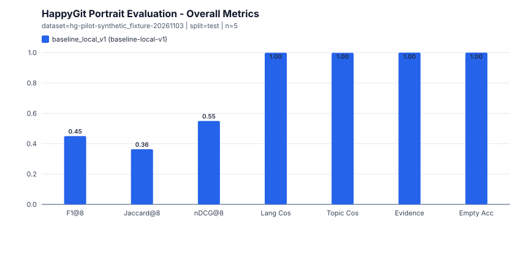
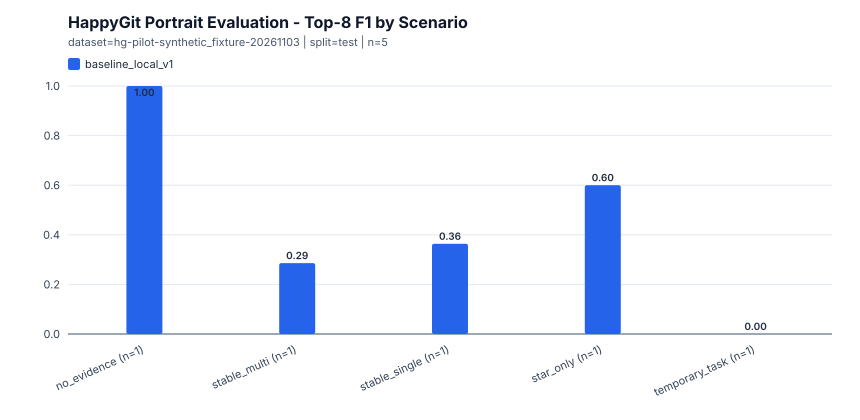
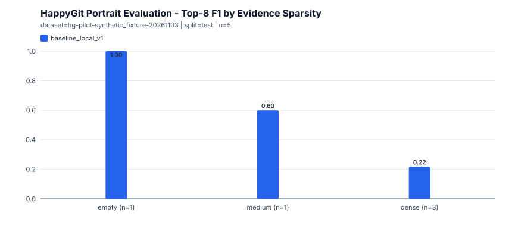

# HappyGit 画像评测报告 (Experiment Report)

- **运行时间**：`2026-11-19T06:11:20Z`
- **代码提交**：`792a0bc290df9e47f96bf71c93f5c9bc1321212c`
- **数据集版本**：`hg-pilot-synthetic_fixture-20261103` (`catalogMode=synthetic_fixture`, `behaviorSource=-`, `split=test`, 样本数 `5`)
- **输入证据 SHA-256**：`95a55d21d992d3eb8b2d9f1b219f3c98d74064fab403c78a9dfc7efe2d8abe14`
- **大模型提示包 SHA-256**：`7f9002e1c88bcc652c0162452e0045b222d7fbe39218eae99711c7aea3205cd1`
- **词表别名版本**：`hg-taxonomy-2026-11-v1`
- **固定重复抽样子集**：`5` 位用户（seed=`20261103`，清单 `repeat-subset-ids.json`）

> 注：通用大模型（`llm_reference`）属于独立对照方法，**不直接当作真值**；空分布样本与非空分布样本分开统计，不强行补齐为均匀向量。

## 1. 各方法整体对比

| 方法 | 模型标识 | 样本数 (成功/失败) | Top-8 P | Top-8 R | Top-8 F1 | Top-8 Jaccard | nDCG@8 | 语言余弦(非空) | 主题余弦(非空) | 证据有效率 | 幻觉引用 | 空画像准确率 | 耗时(ms) |
| --- | --- | ---: | ---: | ---: | ---: | ---: | ---: | ---: | ---: | ---: | ---: | ---: | ---: |
| baseline_local_v1 | `baseline-local-v1` | 5 (5/0) | 0.3857 | 0.6000 | 0.4499 | 0.3635 | 0.5495 | 0.9991 | 0.9989 | 1.0000 | 0 | 1.0000 | 1 |
| learned_model | - | 0 (0/0) | - | - | - | - | - | - | - | - | - | - | (pending_server_export) |
| llm_reference | - | 0 (0/0) | - | - | - | - | - | - | - | - | - | - | (pending_api_credentials) |

## 2. 可视化对比图表

### 各方法核心指标总览

### 分场景 Top-8 F1 对比

### 分证据稀疏度 Top-8 F1 对比

## 7. `baseline_local_v1` 分场景、来源与稀疏度统计

### 按行为场景 (`byScenario`)

| 分组 | 样本数 | 失败数 | F1@8 | 主题余弦(非空) | 证据有效率 | 空画像准确率 |
| --- | ---: | ---: | ---: | ---: | ---: | ---: |
| `no_evidence` | 1 | 0 | 1.0000 | - | 1.0000 | 1.0000 |
| `stable_multi` | 1 | 0 | 0.2857 | 0.9997 | 1.0000 | - |
| `stable_single` | 1 | 0 | 0.3636 | 0.9958 | 1.0000 | - |
| `star_only` | 1 | 0 | 0.6000 | 1.0000 | 1.0000 | - |
| `temporary_task` | 1 | 0 | 0.0000 | 1.0000 | 1.0000 | - |

### 按数据源类别 (`bySourceKind`)

| 分组 | 样本数 | 失败数 | F1@8 | 主题余弦(非空) | 证据有效率 | 空画像准确率 |
| --- | ---: | ---: | ---: | ---: | ---: | ---: |
| `synthetic` | 5 | 0 | 0.4499 | 0.9989 | 1.0000 | 1.0000 |

### 按稀疏程度 (`bySparsity`)

| 分组 | 样本数 | 失败数 | F1@8 | 主题余弦(非空) | 证据有效率 | 空画像准确率 |
| --- | ---: | ---: | ---: | ---: | ---: | ---: |
| `dense` | 3 | 0 | 0.2165 | 0.9985 | 1.0000 | - |
| `empty` | 1 | 0 | 1.0000 | - | 1.0000 | 1.0000 |
| `medium` | 1 | 0 | 0.6000 | 1.0000 | 1.0000 | - |
