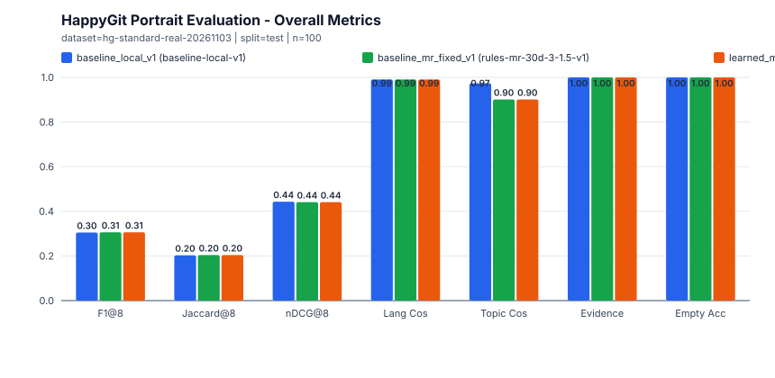
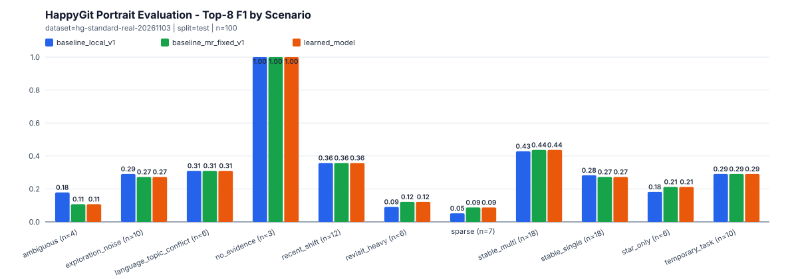
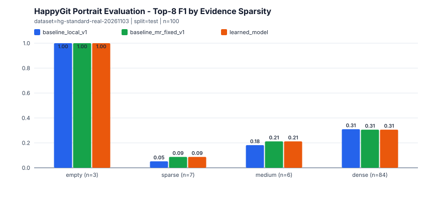

# HappyGit 画像评测报告 (Experiment Report)

- **运行时间**：`2026-11-20T11:04:40Z`
- **代码提交**：`24f0990c7412c8cf6707f92d3719537024f3d076`
- **数据集版本**：`hg-standard-real-20261103` (`catalogMode=real`, `behaviorSource=deterministic_rules`, `split=test`, 样本数 `100`)
- **输入证据 SHA-256**：`5bb5e99918eb10b90a179ca715728cc72a0bf4811543242975bc31f8946ea634`
- **大模型提示包 SHA-256**：`e00d4b0e1a5f2cb4d9ebbe27db19e3e4a03debf82bb8ba2e16703b230351ce94`
- **词表别名版本**：`hg-taxonomy-2026-11-v1`
- **固定重复抽样子集**：`20` 位用户（seed=`20261103`，清单 `repeat-subset-ids.json`）
- **服务端固定导出包**：`modelVersion=portrait-171b14f41dd3b349e93fbcad` / `featureSpaceVersion=fb6cd68c9ff3229f29d3e0ca62c5b9b5671835988b69a4524e329a924c328f69` / `protocolDigest=463387fe8293c6660bac867274d2075de213bd17ac60077738d8c2e7bb219b86`

> 注：通用大模型（`llm_reference`）属于独立对照方法，**不直接当作真值**；空分布样本与非空分布样本分开统计，不强行补齐为均匀向量。

## 1. 各方法整体对比

| 方法 | 模型标识 | 样本数 (成功/失败) | Top-8 P | Top-8 R | Top-8 F1 | Top-8 Jaccard | nDCG@8 | 语言余弦(非空) | 主题余弦(非空) | 证据有效率 | 幻觉引用 | 空画像准确率 | 耗时(ms) |
| --- | --- | ---: | ---: | ---: | ---: | ---: | ---: | ---: | ---: | ---: | ---: | ---: | ---: |
| baseline_local_v1 | `baseline-local-v1` | 100 (100/0) | 0.2462 | 0.4367 | 0.3048 | 0.2028 | 0.4432 | 0.9908 | 0.9737 | 1.0000 | 0 | 1.0000 | 416 |
| baseline_mr_fixed_v1 | `rules-mr-30d-3-1.5-v1` | 100 (100/0) | 0.2470 | 0.4383 | 0.3059 | 0.2042 | 0.4410 | 0.9908 | 0.9013 | 1.0000 | 0 | 1.0000 | 364 |
| learned_model | `portrait-171b14f41dd3b349e93fbcad` | 100 (100/0) | 0.2470 | 0.4383 | 0.3059 | 0.2042 | 0.4410 | 0.9908 | 0.9013 | 1.0000 | 0 | 1.0000 | 127 |
| llm_reference | - | 0 (0/0) | - | - | - | - | - | - | - | - | - | - | (pending_api_credentials) |

## 2. 可视化对比图表

### 各方法核心指标总览

### 分场景 Top-8 F1 对比

### 分证据稀疏度 Top-8 F1 对比

## 3. 方法间一致性对比 (两两对照)

| 对照组合 | 共同样本数 | Top-8 标签 Jaccard | 语言分布余弦 | 主题分布余弦 |
| --- | ---: | ---: | ---: | ---: |
| `baseline_local_v1__vs__baseline_mr_fixed_v1` | 100 | 0.7163 | 1.0000 | 0.9074 |
| `baseline_local_v1__vs__learned_model` | 100 | 0.7163 | 1.0000 | 0.9074 |
| `baseline_mr_fixed_v1__vs__learned_model` | 100 | 1.0000 | 1.0000 | 1.0000 |

## 4. 改进、退化与不确定样本分析

| 对比方向 (候选 vs 基线) | 共同有效样本 | 改进数 (+ΔF1>0.01) | 退化数 (-ΔF1<-0.01) | 持平/不确定 | 平均 ΔF1 | 平均 ΔJaccard | 平均 Δ主题余弦 |
| --- | ---: | ---: | ---: | ---: | ---: | ---: | ---: |
| `learned_model__vs__baseline_local_v1` | 100 | 12 | 12 | 76 | 0.0011 | 0.0014 | -0.0724 |
| `learned_model__vs__baseline_mr_fixed_v1` | 100 | 0 | 0 | 100 | 0.0000 | 0.0000 | 0.0000 |

## 7. 各方法分场景、来源与稀疏度统计

### 7.1 `baseline_local_v1`

#### 按行为场景 (`byScenario`)

| 分组 | 样本数 | 失败数 | F1@8 | 主题余弦(非空) | 证据有效率 | 空画像准确率 |
| --- | ---: | ---: | ---: | ---: | ---: | ---: |
| `ambiguous` | 4 | 0 | 0.1786 | 0.9421 | 1.0000 | - |
| `exploration_noise` | 10 | 0 | 0.2909 | 0.9763 | 1.0000 | - |
| `language_topic_conflict` | 6 | 0 | 0.3095 | 0.9743 | 1.0000 | - |
| `no_evidence` | 3 | 0 | 1.0000 | - | 1.0000 | 1.0000 |
| `recent_shift` | 12 | 0 | 0.3571 | 0.9718 | 1.0000 | - |
| `revisit_heavy` | 6 | 0 | 0.0909 | 0.9990 | 1.0000 | - |
| `sparse` | 7 | 0 | 0.0519 | 0.9612 | 1.0000 | - |
| `stable_multi` | 18 | 0 | 0.4286 | 0.9704 | 1.0000 | - |
| `stable_single` | 18 | 0 | 0.2828 | 0.9724 | 1.0000 | - |
| `star_only` | 6 | 0 | 0.1818 | 0.9993 | 1.0000 | - |
| `temporary_task` | 10 | 0 | 0.2909 | 0.9719 | 1.0000 | - |

#### 按数据源类别 (`bySourceKind`)

| 分组 | 样本数 | 失败数 | F1@8 | 主题余弦(非空) | 证据有效率 | 空画像准确率 |
| --- | ---: | ---: | ---: | ---: | ---: | ---: |
| `synthetic` | 100 | 0 | 0.3048 | 0.9737 | 1.0000 | 1.0000 |

#### 按稀疏程度 (`bySparsity`)

| 分组 | 样本数 | 失败数 | F1@8 | 主题余弦(非空) | 证据有效率 | 空画像准确率 |
| --- | ---: | ---: | ---: | ---: | ---: | ---: |
| `dense` | 84 | 0 | 0.3098 | 0.9729 | 1.0000 | - |
| `empty` | 3 | 0 | 1.0000 | - | 1.0000 | 1.0000 |
| `medium` | 6 | 0 | 0.1818 | 0.9993 | 1.0000 | - |
| `sparse` | 7 | 0 | 0.0519 | 0.9612 | 1.0000 | - |

### 7.2 `baseline_mr_fixed_v1`

#### 按行为场景 (`byScenario`)

| 分组 | 样本数 | 失败数 | F1@8 | 主题余弦(非空) | 证据有效率 | 空画像准确率 |
| --- | ---: | ---: | ---: | ---: | ---: | ---: |
| `ambiguous` | 4 | 0 | 0.1071 | 0.8840 | 1.0000 | - |
| `exploration_noise` | 10 | 0 | 0.2727 | 0.9501 | 1.0000 | - |
| `language_topic_conflict` | 6 | 0 | 0.3095 | 0.9613 | 1.0000 | - |
| `no_evidence` | 3 | 0 | 1.0000 | - | 1.0000 | 1.0000 |
| `recent_shift` | 12 | 0 | 0.3571 | 0.9447 | 1.0000 | - |
| `revisit_heavy` | 6 | 0 | 0.1212 | 0.7378 | 1.0000 | - |
| `sparse` | 7 | 0 | 0.0877 | 0.7203 | 1.0000 | - |
| `stable_multi` | 18 | 0 | 0.4365 | 0.9332 | 1.0000 | - |
| `stable_single` | 18 | 0 | 0.2727 | 0.9408 | 1.0000 | - |
| `star_only` | 6 | 0 | 0.2121 | 0.7735 | 1.0000 | - |
| `temporary_task` | 10 | 0 | 0.2909 | 0.9441 | 1.0000 | - |

#### 按数据源类别 (`bySourceKind`)

| 分组 | 样本数 | 失败数 | F1@8 | 主题余弦(非空) | 证据有效率 | 空画像准确率 |
| --- | ---: | ---: | ---: | ---: | ---: | ---: |
| `synthetic` | 100 | 0 | 0.3059 | 0.9013 | 1.0000 | 1.0000 |

#### 按稀疏程度 (`bySparsity`)

| 分组 | 样本数 | 失败数 | F1@8 | 主题余弦(非空) | 证据有效率 | 空画像准确率 |
| --- | ---: | ---: | ---: | ---: | ---: | ---: |
| `dense` | 84 | 0 | 0.3060 | 0.9255 | 1.0000 | - |
| `empty` | 3 | 0 | 1.0000 | - | 1.0000 | 1.0000 |
| `medium` | 6 | 0 | 0.2121 | 0.7735 | 1.0000 | - |
| `sparse` | 7 | 0 | 0.0877 | 0.7203 | 1.0000 | - |

### 7.3 `learned_model`

#### 按行为场景 (`byScenario`)

| 分组 | 样本数 | 失败数 | F1@8 | 主题余弦(非空) | 证据有效率 | 空画像准确率 |
| --- | ---: | ---: | ---: | ---: | ---: | ---: |
| `ambiguous` | 4 | 0 | 0.1071 | 0.8840 | 1.0000 | - |
| `exploration_noise` | 10 | 0 | 0.2727 | 0.9501 | 1.0000 | - |
| `language_topic_conflict` | 6 | 0 | 0.3095 | 0.9613 | 1.0000 | - |
| `no_evidence` | 3 | 0 | 1.0000 | - | 1.0000 | 1.0000 |
| `recent_shift` | 12 | 0 | 0.3571 | 0.9447 | 1.0000 | - |
| `revisit_heavy` | 6 | 0 | 0.1212 | 0.7378 | 1.0000 | - |
| `sparse` | 7 | 0 | 0.0877 | 0.7203 | 1.0000 | - |
| `stable_multi` | 18 | 0 | 0.4365 | 0.9332 | 1.0000 | - |
| `stable_single` | 18 | 0 | 0.2727 | 0.9408 | 1.0000 | - |
| `star_only` | 6 | 0 | 0.2121 | 0.7735 | 1.0000 | - |
| `temporary_task` | 10 | 0 | 0.2909 | 0.9441 | 1.0000 | - |

#### 按数据源类别 (`bySourceKind`)

| 分组 | 样本数 | 失败数 | F1@8 | 主题余弦(非空) | 证据有效率 | 空画像准确率 |
| --- | ---: | ---: | ---: | ---: | ---: | ---: |
| `synthetic` | 100 | 0 | 0.3059 | 0.9013 | 1.0000 | 1.0000 |

#### 按稀疏程度 (`bySparsity`)

| 分组 | 样本数 | 失败数 | F1@8 | 主题余弦(非空) | 证据有效率 | 空画像准确率 |
| --- | ---: | ---: | ---: | ---: | ---: | ---: |
| `dense` | 84 | 0 | 0.3060 | 0.9255 | 1.0000 | - |
| `empty` | 3 | 0 | 1.0000 | - | 1.0000 | 1.0000 |
| `medium` | 6 | 0 | 0.2121 | 0.7735 | 1.0000 | - |
| `sparse` | 7 | 0 | 0.0877 | 0.7203 | 1.0000 | - |
