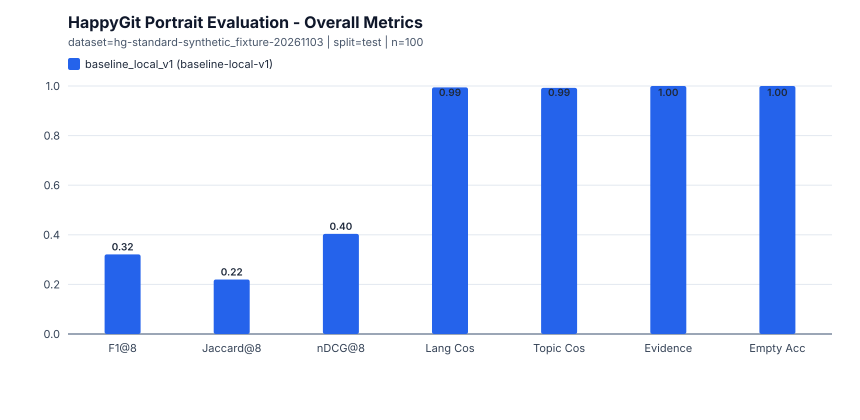
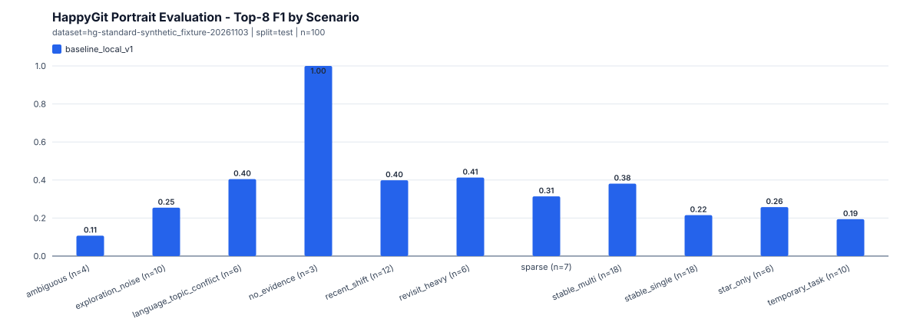
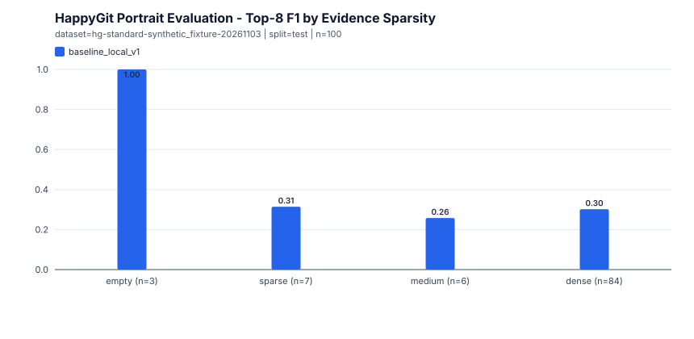

# HappyGit 画像评测报告 (Experiment Report)

- **运行时间**：`2026-11-19T06:08:31Z`
- **代码提交**：`792a0bc290df9e47f96bf71c93f5c9bc1321212c`
- **数据集版本**：`hg-standard-synthetic_fixture-20261103` (`catalogMode=synthetic_fixture`, `behaviorSource=deterministic_rules`, `split=test`, 样本数 `100`)
- **输入证据 SHA-256**：`268cc20fed3cf6a8bb925d4ee8380235fd3152e43740a93753bb6470089315b3`
- **大模型提示包 SHA-256**：`af282e93e6fde9fb1b019403c2b1208f56b9e1710352fb1f690205682806a5c8`
- **词表别名版本**：`hg-taxonomy-2026-11-v1`
- **固定重复抽样子集**：`20` 位用户（seed=`20261103`，清单 `repeat-subset-ids.json`）

> 注：通用大模型（`llm_reference`）属于独立对照方法，**不直接当作真值**；空分布样本与非空分布样本分开统计，不强行补齐为均匀向量。

## 1. 各方法整体对比

| 方法 | 模型标识 | 样本数 (成功/失败) | Top-8 P | Top-8 R | Top-8 F1 | Top-8 Jaccard | nDCG@8 | 语言余弦(非空) | 主题余弦(非空) | 证据有效率 | 幻觉引用 | 空画像准确率 | 耗时(ms) |
| --- | --- | ---: | ---: | ---: | ---: | ---: | ---: | ---: | ---: | ---: | ---: | ---: | ---: |
| baseline_local_v1 | `baseline-local-v1` | 100 (100/0) | 0.2708 | 0.4283 | 0.3209 | 0.2197 | 0.4036 | 0.9943 | 0.9924 | 1.0000 | 0 | 1.0000 | 158 |
| learned_model | - | 0 (0/0) | - | - | - | - | - | - | - | - | - | - | (pending_server_export) |
| llm_reference | - | 0 (0/0) | - | - | - | - | - | - | - | - | - | - | (pending_api_credentials) |

## 2. 可视化对比图表

### 各方法核心指标总览

### 分场景 Top-8 F1 对比

### 分证据稀疏度 Top-8 F1 对比

## 7. `baseline_local_v1` 分场景、来源与稀疏度统计

### 按行为场景 (`byScenario`)

| 分组 | 样本数 | 失败数 | F1@8 | 主题余弦(非空) | 证据有效率 | 空画像准确率 |
| --- | ---: | ---: | ---: | ---: | ---: | ---: |
| `ambiguous` | 4 | 0 | 0.1071 | 0.9976 | 1.0000 | - |
| `exploration_noise` | 10 | 0 | 0.2545 | 0.9999 | 1.0000 | - |
| `language_topic_conflict` | 6 | 0 | 0.4048 | 0.9956 | 1.0000 | - |
| `no_evidence` | 3 | 0 | 1.0000 | - | 1.0000 | 1.0000 |
| `recent_shift` | 12 | 0 | 0.3988 | 0.9703 | 1.0000 | - |
| `revisit_heavy` | 6 | 0 | 0.4131 | 1.0000 | 1.0000 | - |
| `sparse` | 7 | 0 | 0.3143 | 0.9750 | 1.0000 | - |
| `stable_multi` | 18 | 0 | 0.3810 | 0.9998 | 1.0000 | - |
| `stable_single` | 18 | 0 | 0.2155 | 0.9997 | 1.0000 | - |
| `star_only` | 6 | 0 | 0.2576 | 1.0000 | 1.0000 | - |
| `temporary_task` | 10 | 0 | 0.1939 | 0.9837 | 1.0000 | - |

### 按数据源类别 (`bySourceKind`)

| 分组 | 样本数 | 失败数 | F1@8 | 主题余弦(非空) | 证据有效率 | 空画像准确率 |
| --- | ---: | ---: | ---: | ---: | ---: | ---: |
| `synthetic` | 100 | 0 | 0.3209 | 0.9924 | 1.0000 | 1.0000 |

### 按稀疏程度 (`bySparsity`)

| 分组 | 样本数 | 失败数 | F1@8 | 主题余弦(非空) | 证据有效率 | 空画像准确率 |
| --- | ---: | ---: | ---: | ---: | ---: | ---: |
| `dense` | 84 | 0 | 0.3017 | 0.9933 | 1.0000 | - |
| `empty` | 3 | 0 | 1.0000 | - | 1.0000 | 1.0000 |
| `medium` | 6 | 0 | 0.2576 | 1.0000 | 1.0000 | - |
| `sparse` | 7 | 0 | 0.3143 | 0.9750 | 1.0000 | - |
